# Как мы создали «МГИМО Манию»: приложение

Подробности, которые в [описании процесса](PROCESS.md) ([PDF](PROCESS.pdf)) сокращены, чтобы основной документ читался
быстрее: все поручения субагентам 19 ноября со снимками до и после, полный текст итераций 8–21 ноября и таблица
проверок версии 1.1.1 по наборам. Тексты перенесены без изменений.

## Поручения субагентам 19 ноября: остальные карточки

Карточки — не снимки экрана ассистента: их отрисовывает скрипт `scripts/render-dialogue-cards.py` из сохранённого
текста поручения и ответа. Сами тексты — в [briefs/](evidence/subagents-2026-11-19/briefs/) и в JSON рядом.

<figure class="prompt-card">
  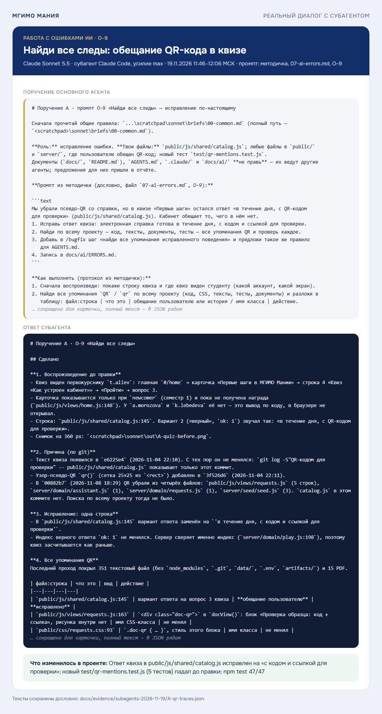
  <figcaption>Субагент A, промпт О-9: найти все следы исправленного поведения. Итог — <code>fe1191c</code>.</figcaption>
</figure>

  <figure>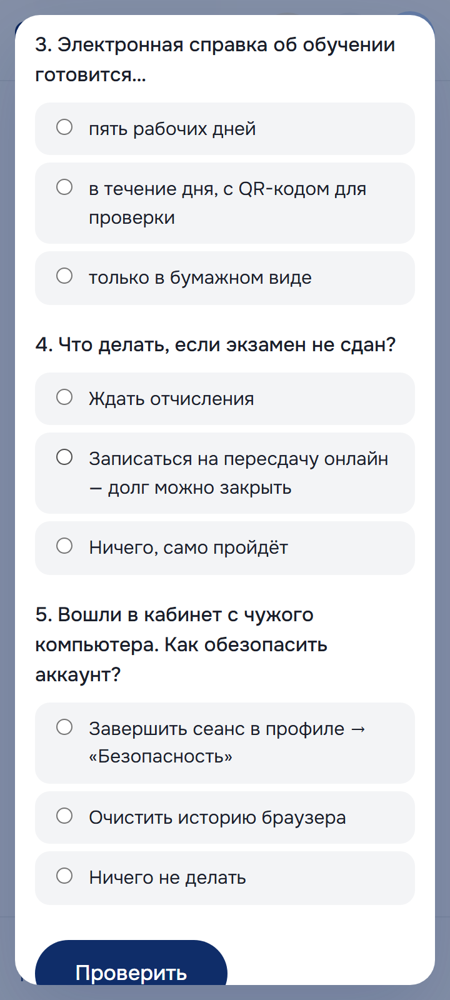<figcaption>До: квиз обещает «QR-код», которого в кабинете нет.</figcaption></figure>
  <figure>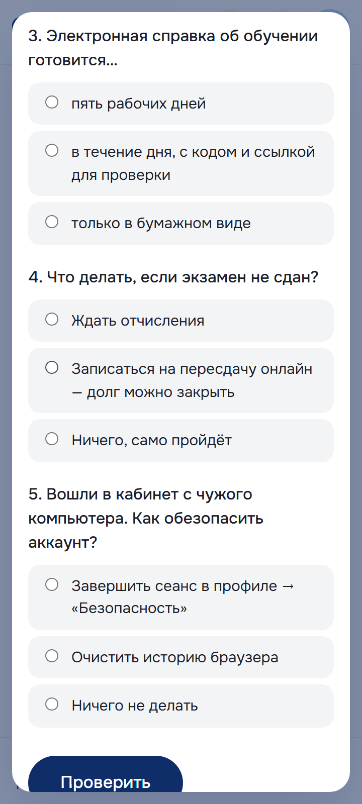<figcaption>После: «с кодом и ссылкой для проверки» — так, как работает справка.</figcaption></figure>

<figure class="prompt-card">
  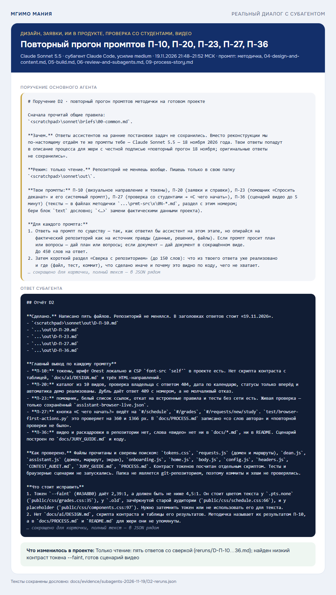
  <figcaption>Субагент D2: дизайн, заявки, ИИ-помощник, проверка со студентами и сценарий видео.</figcaption>
</figure>

<figure class="prompt-card">
  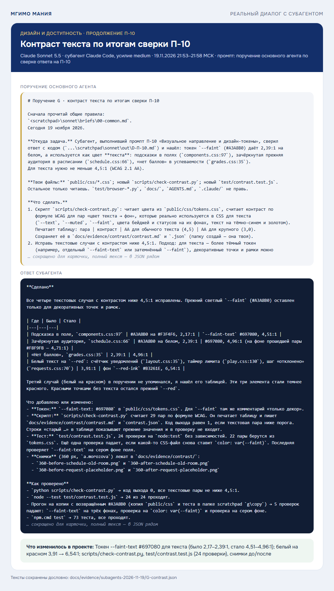
  <figcaption>Субагент G: контраст текста поднят до 4,5:1 и выше. Итог — <code>3aff3bb</code>.</figcaption>
</figure>

  <figure><figcaption>До: прежняя аудитория — серый #A3A8B0, 2,39:1.</figcaption></figure>
  <figure>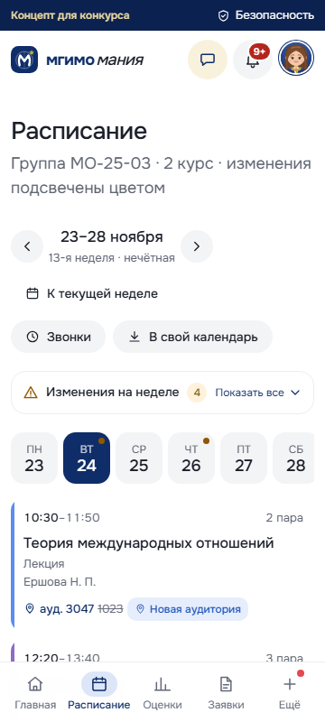<figcaption>После: #697080, 4,96:1; зачёркнутое читается.</figcaption></figure>

<figure class="prompt-card">
  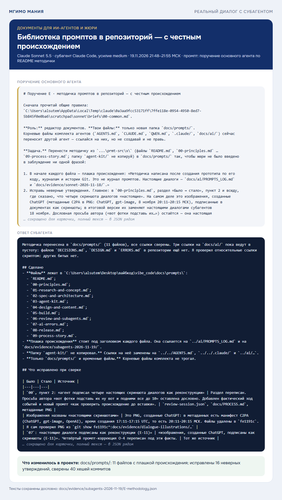
  <figcaption>Субагент E: библиотека в <code>docs/prompts/</code>, 16 утверждений исправлены по репозиторию.</figcaption>
</figure>

<figure class="prompt-card">
  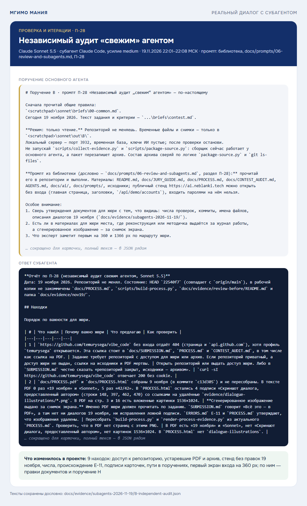
  <figcaption>Субагент B, промпт П-28: независимый аудит итогового состояния. Его находки закрыты правками документов и поручением H.</figcaption>
</figure>

<figure class="prompt-card">
  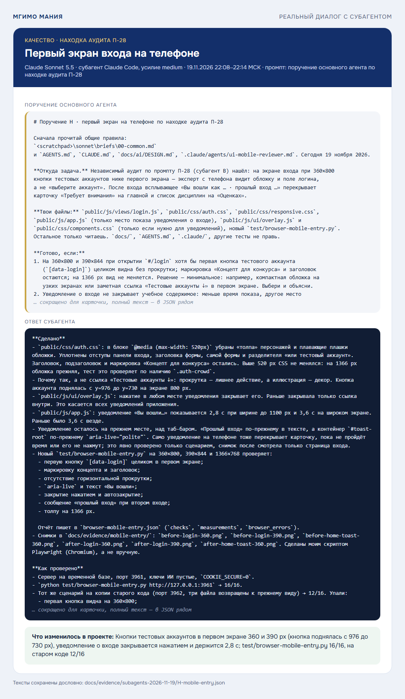
  <figcaption>Субагент H: первый экран входа на телефоне по находке аудита. Итог — <code>c8955dc</code>.</figcaption>
</figure>

  <figure>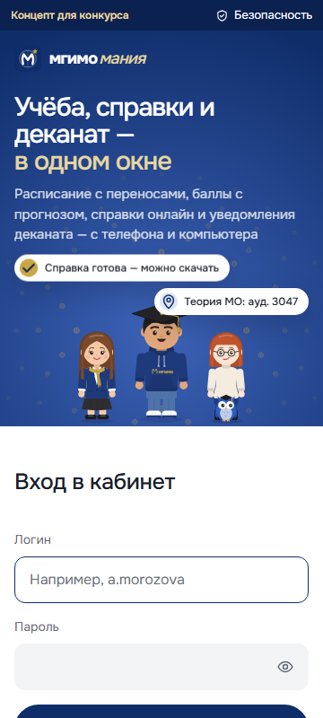<figcaption>До: на 360 px видны обложка и поле логина, тестовые аккаунты ниже экрана.</figcaption></figure>
  <figure>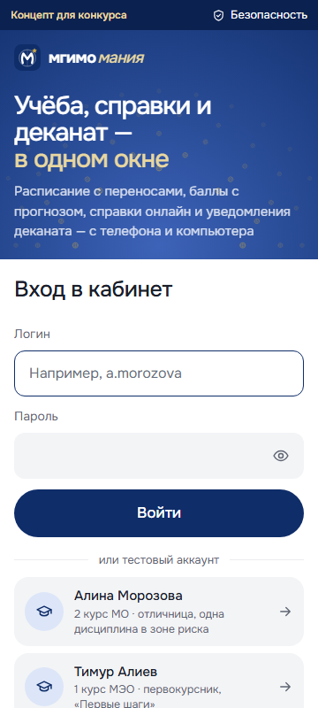<figcaption>После: Алина и Тимур в первом экране, маркировка концепта на месте.</figcaption></figure>

## Итерации 8–21 ноября подробно

### Пример итерации после обратной связи

После публикации мы увидели на домене прежнее приложение, которое раньше работало
по этому адресу. Первые проверки проходили в чистых браузерных профилях и не покрывали
возвращение прежнего посетителя.
Сервер уже отдавал новый кабинет, но установленный service worker возвращал старую
страницу из офлайн-кеша.

Исправление оставили по прежнему адресу `/sw.js`: оно удаляет только кеши старого
приложения, снимает прежнюю регистрацию и переводит открытые вкладки на актуальную
страницу. Новым посетителям офлайн-worker не устанавливается. Добавлена отдельная
регрессия с двумя вкладками и проверкой сохранения других кешей, cookie и localStorage.

Это пример изменения самого плана проверки после обратной связи. Успешный набор
тестов покрывает перечисленные сценарии, но не означает, что неизвестных ошибок нет.

### Первая итерация оценки: от замечания к измеренному изменению

После оценки проекта по конкурсным критериям мы попросили добавить четыре изображения
(позже выяснилось, что они сгенерированы, — запись E-11) и улучшить работу. Ассистент разделил задачи между документацией, интерфейсом и
проверкой публикации; владение файлами определили до правок. Выдержки фактических
поручений этой итерации сохранены в [review-session.json](evidence/review-session.json).

На сохранённом снимке страница успеваемости шириной 360 px имела высоту 4355 px.
Все девять дисциплин показывались подробными карточками. После доработки баллы,
форма контроля, статус и прогноз остались в компактном обзоре, а контрольные точки,
преподаватель и рекомендации открываются по нажатию на дисциплину. Добавлен фильтр
«Требуют внимания» с числом результатов и управлением клавишами Enter и Space.

Повторный браузерный проход измерил **2936 px вместо 4355 px — на 32,6% меньше**.
Это высота страницы на конкретных демонстрационных данных, не измерение скорости
чтения реальными студентами. При фильтре риска высота составила 1934 px. Все девять
дисциплин доступны через «Все», подробности открываются с клавиатуры, а при смене
студента фильтр сбрасывается. На компьютере сохранены подробные карточки.

Снимки для сравнения: [до](evidence/review-before/360-grades.png) и
[после первой итерации](evidence/quality-before/360-grades-review.png). Прежний протокол сохранён в
`evidence/review-before/`; измерения и 40 проверок этой итерации — в
[browser-review.json](evidence/quality-before/browser-review.json).

В верхнем меню оставили четыре основных учебных направления. Кампус, гардероб,
лавка и игра доступны из «Студенческой жизни»; проверены переход, Escape и возврат
фокуса. Короткие карточки главной больше не растягиваются по самому длинному списку,
а подписи нижнего меню на телефоне увеличены с 10 до 11 px.

### Следующая итерация: основные действия в первом экране

После повторной оценки мы попросили улучшить проект и передать изменения в Git.
Основной ассистент разделил работу
между главной страницей, успеваемостью и документами; сам доработал форму заявки
и общий прогон. Поручения, владение файлами и наши уточнения записаны в
[quality-session.json](evidence/quality-session.json).

На мобильной главной ближайшая пара больше не повторяется в развёрнутом списке дня.
Сразу после неё доступны два действия: открыть учебный риск или состояние заявки.
У первокурсника без заявок второе действие ведёт к первой справке. В проверенном окне
360 × 800 px оба действия занимают область 554–678 px и помещаются над нижним меню;
список остальных занятий раскрывается ниже. На компьютере весь день виден сразу.
Проверены переходы к конкретной дисциплине и заявке, пустой день, клавиатура и смена
аккаунта: [28/28 проверок](evidence/final/browser-home-priority.json).

  <figure>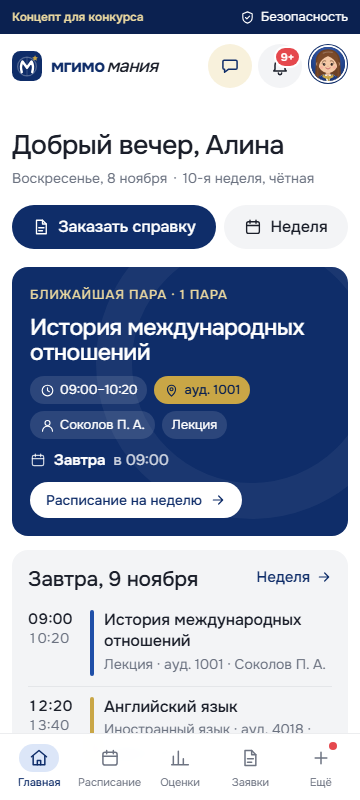<figcaption>До: занятия занимают первый экран.</figcaption></figure>
  <figure>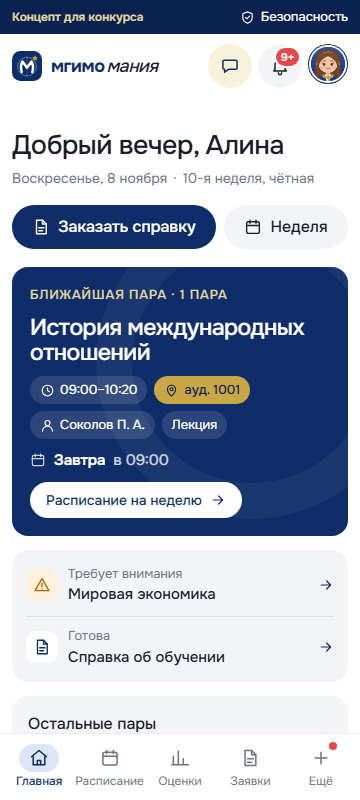<figcaption>После: рядом с ближайшей парой доступны учебный риск и заявка.</figcaption></figure>

В успеваемости расширенная статистика на телефоне раскрывается по запросу. Все оценки,
посещаемость, рейтинг и стипендия сохранены; на компьютере обзор открыт сразу.
Высота страницы на том же демонстрационном профиле уменьшилась **с 2936 до 2096 px
(на 28,6%)**. Фильтр поднялся примерно с 1320 до 480 px, первая дисциплина — с 1447
до 607 px и теперь целиком помещается над нижним меню. Полная статистика открывается
клавишами Enter/Space; подробности дисциплины и фильтр сохраняют корректный фокус.
Подписи нижнего меню увеличены до 12 px. Источники:
[исходные измерения](evidence/quality-before/grades-measurements.json),
[31/31 проверка и новые измерения](evidence/final/browser-grades-compact.json).
Это измерения страницы, а не скорости работы реальных студентов.

<figure class="phone-shot">
  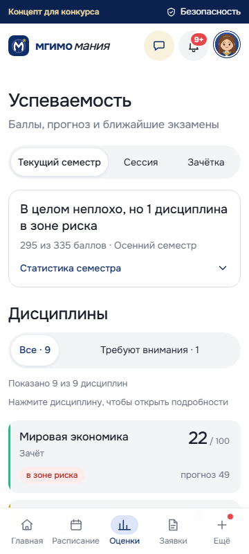
  <figcaption>Успеваемость на 360 × 800 px после второй доработки. Расширенная статистика доступна по нажатию.</figcaption>
</figure>

В форме справки имя и группа остаются видимыми, дополнительные сведения профиля
раскрываются отдельно; электронный и бумажный форматы стоят рядом. Высота сохранённого
снимка прежней формы — 2195 px, текущая высота страницы в браузере — 1925 px.
Первое поле начинается на 722 px. Проверено, что сворачивание профиля сохраняет
введённые поля, формат выбирается с клавиатуры, а после смены аккаунта заменяются
и видимые, и скрытые сведения: [19/19 проверок](evidence/final/browser-request-compact.json).
Сравнение формы: [предыдущий снимок](evidence/quality-before/360-requests-new-study.png)
и [текущий снимок](evidence/final/360-request-compact.png).

### Итерация 8 ноября, вечер: первые действия и читаемость

После анализа по четырём критериям мы поручили: **«давай вот все поправим и зальем сайт
и на github тоже все зальем»**. Постановка и распределение работы сохранены в
[finalization-session.json](evidence/finalization-session.json). Это запись текущей
работы, а не восстановление раннего диалога.

| Исполнитель | Порученная область | Условие завершения |
|---|---|---|
| Основной ассистент | Главная, читаемость, общие проверки и GitHub | Проверить совместную работу изменений и зафиксировать отправленную ревизию |
| Агент расписания | Экран расписания, его стили и при необходимости отдельная проверка | Подтвердить затронутые действия на 360 px и обычном экране |
| Агент публикации | Подготовить и затем обновить существующий VPS | Сохранить базу; проверить опубликованную версию и записать результат |
| Агент документации | Обоснование продукта, происхождение материалов и краткий путь жюри | Разделить гипотезы и наблюдения; согласовать описание с подтверждёнными результатами |

В ходе этой работы мы уточнили отзывы двух студентов. Их затруднение с первым
действием стало основанием для блока «С чего начать».

На главной реализованы компактные списки и необязательный игровой блок; при активной
фокус-сессии он раскрывается. Высота страницы на 1366 px уменьшилась с 2825 до 1614 px.
Мобильные приоритетные действия остаются в первом экране. Недельное расписание на обычном
экране показывает три колонки и даёт доступ ко всем изменениям.

Кнопка «С чего начать» открывает три учебных действия и поддерживает закрытие диалога.
При первом знакомстве те же действия доступны сразу. Это ответ на конкретное замечание
двух участников, но повторной проверки с ними после доработки пока нет.

<figure class="phone-shot">
  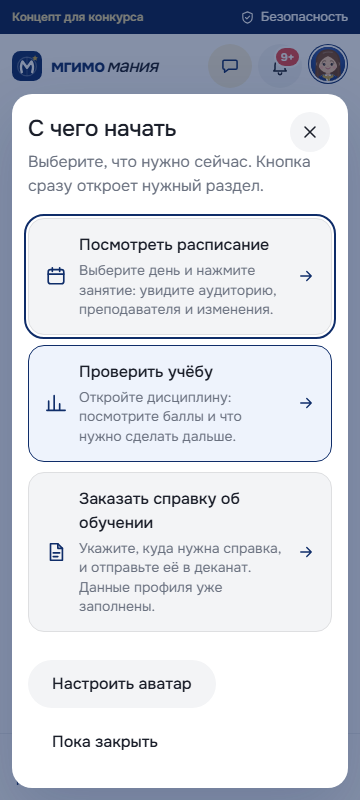
  <figcaption>Реальный снимок локальной проверки: первые действия доступны из отдельного диалога.</figcaption>
</figure>

Итог итерации: 35/35 автотестов и 367/367 браузерных проверок локально, затем
публикация на стенд и 194/194 браузерные проверки уже на HTTPS-версии (раздел 10).

### Итерация 9 ноября: независимый аудит и доводка

Мы попросили проверить всё сделанное по четырём критериям конкурса. Аудит вёл новый
ассистент — Claude Code, — не участвовавший в предыдущих итерациях. Он прочитал код
и документы, запустил тесты, прошёл кабинет своими браузерными сценариями на 360
и 1366 px, проверил изоляцию данных прямыми запросами к API и сверил архив исходников
с Git. Вывод: ядро и безопасность в порядке, а замечания касаются деталей интерфейса,
поведения общего демо-стенда и подачи материалов. После этого мы поручили:
**«давай все правки сделаем чтобы дотянуть до 10… и также запушить в git»**.

| Что нашёл аудит | Почему это важно | Что изменили | Как проверено |
|---|---|---|---|
| На экране входа при 320–414 px плашка «Справка готова» наезжала на подзаголовок | Первый экран, который жюри видит с телефона | Плашки ниже подзаголовка с запасом на анимацию | Промежуток измерен на ширинах 320–1366 px во всех фазах анимации |
| Ссылки «Баллы», «Все» и кнопка «Безопасность» — 20–23 px в высоту | Трудно попасть пальцем | Невидимая область нажатия 34–45 px без сдвига вёрстки | Нажатие на 8 px выше ссылки открывает раздел |
| Лента уведомлений на телефоне — около 4900 px | Настройки и важное теряются внизу | Порции по 12 с кнопкой «Показать ещё», фокус на первой новой карточке | Браузерный сценарий: число карточек, фокус, сброс при смене фильтра |
| Чужая заявка показывала общее «Не найдено» | Маршрут жюри обещал «Заявка не найдена» | Заголовок берётся из ответа сервера | Вход другим студентом по сохранённой ссылке |
| Электронная справка сама становилась готовой через 70 секунд | Жюри не успевало принять решение в кабинете деканата | Демо-автоматика — около 8 минут; ускорение только в браузерных тестах | Регрессионный тест времени и отключения автоматики сотрудником |
| Публичный аккаунт деканата мог бесконечно публиковать объявления всем студентам МО | Общий стенд для всех экспертов | 10 публикаций за 10 минут, затем 429 | Регрессионный тест лимита |
| CSP разрешала Google Fonts, хотя шрифт локальный | Лишнее разрешение в политике | Только свой домен для стилей и шрифтов | Тест заголовков |
| В документах — внутренние детали сервера и устаревшие формулировки | Жюри читает материалы, а не журнал администратора | Документы сокращены; история Git описана честно | Ссылки и тексты сверены с кодом |

Новые проверки закреплены в `test/dean-limits.test.js` и браузерном сценарии
`test/browser-audit-fixes.py`. Ошибки самого ассистента в этой итерации тоже записаны:

- Ускорение демо-автоматики для тестов сначала применялось ко всем этапам сборщика,
  и новый тест времени готовности упал внутри общего прогона. Ускорение оставили только
  браузерным сценариям, а тест сам закрепляет скорость стенда.
- Новый браузерный сценарий сначала мерил подзаголовок один раз — во время анимации
  появления экрана, когда текст ещё смещён на 5 px, — и сообщал о наложении, которого нет.
  Замер перенесли в каждый кадр; настоящий зазор — 6 px.
- Прогон, запущенный до правки автоматики, остановлен и не использован: проверенный код
  не совпал бы с итоговым.

Итог итерации: 37/37 автотестов и 381/381 браузерных проверок на свежих базах
в одном запуске, без повторов ([сводка](evidence/polish/run-summary.json)).

### Повторная проверка 9 ноября: реализация и доступность интерфейса

После проверки по критериям мы поручили исправить замечания к реализации и качеству
и отправить изменения в GitHub. Codex распределил работу между тремя субагентами:
календарные ответы помощника и серверные тесты; сохранение фокуса и контраст;
отдельный браузерный сценарий смены аккаунтов. Основной агент исправлял синхронизацию
сеанса, проверял изменения и собирал материалы. Владение файлами согласовали до правок.

| Воспроизведённый дефект | Исправление | Регрессионная проверка |
|---|---|---|
| В воскресенье помощник показывал пары понедельника; субботний вопрос о завтра давал пустой ответ | Три календарных дня в контексте, точный выбор даты, отдельные ответы для выходного и недоступных данных | Суббота, воскресенье, понедельник, праздник, пустой день в `assistant.test.js` |
| После смены аккаунта в другой вкладке оставались прежний интерфейс и CSRF | Сигнал входа/выхода между вкладками; очистка и перезагрузка; проверка при возвращении к вкладке | `browser-session-sync.py`: старые формы и чат исчезают, новые GET и POST работают |
| Пропущенный сигнал позволял загрузить новый профиль в старый интерфейс | CSRF связывает с сеансом и чтение API; сервер отклоняет старый контекст до выполнения маршрута, запрос автоматически не повторяется | Серверный тест и браузерные GET/POST без сообщения между вкладками |
| Обновление заявок и расписания удаляло сфокусированный элемент | Восстановление по устойчивому ключу без прокрутки; обновление не заменяет фон открытого диалога | Реальные callbacks обновления списка, карточки и расписания на 360/1366 px |
| Фильтр уведомлений терял фокус и не сообщал о выборе диктору | Сохранение кнопки под фокусом и `aria-pressed`; понятный фокус после исчезновения действия | Enter, Tab, «Прочитать все», выбранный фильтр и состояние фокуса |
| Мелкие серые, зелёные и оранжевые подписи были недостаточно контрастны | Затемнены текстовые токены с сохранением общей палитры | Контраст фактически отрисованных подписей на их фонах в `browser-focus-contrast.py` |
| Изменение счётчика уведомлений пересоздавало шапку и кнопку открытия меню | Счётчик обновляется точечно, кнопка остаётся тем же DOM-узлом | Фокус колокольчика и возврат после Escape при изменившемся счётчике |

Дополнительный review выявил крайний случай: анонимная вкладка могла пропустить вход
в соседней вкладке. Проверка сеанса при фокусе теперь работает и на форме входа;
браузерная регрессия проверяет восстановление без ручного обновления.
Обмен между вкладками не содержит профиля или токенов: временная запись storage
немедленно удаляется. При недоступности BroadcastChannel используется storage,
а пропущенные события дополнительно обнаруживаются сервером.

Первый общий прогон обнаружил ещё один дефект, который не проявлялся во время коротких
проверок: после окончания сегодняшних занятий главная показывала завтрашнюю пару с длинным
названием и пояснением об изменении аудитории. Карточка становилась выше, и второе важное
действие уходило под нижнее меню на 360 × 800 px. Проверка остановила сборку;
[неуспешный прогон](evidence/quality-fixes-first-attempt/run-summary.json) и
[снимок](evidence/quality-fixes-first-attempt/360-home-viewport.png) сохранены.
Этот случай потребовал исправления мобильной компоновки и отдельного сценария с длинным
названием и переносом; требование видимости обоих действий не ослаблялось.
Дата или остаток времени теперь стоят рядом с номером пары, повторная ссылка на неделю
внутри карточки скрыта только на телефоне, а верхняя кнопка ведёт в то же расписание.
Уменьшены пустые отступы; название, время, аудитория, преподаватель и причина изменения
остаются полностью видимыми. Отдельный прогон дал 40/40 проверок, включая текущую пару
с длинным названием и сменой аудитории; общий повтор приведён ниже.

После [успешного промежуточного прогона](evidence/quality-fixes-before-home-focus/run-summary.json)
42/42 и 482/482 дополнительная проверка нашла аналогичный сброс фокуса у кнопки
расписания на главной компьютера ([воспроизведение](evidence/quality-fixes-before-home-focus/home-focus-repro.json)). Таймер `next/day` теперь откладывает обновление карточки,
пока в ней находится клавиатурный фокус или фон заблокирован диалогом. После ухода фокуса
обновление возобновляется; игровые действия не менялись. Сценарий закреплён в
`browser-focus-contrast.py`: отдельный прогон — 65/65, окончательный общий запуск — ниже.

Существующие проверки проходили и до этих исправлений. Новые сценарии добавлены
именно для воспроизведённых ошибок. Успешный прогон не считается полным аудитом WCAG,
нагрузочной проверкой или подтверждением доступности из России. Результат этой итерации
приведён в разделе 10; публикация исходников и обновление публичного стенда учитываются отдельно.

### Публикация исправленной версии, 9 ноября

По нашему отдельному поручению обновлён публичный сайт. Перед публикацией проверено
совпадение исходников с успешным локальным прогоном 42/42 и 492/492; в отдельную версию
упакованы только runtime-файлы, без базы, ключей и документов. Резервная копия SQLite
прошла `integrity_check`. Заменён контейнер деканата с прежним постоянным томом.

Опубликован код `3b722e9` (`review-ad34040a18b8`), контейнер `healthy`.
Все 52 публичных файла совпали с подготовленной версией; старые заявки, история и сеансы
сохранены. Отдельная проверочная заявка и её сеанс пережили замену, после проверки
заявка отменена. Четыре соседних контейнера остались с прежними ID и временем запуска.
[Протокол публикации](evidence/deployment/quality-fixes-deployment.json).

Другой субагент затем выполнил публичную браузерную приёмку: **25/25** на 360/1366 px,
без ошибок JavaScript. Проверены обе роли, учебные разделы, чужая заявка и очистка данных
после смены аккаунта между вкладками. Этот браузерный сценарий разрешал только вход и выход,
не создавая заявки, объявления или решения.
[Отчёт](evidence/deployment/quality-fixes-browser/public-acceptance.json) и
[снимок профиля на телефоне](evidence/deployment/quality-fixes-browser/360-profile.png).

### Итерация 19 ноября: находки из промптов библиотеки

Подробно — в разделе 3. Коротко: промпты библиотеки, выполненные субагентами Sonnet 5.5,
нашли три недоработки, которые прежние проверки пропускали.

| Что нашли | Каким промптом | Что изменили | Как проверено |
|---|---|---|---|
| Квиз «Первые шаги» обещал справку «с QR-кодом», а QR в кабинете убрали ещё 8 ноября | О-9 «Найди все следы» | Ответ квиза: «с кодом и ссылкой для проверки»; правило «найди все упоминания» в `AGENTS.md` и `/bugfix` | `test/qr-mentions.test.js`: до правки 2 из 5 падали |
| Экранирование объявлений и комментариев описано, но не проверено; нет проверки ключей в истории Git и боевой cookie | П-08 «Модель угроз» | Новые проверки, без изменения кода приложения | `test/browser-xss.py` (21), `test/security-gaps.test.js`; каждый падал на сломанной копии |
| Серый текст подсказок, прежней аудитории и «нет баллов» — 2,17–2,39:1 | П-10 «Токены и контраст» | Токен `--faint-text` и тёмно-красный фон для белого текста | `scripts/check-contrast.py`, `test/contrast.test.js` (24) |

После всех исправлений — общий прогон на свежих базах (73/73 автотеста, 523/523 браузерных
проверки в 17 наборах) и публикация этого же кода на стенд по нашей просьбе «публичным сделал
сделай теперь стенд»: версия `review-d7a91e220757`, 16/16 проверок публикации, все прежние заявки
и сеансы сохранены ([протокол](evidence/deployment/nov19-deployment.json)). Репозиторий мы
открыли в тот же день.

### Итерация 21 ноября: чистка материалов перед подачей и видео

Перед подачей мы попросили Claude Code (Claude Opus 5.5) разобрать коммиты 19 ноября:
**«посмотри последние коммиты в репозитории от 19 ноября и напиши, что изменилось и что осталось
поправить. закрыт ли критерий с промтами?»** После разбора ответили: **«Да, бери»**.

| Что нашли | Что изменили | Как проверено |
|---|---|---|
| Qwen Code назван использованным инструментом, но в репозитории нет ни его диалога, ни коммита; кабинет деканата собрал Claude Code 4 ноября | Qwen Code убран из перечня инструментов, `SUBMISSION.md` и `CONTEST_AUDIT.md`; роли методички сверены с Git (E-37) | Поиск по документам; коммиты `e260247`, `3126a39` |
| Шесть карточек-реконструкций в приложении дублировали настоящие поручения 19 ноября | Приложение и `PROMPTS.json` удалены; сборка PDF их больше не использует | Пересборка PDF |
| Текст звучал как чужой аудит: «автор попросил», «по словам автора» | Описание переписано от первого лица; факты, числа и цитаты прежние | 25 мест в этом документе |
| Дата, когда заметили сгенерированные изображения, ничем не подтверждалась | В разделе 2 и записи E-11 — только проверяемое | Сверка с журналом ошибок |
| В 119 журналах был путь к профилю Windows с именем учётной записи | Имя заменено на `<пользователь>`; сборщик теперь пишет `<project>` и `~` (E-36) | `test/evidence-privacy.test.js`: до правки падал на 119 файлах, после — зелёный; `npm test` — 74/74 |
| Видео не было | [Видео с мобильного экрана, 2:08](video/demo-mobile.mp4): `scripts/demo/record-demo.py` проходит маршрут жюри в Chromium 390×844, `encode-demo.swift` собирает MP4 | 12 шагов, ошибок JavaScript нет |

Видео записал сценарий, а не человек с телефоном: так запись можно повторить на любой версии.
Интерфейс кабинета в этой итерации не менялся, поэтому стенд не обновлялся.

## Проверки версии 1.1.1 по наборам

Прогон из чистой копии на коде `f6419db`, 22 ноября, 20:37–20:42 МСК: [сводка](evidence/release-1.1.1/run-summary.json).

| Набор | Пройдено | Журнал |
|---|---:|---|
| API, безопасность и предметная логика | 115/115 | [unit-tests.txt](evidence/release-1.1.1/unit-tests.txt) |
| Экраны на 360 и 1366 px | 52/52 | [browser-smoke.txt](evidence/release-1.1.1/browser-smoke.txt) |
| Путь заявки двух ролей, смена аккаунта, изоляция | 36/36 | [browser-flows.txt](evidence/release-1.1.1/browser-flows.txt) |
| Клавиатура, фокус, восстановление после ошибок | 23/23 | [browser-accessibility.txt](evidence/release-1.1.1/browser-accessibility.txt) |
| Мобильные доработки и состояния расписания | 21/21 | [browser-polish.txt](evidence/release-1.1.1/browser-polish.txt) |
| Справка о стипендии: заявка, таблица, печать и скачанный PDF | 51/51 | [browser-stipend.txt](evidence/release-1.1.1/browser-stipend.txt) |
| Компактные оценки, фильтр риска, меню | 40/40 | [browser-review.txt](evidence/release-1.1.1/browser-review.txt) |
| Главная: приоритеты, причина риска, длинные названия и текущая пара | 42/42 | [browser-home-priority.txt](evidence/release-1.1.1/browser-home-priority.txt) |
| Успеваемость: первый экран и статистика | 31/31 | [browser-grades-compact.txt](evidence/release-1.1.1/browser-grades-compact.txt) |
| Форма справки: профиль, формат, смена аккаунта | 19/19 | [browser-request-compact.txt](evidence/release-1.1.1/browser-request-compact.txt) |
| Читаемость расписания | 35/35 | [browser-schedule-readability.txt](evidence/release-1.1.1/browser-schedule-readability.txt) |
| «С чего начать»: первые действия | 34/34 | [browser-first-actions.txt](evidence/release-1.1.1/browser-first-actions.txt) |
| Правки 9 ноября: вход, нажатия, уведомления, чужая ссылка | 14/14 | [browser-audit-fixes.txt](evidence/release-1.1.1/browser-audit-fixes.txt) |
| Вкладки, пропущенные события и восстановление сеанса | 37/37 | [browser-session-sync.txt](evidence/release-1.1.1/browser-session-sync.txt) |
| Фокус при обновлениях, меню и контраст текста | 65/65 | [browser-focus-contrast.txt](evidence/release-1.1.1/browser-focus-contrast.txt) |
| Разметка в объявлениях и комментариях остаётся текстом | 21/21 | [browser-xss.txt](evidence/release-1.1.1/browser-xss.txt) |
| Первый экран входа, в том числе 375×548 и 360×640; сообщение о входе: на компьютере — всплывающее, на телефоне — в профиле | 20/20 | [browser-mobile-entry.txt](evidence/release-1.1.1/browser-mobile-entry.txt) |
| Правки рецензии 21 ноября: демо-кабинеты, игровой слой, деканат (поиск не теряет набранный номер), PDF, расписание, тур | 32/32 | [browser-review-fixes.txt](evidence/release-1.1.1/browser-review-fixes.txt) |
| Правки рецензии 22 ноября: кабинет после пароля, проверка справки без кабинета, заявка без игры, повтор после сбоя сети, пара из главной, «Сегодня», «Сессия» без оценок, версия, обрезки на 360 px | 31/31 | [browser-review-1122.txt](evidence/release-1.1.1/browser-review-1122.txt) |
