# Как мы создали «МГИМО Манию»

## Цифровой деканат будущего

**История конкурсного прототипа: от учебных задач до работающего кабинета.**

Версия 1.1.1 · 22 ноября 2026 года · Москва

Учёба, документы и связь с деканатом в одном месте. Собственный визуальный стиль,
мобильные сценарии, игровой кампус и помощник по данным студента.

**«МГИМО Мания» — конкурсный концепт, а не официальный сервис МГИМО. Все персонажи,
оценки, группы, документы и учебные ситуации вымышлены.**

Прототип: [ai.neblanki.tech](https://ai.neblanki.tech/). 
Исходники: [temurysega/vibe_code](https://github.com/temurysega/vibe_code).

<figure class="cover-shot">
  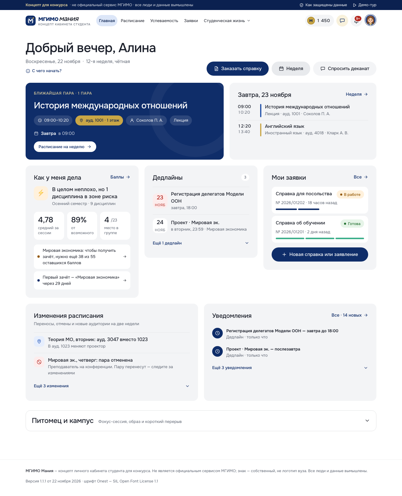
  <figcaption>Главная итоговой версии. Снимок прогона версии 1.1.1 из чистой копии репозитория 22 ноября, evidence/release-1.1.1.</figcaption>
</figure>

## Коротко для жюри

**Указатель** — ссылки кликабельны и в PDF:

| Что | Где |
|---|---|
| Проблема и гипотезы | [раздел 1](#problem) |
| Опрос 25 студентов: что мешает и как прошли задания | [раздел 1](#survey) |
| Основной сценарий: справка от заявки до PDF | [раздел 6](#scenario) · [маршрут жюри](JURY_GUIDE.md) · [видео](video/demo-mobile.mp4) |
| Примеры работы с ИИ: поручение → ошибка агента → решение человека → исправление → тест | [раздел 9](#ai-examples) |
| Одна правка целиком: ссылка проверки справки — поручение, находка, решение, коммит, тест до и после | [пример 4](#review-1122) |
| Защита данных простыми словами | [раздел 6](#security) |
| Вклад команды и инструменты | [раздел 11](#team) |
| Ранняя версия рядом с итоговой | [раздел 9](#early-final) |
| Проверки версии 1.1.1: 115/115 и 604/604 в чистой копии, Safari на iPhone, замер нагрузки | [раздел 10](#checks) |

- **Что это.** Кабинет студента, в котором связаны расписание с переносами, баллы с подсказкой
  «сколько не хватает», справки и уведомления. Заявка проходит через сотрудника деканата
  и возвращается документом с кодом проверки. Три студента и сотрудник деканата, пароль `mgimo2026`.
- **Видео.** [Две минуты с мобильного экрана](video/demo-mobile.mp4): справка от заявки до PDF,
  поиск заявки по номеру в деканате и проверка чужой ссылки.
- **Проверить за 5 минут** — [маршрут жюри](JURY_GUIDE.md): у каждого проверяющего свой демо-кабинет;
  Алина заказывает справку → `dekanat.mo` по ссылке «Ваш демо-кабинет» находит её по номеру и отмечает
  готовность → Алина получает уведомление и скачивает PDF → Тимур по той же ссылке видит
  «Заявка не найдена». Всё работает с телефона от 360 px.
- **Как работали с ИИ.** 4 ноября Claude Code (Claude Opus 5.5) собрал первую версию по полному
  тексту задания и сам проверял её во встроенном браузере. 8 ноября Codex с субагентами провёл аудит,
  исправления и публикацию. 9 ноября независимый аудит сделал новый агент Claude Code.
  19 ноября субагенты Claude Sonnet 5.5 выполнили девять поручений, и их находки стали исправлениями
  с тестами. 21 ноября мы убрали из материалов неподтверждённые утверждения и реконструкции,
  а вечером передали Claude Code 15 пунктов независимого проверяющего: десять он закрыл кодом и документами,
  в пяти сделал свою часть, остальное в них — наши шаги (опрос, телефоны, стенд, ролик). 22 ноября второй
  проверяющий нашёл пять ошибок: три агент внёс сам 21 ноября, две были с первой версии и остались
  незамеченными (E-45…E-49). Исправление разобрано как пример 4 в разделе 9.
- **Где промпты.** Наши дословные просьбы — раздел 2. Поручения субагентам целиком, с ответами —
  раздел 3, [приложение](PROCESS-APPENDIX.md#subagents) и [briefs/](evidence/subagents-2026-11-19/briefs/). Правила для агентов —
  [AGENTS.md](../AGENTS.md), `CLAUDE.md` и `.claude/`; журналы промптов и ошибок — [docs/ai/](ai/).
- **Проверено.** 115/115 автотестов и 604/604 браузерных проверок на 360 и 1366 px в чистой копии
  репозитория, 22 ноября ([сводка](evidence/release-1.1.1/run-summary.json)); справка, форма и вход — ещё и в Safari
  на iPhone в симуляторе iOS; по нашим словам, основной путь пройден и на настоящих iPhone и Android, стенд
  открывается из России без VPN. Какая версия на стенде, видно без входа: внизу страницы входа — «Версия 1.1.1».
- **Опрос.** 25 студентов: 24 за семестр нужна была справка, 19 получают её лично и ждут дольше двух дней,
  до сессии точно знают, хватает ли баллов, только 4. Самооценка лёгкости заданий в кабинете с телефона —
  4,4 из 5; трудными назвали риск по дисциплине и перенос пары, по 3 голоса из 25. Причину риска мы вынесли
  на главную; в повторном замере пятеро из тех же 25 оценили лёгкость в 4,4 против своих прежних 3,2. Раздел 1.
- **Чего нет.** Ответы ассистентов на постановки 4 ноября не сохранились. Ранние этапы — понять задание,
  концепция, спецификация, модель угроз — мы прогнали заново 19 ноября как настоящие задачи; ответы сохранены
  целиком (раздел 3). В опросе нет замеров времени: и опрос, и повторный замер — самооценка. Экранный диктор
  не проверяли — только автоматические проверки доступности.

Дальше: раздел 1 — продукт, разделы 2–3 — работа с ИИ, раздел 9 — ошибки и доработки,
раздел 10 — журналы проверок. Шаблоны промптов на будущее — в [методичке](prompts/README.md).

## 1. С какой задачи мы начали

Студенту обычно приходится собирать учебную жизнь по частям: искать расписание,
проверять оценки в другой системе, выяснять порядок получения справки и следить
за объявлениями в чатах. Мы хотели собрать эти действия вокруг одного человека
и одного понятного вопроса: **«Что мне нужно знать и сделать сейчас?»**

Поэтому ядром проекта стали пять связанных задач. В профиле хранятся данные для
заявления. Изменение пары появляется и в расписании, и в уведомлениях. Учебный риск
объясняется через баллы и следующий шаг. Заявка не заканчивается сообщением
«отправлено»: студент видит её движение и результат решения деканата.

### Гипотезы продукта и границы проверки

Технический тест подтверждает действие приложения. Понимает ли его студент и стало ли
ему удобнее, нужно проверять отдельно. Поэтому для каждой идеи фиксируем оба вопроса.

| Гипотеза | Решение в прототипе | Что подтверждено проверками | Что проверить со студентами |
|---|---|---|---|
| Явный первый шаг помогает перейти от знакомства к действию | Кнопка «С чего начать» открывает диалог: расписание, оценки и справки; эти действия доступны и при первом знакомстве | Отдельные браузерные повторы — по 34/34. Два студента, которым мы показали прежнюю версию, не сразу нашли первое действие | Стало ли понятно первое действие без подсказки? Повторная проверка после правок ещё не проведена |
| При коротком визите важнее ближайшая пара и изменения | Главная с ближайшим занятием; день и неделя с аудиторией и переносами | Переходы, разные дни, экспорт календаря и экран 360 px | Найдёт ли человек нужную аудиторию и заметит ли перенос без подсказки? |
| Баллы полезнее, когда понятен следующий шаг | Порог, недостающие баллы и подробности дисциплины; переход к пересдаче | Формулы расчёта, фильтр риска, открытие подробностей | Сможет ли студент своими словами объяснить риск и выбрать действие? |
| Прозрачный статус сокращает неопределённость после заявления | Форма → решение сотрудника → история → уведомление → образец документа | Полный путь двух ролей, сохранение полей, получение документа | Понятно ли, кто сейчас обрабатывает заявку и что делать после готовности? |
| Объявление полезнее, когда ведёт к предмету сообщения | Персональные уведомления со ссылкой на заявку или расписание | Переход к нужной заявке, адресаты, сохранение прочитанного | Различает ли человек общую новость и событие, требующее его действия? |
| Необязательный игровой слой придаёт кабинету характер | Питомец, фокус-сессии и кампус; учебные разделы доступны напрямую | Наличие отдельных маршрутов; учебный путь проходит без игры | Помогает ли этот слой возвращаться в кабинет или отвлекает от основной задачи? |

Источники технических проверок: `domain.test.js`, `security.test.js`,
`backend-regressions.test.js`, `browser-flows.py`, `browser-accessibility.py`
и `browser-home-priority.py`. Даты и результаты конкретных запусков — в разделе 10.
Изоляция аккаунтов является обязательным требованием: сервер проверяет владельца,
а при смене входа форма и помощник получают данные нового студента.

Проблема взята из конкурсного задания. Готовый кабинет мы показали **двум студентам**.
Обоим было понятно назначение сервиса и его возможности, но при переходе от знакомства
к действию они не сразу поняли, с чего начать и куда нажать дальше. Оба в итоге разобрались.
Имена мы не публикуем; анкет и замеров времени у нас нет — это качественная обратная связь,
а не исследование.

По этому замечанию реализована заметная кнопка «С чего начать» на главной. Она открывает
диалог с прямыми переходами к расписанию, оценкам и справкам; его можно закрыть.
При первом знакомстве эти действия заменили единственное предложение настроить аватар.
Техническая проверка описана ниже. Повторное пользовательское тестирование после
изменений не проводилось.

Следующая проверка с участниками должна была использовать четыре задания без подсказок:
найти изменённую пару, объяснить учебный риск, заказать справку и найти готовый документ,
а после основного пути — спросить о пользе игрового слоя. Её результаты — ниже.

### Опрос 25 студентов

Таблицу ответов автор передал 22 ноября: 25 анонимных ответов на форму, все — выбор из готовых
вариантов, без имён, почты и дат. Отвечали студенты 1–4 курсов и магистратуры; по формулировкам
вопросов задания в кабинете они выполняли с телефона. Копия ответов, расчёт и способ пересчитать —
[survey-2026-11-22](evidence/survey-2026-11-22/).

| Гипотеза | Что ответили о нынешних способах | Как прошли задания в кабинете |
|---|---|---|
| Прозрачный статус сокращает неопределённость после заявления | Справка или заявление нужны были 24 из 25; 19 получают справку лично и ждут дольше двух дней; «получить справку и знать, когда готова» трудно 11 | «Заказ справки» назвали самым трудным 2, «найти документ» — 1 |
| Баллы полезнее, когда понятен следующий шаг | Точно понимают до сессии, хватает ли баллов, 4 из 25; 9 узнают в конце семестра | «Риск по дисциплине» — самое трудное для 3, у них средняя лёгкость 3,7 из 5 |
| При коротком визите важнее ближайшая пара и изменения | «Вовремя узнать о переносе» трудно 9; узнают из приложения вуза (18) и на месте (14) | «Перенос пары» — самое трудное для 3, средняя лёгкость 4,3 |
| Объявление полезнее, когда ведёт к предмету сообщения | «Найти объявление деканата» трудно 12 — вторая по частоте проблема | Отдельного задания не было |
| Кабинет удобен с телефона | «Делать всё с телефона» трудно 15 — самая частая проблема | Самооценка лёгкости заданий с телефона — 4,4 из 5; «все были лёгкими» — 16 из 25 |
| Необязательный игровой слой придаёт кабинету характер | — | Помогает возвращаться — 17, не нужен, но не мешает — 5, отвлекает — 2, незаметен — 1 |

Пользоваться таким кабинетом вместо нынешних способов готовы 22 из 25 («да» и «скорее да»), не готовы трое.

<figure class="wide-shot">
  
  <figcaption>Карточка построена скриптом <code>scripts/survey-summary.py</code> из таблицы ответов, а не снята с экрана. Лёгкость — самооценка участников.</figcaption>
</figure>

**Что изменили.** Чаще других самыми трудными называли «риск по дисциплине» и «перенос пары» — по три ответа;
у риска ниже средняя лёгкость, поэтому его взяли первым. На главной в ярлыке «Требует внимания» было
только название дисциплины, и причину приходилось искать в оценках. Теперь ярлык называет её теми же
числами, что в успеваемости, — у Алины «Риск · нужно ещё 38 из 55 баллов» (`4209326`, проверки
`grades-forecast.test.js` и `browser-home-priority.py`).

**Повторный замер.** Пятеро из тех же 25 участников повторили четыре задания и ответили на те же два вопроса;
ответы мы внесли в два новых столбца таблицы ([survey-repeat-2026-11-22](evidence/survey-repeat-2026-11-22/)).

| | Исходный замер | Повторный замер |
|---|---|---|
| Участников | 25 | 5 — из тех же 25 |
| Самооценка лёгкости, 1–5 | 4,4 в среднем | у этих пятерых было 3,2, стало 4,4 |
| «Все задания были лёгкими» | 16 из 25 | у пятерых было 1, стало 3 |
| Самым трудным назвали | риск по дисциплине — 3, перенос пары — 3, заказ справки — 2, найти документ — 1 | стало: заказ справки — 1, найти документ — 1 |

Фактическая разница — у тех же людей: +1,2 балла, у каждого на 1 или 2. Средние двух групп (4,4 и 4,4)
напрямую не сравниваются: в пятёрку попали те, кто в исходном замере оценил задания ниже остальных (3,2 против
4,7 у двадцати не повторявших), а такие оценки при повторе склонны расти и без изменений; добавляется
привыкание к заданиям. Единственный в пятёрке, кто называл самым трудным риск по дисциплине, после правки
ответил «все были лёгкими»; трудными остались «найти документ» и «заказ справки». Повторяли на исправленной
версии, с причиной риска на главной, — это наши слова: в таблице сборка не записана.

**Чего опрос не показывает.** Время до первого верного действия и успех по каждому заданию не записывались —
только самооценка лёгкости и одно самое трудное задание. Свободных ответов нет, поэтому правка для риска —
наша гипотеза о причине. Повторный замер — пять человек, отобранных не случайно, а 25 ответов без описания
выборки не репрезентативны для всех студентов. Автоматические проверки и уменьшение высоты страницы не доказывают
сокращение времени выполнения задачи студентом.

Вторая часть идеи — ощущение собственного студенческого пространства. Аватар, питомец,
виртуальный кампус и короткая игра дают кабинету характер. При этом расписание и справки
доступны через обычную навигацию: для учебных действий не требуется играть или копить монеты.
Связь игрового слоя с вовлечённостью — гипотеза концепта, а не доказанный образовательный эффект.

Статус справки в демо может меняться автоматически, но проверенный сквозной сценарий
использует действие сотрудника: оно записывается в историю и вызывает уведомление студенту.
Так короткая демонстрация дополняется полноценным взаимодействием двух ролей.

## 2. Из чего складывается эта история

Кабинет написали **Claude Code** и **Codex** — это видно по истории Git, журналам запусков
и записям сессий. Документ опирается на то, что можно проверить в проекте: историю Git,
исходники, сохранённые результаты запусков и снимки браузера.

| Источник | Что он позволяет установить |
|---|---|
| Наши решения | Мы ставили задачи и решали, куда развивать проект и когда публиковать |
| Git | Состав и зафиксированную последовательность изменений, даты записей и атрибуцию соавторства |
| Исходники | Как устроены сценарии, защита, интерфейс и интеграция помощника |
| Журналы и реальные снимки | Что было выполнено в конкретном запуске и как выглядел проверенный экран |
| Наши дословные просьбы | Короткие постановки 8–9 ноября, сохранённые в записях сессий `docs/evidence/*-session.json` |
| Журнал промптов | [docs/ai/PROMPTS_LOG.md](ai/PROMPTS_LOG.md): постановки с указанием происхождения — оригинал, выдержка или реконструкция |
| Диалоги с субагентами 19 ноября | Промпты методички, выполненные по-настоящему: поручение → ответ → изменение в проекте ([папка](evidence/subagents-2026-11-19/)) |
| Методичка промптов | [docs/prompts/](prompts/README.md): промпты по этапам, поручения субагентам и промпты-коррекции. Написана после создания прототипа по его коду и журналам — это методичка, а не журнал |

**Чего в документе нет.** Ответы ассистентов на ранние постановки 4 ноября не сохранились,
поэтому «восстановленных» диалогов того времени здесь нет. Ранние этапы мы прогнали заново 19 ноября как
настоящие задачи: субагент выполнил промпты П-01 (понять задание), П-04 (концепция), П-05 (спецификация)
и П-08 (модель угроз), его ответы сохранены целиком и сверены с кодом
([reruns/](evidence/subagents-2026-11-19/reruns/), раздел 3). Ранняя версия документа содержала
четыре изображения диалогов, созданные ChatGPT (в PNG есть метаданные C2PA: ChatGPT, gpt-image),
и подписывала их как скриншоты переписки; в записях сессий 8 ноября эта подпись сохранилась
как историческая цитата. На признаки генерации указала ИИ-проверка материалов: у всех четырёх
файлов одинаковый размер 1536×1024 и вес около 1,6 МБ, а рамка окна — macOS, хотя работа шла
в Windows. Отчёт той проверки остался в чате, поэтому её дата не подтверждена; сборка PDF
9 ноября изображения ещё содержала. 19 ноября мы проверили метаданные C2PA и удалили файлы —
см. запись E-11 в [журнале ошибок](ai/ERRORS.md).

### Что мы просили и что сделали агенты

| Наша дословная просьба | Кто выполнял | Что получилось | Источник |
|---|---|---|---|
| «вот фотки подставь их ну вот и подними все до 10» | Codex и три субагента: документы, интерфейс, публикация | Компактная успеваемость с фильтром риска, меню «Студенческая жизнь», публикация сборки `review-b27684eaebf8` | [review-session.json](evidence/review-session.json) |
| «подними все до 10 и запуш все» | Codex и субагенты: главная, успеваемость, документы | Главная без дублей с быстрыми действиями, компактная форма справки, маршрут жюри | [quality-session.json](evidence/quality-session.json) |
| «давай вот все поправим и зальем сайт и на github тоже все зальем» | Codex: основной агент и субагенты расписания, публикации и документов | «С чего начать», читаемое расписание, публикация `review-21595807feaf`, 194/194 проверки на HTTPS | [finalization-session.json](evidence/finalization-session.json) |
| «проверь по критериям все что написано… все что сделал», затем «давай все правки сделаем чтобы дотянуть до 10» | Claude Code (Claude Opus 5.5) | Независимый аудит и восемь исправлений с регрессиями (раздел 9) | Коммиты `0e3d1c3`…`645b5c5` |
| «вот промпты которые использовались… обращайся к подагенту… sonnet… делаешь скрины… пушить не забываешь» | Claude Code и субагенты Claude Sonnet 5.5, 18–19 ноября | Промпты методички выполнены по-настоящему, комплект файлов для агентов, диалоги — ниже в разделе 3 | [subagents-2026-11-19/](evidence/subagents-2026-11-19/) |

Короткие просьбы сработали потому, что агенты сами восстанавливали контекст из кода,
`AGENTS.md` и критериев. Как такие просьбы стоило формулировать полностью — в
[методичке](prompts/00-principles.md), раздел «Было → стало».

### Как шла работа: журналы сессий

Первая версия кабинета создана за одну сессию **Claude Code в приложении Claude**
(модель Claude Opus 5.5) **4 ноября, 20:49–22:13 МСК**. Стартовым промптом был полный
текст конкурсного задания. Дальше агент работал сам: создал 89 файлов, внёс 50 правок,
выполнил 39 команд и около 75 действий во встроенном браузере — открывал разделы кабинета,
проходил сценарии и проверял вёрстку на экране 360 px. Через веб-поиск агент уточнил
фирменные цвета МГИМО, список факультетов и 100-балльную систему оценивания.

8 ноября проект проверяли и дорабатывали в **Codex**: сохранился 31 журнал сессий —
основные сессии и сессии субагентов — с 46 постановками задач — нашими и основного
агента субагентам. Из этих сессий взяты поручения и результаты, описанные в разделах 3 и 9.
Журналы хранятся у нас локально и в репозиторий целиком не входят: в них есть служебные
данные сервера.

### Что показывает история Git

Коммиты **4 ноября не отражают хронологию работы**. В конце той же сессии агент написал
скрипт, который разложил готовый код на **629 последовательных коммитов** по файлам
и функциям, сверил итоговое дерево с резервной копией и отправил историю в GitHub.
Все 629 коммитов созданы за 2 минуты 21 секунду (22:09:47–22:12:08). Поэтому они
показывают устройство кода — от каркаса и модели данных к логике и интерфейсу, —
а не время, потраченное на каждую часть. В них есть трейлер `Co-Authored-By` с именем
Claude; это атрибуция в репозитории, а не независимое подтверждение текста промптов.

Начиная с **8 ноября** каждый коммит — отдельная реальная итерация: аудит и исправления,
интеграция OpenRouter, публикация, возврат посетителей прежнего сайта, доработка интерфейса.
Полный экспорт — в [git-history.json](evidence/history/git-history.json).

| Этап | Примеры коммитов | Что можно увидеть в проекте |
|---|---|---|
| Устройство кода, разложенное 4 ноября | `9c74eef`, `832c17b`, `5b9088a`, `aea48ab` | Каркас Node.js, схема SQLite, расписание, успеваемость, заявки, стили |
| Аудит и доработка, 8 ноября | `00882b7` | Исправления сценариев, интеграция OpenRouter, тесты и документы |
| Публикация, 8 ноября | `969bdf4`, `2e48826` | Конфигурация сервиса и результаты приёмки |
| Возврат посетителей прежнего сайта, 8 ноября | `6376d05`, `e3ac392` | Исправление старого офлайн-кеша и браузерный сценарий |
| Доработка по критериям, 8–9 ноября | `19e9672`, `0e3d1c3`, `a1aff22` | Первые действия, мобильный интерфейс, ограничения демо-стенда |

<figure class="evidence-card">
  
  <figcaption>Визуализация метаданных Git. Первичный источник — экспорт истории репозитория, а не восстановленный чат.</figcaption>
</figure>

## 3. Как распределялась работа с ИИ

Наша роль — выбрать задачу и продукт, передать агентам критерии конкурса, давать
обратную связь по результатам и решать, что и когда показывать. На позднем этапе
мы предложили OpenRouter, сами задали настройки доступа к провайдеру, отложили
необязательный ролик и сообщили агенту, что после публикации открылся старый сайт.
Ключи и другие секреты в этот документ не включаются.

Codex использовался для согласованной работы над кодом, проверками и материалами.
Работа была разделена между основным ассистентом и тремя направлениями субагентов.

| Направление | Задача | Проверяемый результат |
|---|---|---|
| Основной ассистент | Сопоставить проект с заданием, распределить файлы и проверить интеграцию | `AGENTS.md`, скрипт `collect-evidence.py`, общий журнал `run-summary.json` |
| Сервер и безопасность | Проверить доступ, заявки, сеансы, сохранение и ошибки | `server/routes/`, `server/security/`; регрессии персональных дедлайнов, параллельного входа и дат в `backend-regressions.test.js` |
| Интерфейс | Пройти основные экраны, мобильные сценарии, клавиатуру и смену аккаунта | `public/`; очистка состояния после выхода, восстановление после ошибки, браузерные сценарии и снимки |
| Документы | Сверить описание с кодом, уточнить лицензии и собрать историю | `PROCESS.md`, `THIRD_PARTY.md`, `SUBMISSION.md`; реальные диалоги, команды и результаты по этапам |

В `AGENTS.md` сначала было шесть инвариантов; 19 ноября комплект для агентов расширил их до 12,
и у каждого теперь указан тест, который его охраняет. Там же структура каталогов и правила проверки.
Например, пользователя определяет серверная сессия; смена аккаунта очищает кеши;
основной кабинет работает без внешнего ИИ; новые заявки сохраняются после перезапуска.
Перед параллельными правками распределяется владение файлами.

В сохранённом описании позднего этапа приведены конкретные выдержки задач:

> «Проверь изоляцию минимум двух студентов, роли деканата, сессии/CSRF, основные сценарии
> заявок и расписания, персистентность, ошибки; запускай имеющиеся тесты».

> «Проверь сценарии login/profile/schedule/grades/requests/notifications, мобильные 360px,
> доступность, ошибки/пустые состояния, явную маркировку конкурсного концепта/вымышленных данных».

Полные тексты поручений субагентам 19 ноября — ниже в этом разделе и в папке
[briefs/](evidence/subagents-2026-11-19/briefs/).

### 19 ноября: промпты библиотеки, выполненные субагентами

Мы передали основному агенту — Claude Code (Claude Opus 5.5) — библиотеку промптов команды
([docs/prompts/](prompts/README.md)) и попросили: «обращайся к подагенту то есть к sonnet…
делаешь скрины… пушить не забываешь». Основной агент не стал пересказывать промпты, а отдал их
субагентам **Claude Sonnet 5.5** как настоящие задачи на этом проекте. Поэтому ниже —
не реконструкции, а реальные диалоги: поручение, ответ субагента и изменение в репозитории.

Как устроена работа:

- **Общие правила** для всех субагентов — один файл
  ([00-common.md](evidence/subagents-2026-11-19/briefs/00-common.md)): свои файлы, без коммитов,
  пушей и публикации, только временная база, без входа паролями на публичный стенд, факты
  отдельно от непроверенного, отчёт «Сделано / Как проверено / Не проверено / Предложения».
- **Поручение — файл.** Каждому субагенту основной агент передавал путь к поручению; эти файлы
  сохранены без изменений в [briefs/](evidence/subagents-2026-11-19/briefs/). Ответ — последнее
  сообщение субагента из журнала сессии, тоже без правок: `<имя>.json` рядом.
- **Владение файлами** назначено до запуска, поэтому субагенты работали параллельно
  и ни разу не правили один файл.
- **Коммит после каждого шага**: исправление, проверка, пуш.

| Субагент | Промпт библиотеки | Что сделал | Как проверено | Коммит |
|---|---|---|---|---|
| A · ошибки ИИ | О-9 «Найди все следы» | Нашёл все упоминания QR и исправил единственное обещание пользователю: квиз «Первые шаги» обещал справку «с QR-кодом» | Новый `test/qr-mentions.test.js` падал 2 из 5 до правки; снимки квиза до и после | `fe1191c` |
| D1 · повторный прогон | П-01, П-04, П-05, П-08 | Ответил на промпты исследования, концепции, спецификации и модели угроз и сверил каждый ответ с кодом | Только чтение; находка по П-08 → поручение F | `0706409` |
| D2 · повторный прогон | П-10, П-20, П-23, П-27, П-36 | Ответил на промпты дизайна, заявок, ИИ-помощника, проверки со студентами и сценария видео | Только чтение; находка по П-10 → поручение G | `0706409` |
| F · безопасность | продолжение П-08 | Тест внедрения разметки через объявление и комментарий, тест ключей во всей истории Git, тест cookie `__Host-` в боевом режиме | 21 браузерная проверка XSS; каждый тест падал на нарочно сломанной копии | `6616890` |
| G · дизайн | продолжение П-10 | Текст подсказок, зачёркнутой аудитории и «нет баллов» был 2,17–2,39:1 — стал 4,51–4,96:1; белый на красном 3,91 → 6,54:1 | `scripts/check-contrast.py`, `test/contrast.test.js` (24 проверки), снимки до и после | `3aff3bb` |
| E · документы | по README библиотеки | Перенёс библиотеку в `docs/prompts/` с пометкой происхождения, исправил 16 неверных утверждений, сверил 40 хешей коммитов | Скрипт проверки ссылок | `89748f4` |
| C · файлы для агентов | П-09 «Собери комплект для агентов» | `AGENTS.md`, `CLAUDE.md`, `QWEN.md`, шесть субагентов и три команды в `.claude/`, `docs/ai/` | Пробный прогон комплекта на задаче и сверка каждой ссылки | `89748f4` |
| B · независимый аудит | П-28 «Независимый аудит „свежим“ агентом» | Проверил итоговое состояние как эксперт: девять находок — от доступа к репозиторию и устаревшего PDF до первого экрана входа на телефоне | Тесты, API-пробы изоляции, свой браузерный маршрут на 360 и 1366 px, сверка архива с Git | `babcd1d` и поручение H |
| H · интерфейс | находка аудита П-28 | На телефоне кнопки тестовых аккаунтов попали в первый экран (кнопка поднялась с 976 до 730 px), уведомление о входе закрывается нажатием и держится 2,8 с | `test/browser-mobile-entry.py`: 16/16, на старом коде 12/16; снимки до и после | `c8955dc` |

**Цепочка, ради которой это делалось.** Промпт → ответ → сверка с кодом → находка → новое
поручение → исправление → тест. Ответ на П-08 показал, что экранирование объявлений описано,
но не проверено, — субагент F написал браузерный сценарий XSS. Ответ на П-10 посчитал контраст
токенов и нашёл серый текст 2,39:1 — субагент G исправил цвет и закрепил его тестом. Так промпты
библиотеки проверили не только себя, но и проект.

**Что пошло не так.** Первый запуск пяти субагентов 18 ноября упал сразу с ошибкой API
(аккаунт требовал подтверждения). На следующий день четыре субагента с максимальным усилием
упёрлись в пятичасовой лимит Sonnet; по нашей просьбе их перезапустили с усилием medium.
Ошибку в поручениях допустил и основной агент: в них стояла дата «18 ноября», хотя настоящие
запуски прошли 19-го. Тексты поручений сохранены как есть, а даты в документах исправлены.

**Диалоги.** Карточки — не снимки экрана ассистента: их отрисовывает скрипт `scripts/render-dialogue-cards.py` из сохранённого текста поручения и ответа субагента. Длинные тексты в карточке сокращены с пометкой; полный текст обоих — в JSON рядом с изображением.

<figure class="prompt-card">
  
  <figcaption>Субагент D1: четыре промпта ранних этапов и сверка ответа с кодом. Ответы — в <code>reruns/</code>.</figcaption>
</figure>

<figure class="prompt-card">
  
  <figcaption>Субагент F: пробелы безопасности из ответа на П-08 закрыты тестами. Итог — <code>6616890</code>.</figcaption>
</figure>

<figure class="prompt-card">
  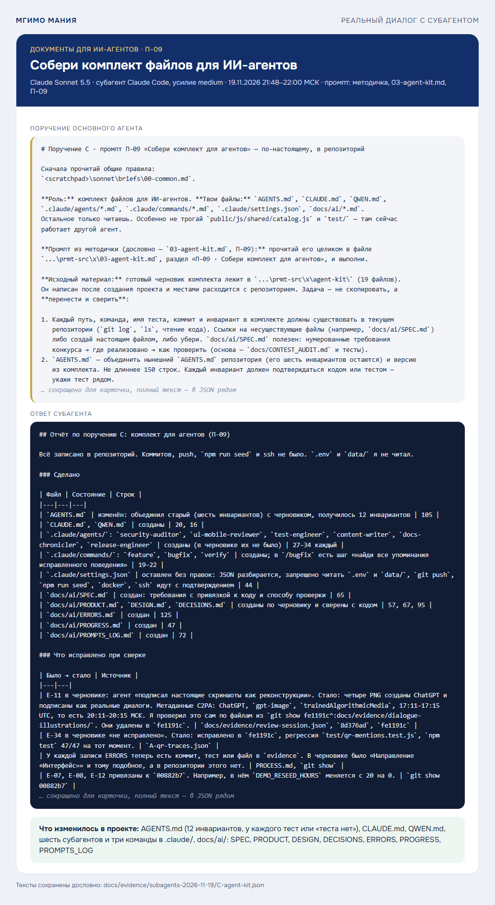
  <figcaption>Субагент C, промпт П-09: <code>AGENTS.md</code>, <code>CLAUDE.md</code>, <code>QWEN.md</code>, <code>.claude/</code>, <code>docs/ai/</code>.</figcaption>
</figure>

Карточки остальных шести поручений — A, D2, G, E, B и H — и снимки до и после их правок: квиз, контраст, первый экран входа — в [приложении](PROCESS-APPENDIX.md#subagents).

## 4. От идеи к устройству приложения

Для конкурсного прототипа выбран небольшой стек: Node.js с серверными модулями HTTP,
SQLite и криптографии; в браузере — ES-модули без сборки. Данные и правила остаются
на сервере. Интерфейс получает JSON, показывает состояние и отправляет действия.

В маршрутах находятся проверки роли и входных данных. Предметная логика отдельно
собирает расписание, считает учебные показатели и проводит заявку через статусы.
SQLite хранит профили, сеансы, заявки, уведомления и игровой прогресс. Такое разделение
помогает проверять правила без браузера и менять интерфейс без переписывания прав доступа.

**Что получилось.** Пять обязательных задач связаны общими сущностями, а роли студента
и деканата разделены на сервере. Выбранная архитектура подходит для работающего демо.
Горизонтальное масштабирование потребует отдельной работы с хранилищем, общими лимитами
и фоновыми задачами; оно не заявляется как готовая возможность.

## 5. Учебное ядро: понимать ситуацию и действовать

В расписании важна не только таблица, но и исключения из неё. Поэтому регулярные занятия
и изменения хранятся раздельно: отменённая пара или новая аудитория отражаются при сборке
конкретной недели. Время рассчитывается по Москве, независимо от расположения сервера.

В успеваемости мы показываем не только итоговую цифру. Контрольные точки, прогноз,
учебный риск и пороги помогают понять положение по дисциплине. Сессия и зачётка
собраны рядом, чтобы студенту не требовалось искать их в другом сервисе.

<figure class="wide-shot">
  
  <figcaption>Настоящий экран расписания. Изменения выделены в контексте конкретных занятий.</figcaption>
</figure>

<figure class="wide-shot">
  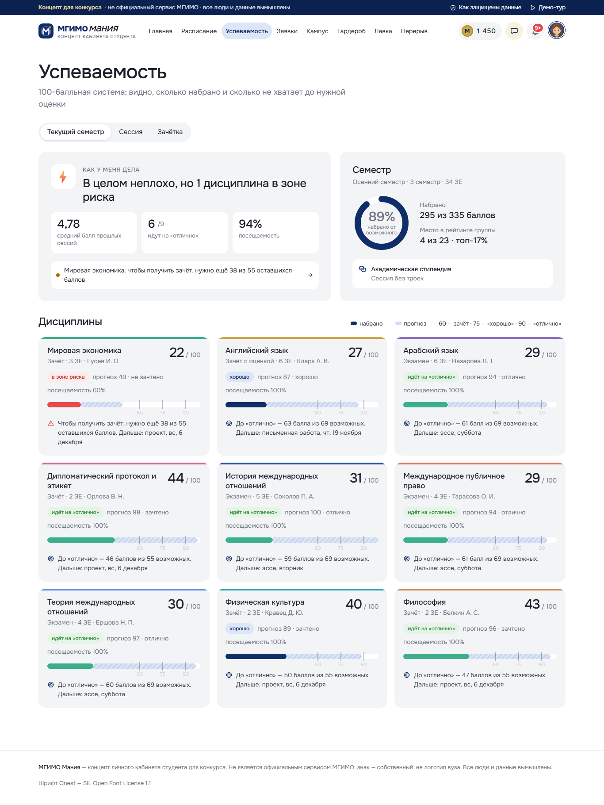
  <figcaption>Экран успеваемости связывает баллы, прогноз и учебные риски. Учебные данные вымышлены.</figcaption>
</figure>

**Инженерная итерация.** При проверке выяснилось, что персональный дедлайн с указанной
группой мог попасть в выборку другого студента. Условия отбора уточнили в API,
уведомлениях и контексте помощника. Для длинной истории исправили «прочитать все»:
действие теперь не ограничивается первой загруженной частью списка. Оба случая
проверяются регрессионными тестами.

## 6. Справка как законченный процесс

Путь заявки построен по модели отслеживания: студент понимает, что отправлено,
какой сейчас статус и что было сделано. Форма подставляет учебные сведения из профиля,
а повторная отправка той же формы открывает уже созданную заявку. Сотрудник видит очередь
своего факультета, находит заявку по номеру, принимает решение и оставляет комментарий.
Студент получает уведомление и видит запись в истории.

Для такого сценария важно разделить два решения: что видит студент после отправки
и кто вправе изменить статус. Поэтому в кабинете две роли, а сотрудник ограничен своим
факультетом; роли и переходы проверяются по коду и сквозному тесту.

Список статусов включает подачу, работу, готовность, выдачу, одобрение
и отмена; допустимый путь зависит от вида документа. Уведомление связано с конкретным
номером заявки, а сотрудник ограничен своим факультетом. Эти детали превращают
демонстрацию в проверяемый процесс с владельцем, действием и результатом.

У электронного образца есть код и ссылка проверки. «Скачать PDF» сохраняет файл: сервер
собирает A4 со встроенным шрифтом, пометкой «Образец» и кликабельной ссылкой проверки;
«Распечатать» открывает печать браузера. Образец явно обозначен как демонстрационный документ
без электронной подписи — он не выдаётся за официальную справку университета.

  <figure>
    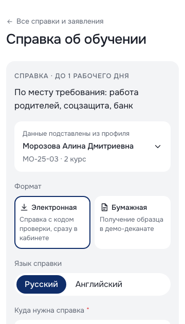
    <figcaption>Форма на 360 px: сведения профиля подставлены, формат выбирается одним нажатием.</figcaption>
  </figure>
  <figure>
    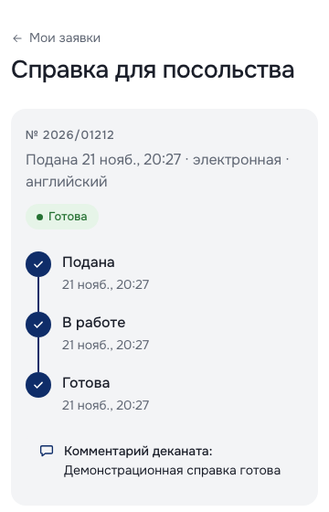
    <figcaption>После решения деканата: статус «Готова», история и комментарий сотрудника.</figcaption>
  </figure>

<figure class="wide-shot">
  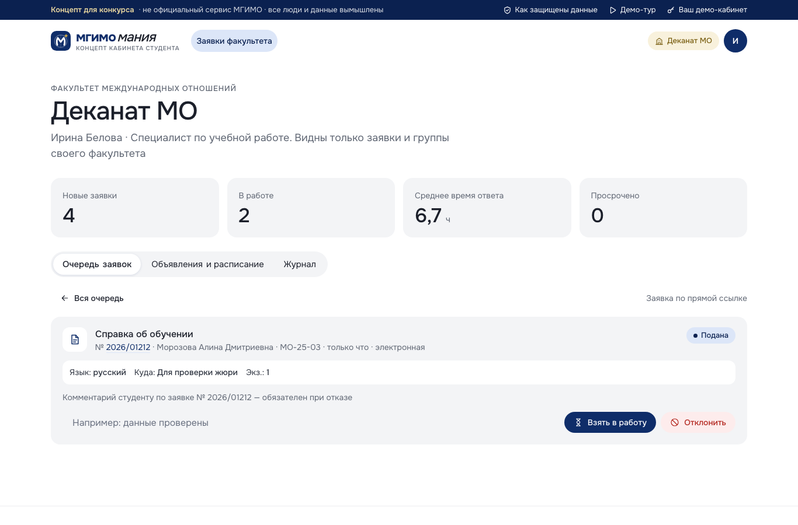
  <figcaption>Сотрудник открыл заявку по прямой ссылке из её номера; над очередью — поиск по номеру.</figcaption>
</figure>

  <figure>
    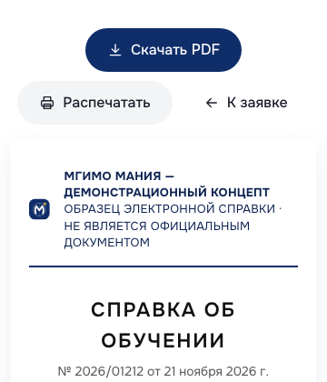
    <figcaption>Страница справки: «Скачать PDF» — первая кнопка, печать — отдельно.</figcaption>
  </figure>
  <figure>
    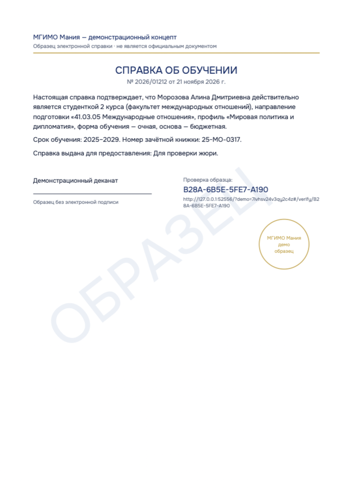
    <figcaption>Первая страница скачанного файла: кириллица — текстом, «Образец», код и ссылка проверки.</figcaption>
  </figure>

Кадры на 360 px обрезаны до действия из снимков итогового прогона ([как обрезаны](evidence/process-crops-1121/)).

### Защита простыми словами

Пароль сравнивается с хешем scrypt и случайной солью. После входа браузер получает
случайный идентификатор сеанса в HttpOnly-cookie; сервер хранит его хеш. В HTTPS-режиме
cookie передаётся только по защищённому соединению. Изменяющие запросы проверяются
по CSRF-токену и источнику Origin.

Номер заявки в адресе не определяет право доступа. Сервер проверяет владельца
по сеансу; для сотрудника дополнительно ограничивает факультет. Подмена номера
не открывает чужой документ. После смены аккаунта очищаются данные интерфейса
и кеши модулей, включая автозаполнение формы.

В итоговой локальной версии справка о стипендии получила таблицу шести завершённых
месяцев, суммы по месяцам и общий итог вместо общего утверждения о назначении выплаты.
Нулевые начисления обозначены отдельно. Все суммы — демонстрационные, что явно указано
в документе; проверяются арифметика, оформление на двух ширинах и сохранение в PDF.

<figure class="wide-shot">
  
  <figcaption>Новая локальная версия справки о стипендии. Таблица и итог проверены в браузерном сценарии.</figcaption>
</figure>

**Инженерные итерации.** Исправлены кеш профиля предыдущего пользователя, нормализация
невозможных дат и обход последовательного счётчика неверных входов параллельными
запросами. Автоматический сброс демонстрационной базы выключен по умолчанию, чтобы
созданные изменения не исчезали. Декоративный рисунок, похожий на QR, заменён честной
ссылкой и кодом проверки.

## 7. Визуальный язык и мобильный кабинет

Проект использует светлые карточки, тёмно-синий и золотой акценты, единые поля и кнопки.
Шрифт Onest хранится локально вместе с лицензией. Собственный знак, аватар, питомцы
и кампус реализованы SVG; короткий раннер — Canvas. Отдельная генерация растровых
картинок для интерфейса приложения не подтверждается и не заявляется.

**Дизайн и контент делали ИИ-агенты, а не отдельные графические сервисы.** Знак, аватары, питомцы,
кампус и раннер (`public/js/art/`, `public/js/campus/`, `public/js/game/`), тексты интерфейса и вымышленные
демо-данные (`server/seed/`) по истории Git появились в первой версии 4 ноября, которую собрал Claude Code
по тексту задания. Дальше их правили агенты в итерациях раздела 9: контраст текста, первый экран входа,
формулировки справки. Генератор изображений использовали один раз — для «диалогов» ранней версии этого
описания; их удалили как недостоверные (E-11). Карточки опроса и проверок здесь построены скриптами
по данным, а не нарисованы генератором.

Визуальные решения подчинены порядку действий. Ближайшее занятие и срочные задачи
нужны при коротком визите с телефона; подробности дисциплин и история документов —
при более долгой работе. Поэтому ключевые сведения видны на главной, а дополнительное
содержимое раскрывается по запросу. Названия действий и текстовые статусы дополняют
иконки и цвет. Одинаковые карточки, поля и кнопки сокращают необходимость заново
разбираться в каждом разделе.

Замечание об интерфейсе превращалось в конкретную задачу: поменять приоритеты блоков
и объяснить балл через учебный порог. Измерения изменений интерфейса приведены в разделе 9,
а снимки готового кабинета получены браузерными сценариями.

Главная помогает быстро найти ближайшую пару, срок и нужное действие. На телефоне
сохраняются те же учебные сценарии. Игровой кампус добавляет альтернативный способ
перейти в раздел, а фокус-сессии связывают питомца с учебным контекстом.

В продукте кампус даёт дополнительный путь к разделам, а питомец и короткая игра
создают узнаваемый образ кабинета. Доступ к расписанию и заявкам не зависит от
игрового прогресса. Проверяемое ограничение здесь — возможность выполнить учебную
задачу обычной навигацией, даже если человек ни разу не открывал игру.

Второстепенные списки и игровой блок на телефоне сворачиваются, сохраняя доступ
по нажатию и с клавиатуры. Ближайшая пара, учебная ситуация и действие со справкой
остаются в основном учебном пути. Итерации и измерения описаны в разделе 9.

<figure class="phone-shot">
  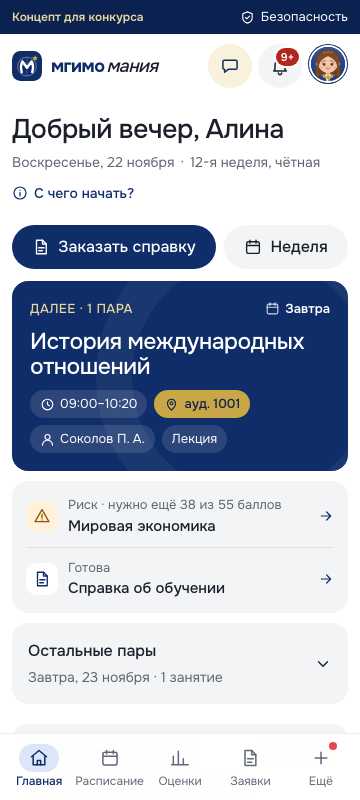
  <figcaption>Первый экран главной на 360 px, итоговый прогон 22 ноября на отдельной тестовой базе.</figcaption>
</figure>

<figure class="phone-shot">
  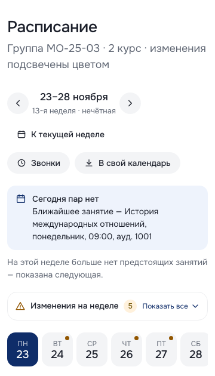
  <figcaption>Расписание на 360 px в выходной: «Сегодня пар нет», ближайшее занятие и изменения недели.</figcaption>
</figure>

**Инженерная итерация.** В части разделов кнопка повторной загрузки не запускала запрос.
Добавлен общий обработчик восстановления. Отдельно проверяются подписи полей,
переход к основному содержимому, фокус в обычном и вложенном диалоге, Tab/Shift+Tab,
Escape, управление днями расписания и настройка уменьшения анимаций.

## 8. «Спросить деканат»: ИИ внутри продукта

Использование ИИ для разработки и ИИ-помощник в приложении — две разные части проекта.
Первое описывают история работы и постановки задач. Второе — конкретная пользовательская
функция: получить краткий ответ по своему расписанию, группе, срокам или заявкам.

Помощник получает ограниченный контекст вошедшего студента. Вызов провайдера идёт
только с сервера; ключ не передаётся браузеру. Модель не получает инструменты
изменения оценок и решений деканата. При отсутствии ключа, ошибке или тайм-ауте
работают встроенные правила, а источник ответа показан пользователю.

Контракт внешнего API проверяется подставными ответами, включая ошибки и отсутствие
полезного текста. Ранее, при публикации 8 ноября, отдельно выполнены живые запросы
OpenRouter для двух студентов. Ответы о группе совпали с их профилями; история
прошлого аккаунта не появилась в новом сеансе. Эти результаты сохранены в
[assistant-browser-live.json](evidence/deployment/assistant-browser-live.json).

<figure class="phone-shot">
  
  <figcaption>Архивный снимок живого запроса на опубликованном стенде, 8 ноября 2026 года. Это отдельная предыдущая проверка, а не новый локальный запрос.</figcaption>
</figure>

При первом подключении провайдер отклонил ключ с HTTP 401. Этот ответ не был принят
за успешную интеграцию. После замены ключа в серверном окружении запрос прошёл;
значения ключей не сохранялись в материалах. Успех конкретных запросов не является
гарантией точности будущих ответов модели.

## 9. Как мы проверяли результат и исправляли ошибки

Задачу ИИ формулировали через наблюдаемое поведение. Недостаточно написать,
что «сохранение работает»: нужно создать заявку, открыть ту же базу после перезапуска
и сравнить данные. Недостаточно показать красивую форму: нужно отправить её,
обработать в деканате и получить результат под исходным аккаунтом.

| Обнаруженная проблема | Что изменили | Как это проверяется |
|---|---|---|
| Автозаполнение сохраняло профиль после смены аккаунта | Очистка модульного кеша и состояния | Два разных входа в одной вкладке |
| Персональный дедлайн мог попасть другому студенту той же группы | Уточнение условий видимости | Сравнение API, уведомлений и контекста помощника |
| Параллельные неверные входы обходили счётчик | Резервирование попытки до проверки пароля | Одновременные запросы входа |
| «Прочитать все» оставляло часть истории непрочитанной | Обработка всей доступной истории | Длинная история уведомлений |
| Невозможная дата превращалась в другую дату | Строгая календарная проверка | Некорректные даты и недели |
| Повторная загрузка не работала в части экранов | Общий обработчик восстановления | Ошибка 503, затем нажатие «Повторить» |
| Старый сайт открывался после смены приложения на домене | Миграция прежнего service worker | Старый worker, две вкладки, сохранение других данных |

### Итерации 8–21 ноября коротко

Каждая итерация начиналась с нашей просьбы и заканчивалась проверкой, которая падала бы без исправления.
Полный текст итераций с поручениями, измерениями и снимками — в [приложении](PROCESS-APPENDIX.md#iterations).

| Когда | Что нашли | Что изменили и чем проверили |
|---|---|---|
| 8 ноября, после публикации | У вернувшихся посетителей на домене открывался прежний сайт: старый service worker отдавал страницу из кеша | Миграция по прежнему адресу `/sw.js` снимает старый worker; регрессия с двумя вкладками |
| 8 ноября, первая оценка по критериям | Успеваемость на 360 px — 4355 px высотой: девять подробных карточек | Компактный обзор, подробности по нажатию, фильтр «Требуют внимания»: 2936 px, на 32,6% меньше; 40 проверок |
| 8 ноября, повторная оценка | Главное действие не помещалось в первый экран главной, успеваемость оставалась длинной | Два быстрых действия рядом с ближайшей парой (28 проверок), статистика по запросу: 2096 px (31 проверка), компактная форма справки (19) |
| 8 ноября, вечер | Первые действия и читаемость расписания | «С чего начать» с тремя учебными действиями; три агента с заранее разделённым владением файлами; публикация |
| 9 ноября, независимый аудит | Восемь находок: плашка входа наезжала на текст, ссылки 20–23 px, лента уведомлений около 4900 px, общее «Не найдено» для чужой заявки, лишний Google Fonts в CSP | Каждая находка исправлена и закреплена проверкой |
| 9 ноября, повторная проверка | Семь дефектов: помощник в воскресенье показывал пары понедельника, старая вкладка после смены аккаунта, потеря фокуса при обновлении, контраст подписей | Исправления с регрессионными проверками; публикация на стенде — 25/25 браузерных проверок на HTTPS |
| 19 ноября | Находки промптов библиотеки: квиз обещал «QR-код», экранирование не проверялось, серый текст 2,17–2,39:1 | Квиз исправлен, сценарий XSS, контраст 4,5:1 и выше (раздел 3) |
| 21 ноября, днём | Qwen Code в перечне без следов в репозитории, реконструкции диалогов, имя учётной записи Windows в журналах, видео не было | Убрано, обезличено, ролик записан |

  <figure>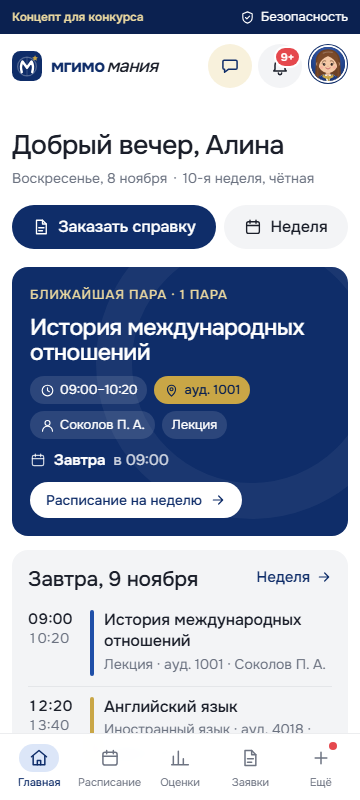<figcaption>До: занятия занимают первый экран.</figcaption></figure>
  <figure><figcaption>После: рядом с ближайшей парой доступны учебный риск и заявка.</figcaption></figure>

### Итерация 21 ноября, вечер: 15 пунктов независимого проверяющего

Вечером мы передали Claude Code (Claude Opus 5.5) рецензию независимого проверяющего — 15 пунктов
по всем критериям — со словами **«выполняй только то, что считаешь действительно нужным. и что поднимает
итоговый балл работы и сделает ее качественней»**. Агент начал выбирать главное, и через две минуты мы
решили объём: **«проверять, вероятно будут жюри с помощью ии, так что лучше правь все или почти все,
кроме лишнего»**. Дальше мы писали только «продолжи» и «доделай». Полное поручение —
[review-2026-11-21/prompt.md](evidence/review-2026-11-21/prompt.md); агент работал без субагентов,
коммиты — от нашего имени с соавтором Claude. Итог: десять пунктов агент закрыл кодом и документами,
в пяти (5, 8, 10, 11, 15) сделал свою часть, а остальное в них — наши шаги. 22 ноября второй проверяющий
нашёл ошибки и пропуски агента в пунктах 1, 2, 6, 7 и 10 — исправление разобрано в [примере 4](#review-1122).
Три пункта разобраны целиком.

#### Пример 1. Изоляция демо: свой кабинет у каждого проверяющего

- **Поручение (пункт 1).** «Изолировать демоданные проверяющих. Каждому проверяющему выдавать отдельный набор данных с двумя студентами и сотрудником. … Проверка: два человека одновременно входят под одинаковыми демологинами в разные демокабинеты.»
- **Что сделал агент.** Первый вход создаёт отдельную SQLite с демо-данными и запоминает её в cookie; ссылка «Ваш демо-кабинет» открывает тот же кабинет во втором окне — для пары «студент — деканат». Маршруты о кабинетах не знают: работают с `ctx.store`. Пределы и удаление старых — [ADR-012](ai/DECISIONS.md)
- **Где агент ошибся.** Регрессия E-34 упала на новом коде: проверка «кабинет не обещает QR» нашла «qr» внутри алфавита base32 (`…opqrst…`). Агент не ослабил тест, а собрал алфавит программно. В прогоне из чистой копии журналы получили путь к Python с именем пользователя macOS; агент заметил это, проверяя журналы до коммита (E-38)
- **Что решили мы.** Объём — «правь все или почти все»: изоляцию делать целиком. Обновить стенд с `DEMO_SANDBOXES=1` — наш шаг; до него стенд показывает версию 19 ноября
- **Исправление.** `5a1844e`, `367d8fd`, `2f061e8`, `1472549`, `cd64f24`
- **Тест.** `test/sandboxes.test.js`, 7 тестов: разные кабинеты; заявки, объявления, прочитанное и выход не влияют друг на друга; чужой код не открывает кабинет; перезапуск; «чистый кабинет»; готовность базы. `browser-review-fixes.py` — три проверяющих в браузере. Под нагрузкой создано 10 новых кабинетов, первый вход — 60–81 мс
- **22 ноября.** Второй проверяющий показал, чего тесты не ловили: кабинет создавался до проверки пароля, одновременные входы давали несколько кабинетов, а ссылка проверки справки открывала кабинет посторонним (E-45, E-46, пример 4). Тестов стало 13

#### Пример 2. Дедлайны и свежие данные на открытых экранах

- **Поручение (пункт 3).** «Починить дедлайны и обновление открытых экранов. На стенде 21 ноября уведомления от 8 ноября всё ещё говорили «послезавтра». … Главная и расписание должны получать свежие данные после окончания пары, при изменении расписания и при возврате во вкладку.»
- **Что сделал агент.** Срок в заголовке уведомления пересчитывается при показе: «завтра до 18:00», «через 3 дня», «срок прошёл»; в день срока — отдельное напоминание. Уведомление о переносе ведёт на `#/schedule/<дата>/<пара>` и сразу открывает пару со старой и новой аудиторией. Главная и расписание обновляются при возврате во вкладку, после пары и по уведомлению, не трогая карточку с фокусом. После пар и в выходной — «Сегодня пар нет» и ближайшее занятие
- **Где агент ошибся.** После этих правок два браузерных набора стали падать нестабильно. Агент сначала добавил ожидание кадра — тест упал в другом месте; только журнал событий `toggle` показал, что гонка в самом тесте: он менял ширину экрана раньше, чем страница обработала нажатие (E-41). Ещё три набора сломались от даты: за 30 дней до сессии на странице оценок появилась вторая ссылка на неё (E-42). Новая плашка «Сегодня» прилипла к строке под ней — агент заметил на снимке прогона и поправил отступ (`c37c69a`), после чего прогон повторён целиком
- **Что решили мы.** Объём — «правь все». Общую базу стенда не пересоздавать: по нашему правилу из `AGENTS.md`, `npm run seed` — только по нашей команде, а созданные заявки должны сохраниться. Свежие даты получает каждый новый кабинет
- **Исправление.** `c33b509`, `fc973b5`, `fe3432e`, `cd64f24`, `99e71cb`, `c37c69a`; тесты гонок — `3355226`, `a0dcf46`
- **Тест.** `test/deadlines-links.test.js`: относительный срок; старое «послезавтра» показывает актуальный срок и напоминание в день срока; ссылка на дату и пару. `browser-review-fixes.py`: из уведомления одним касанием к паре; «Сегодня» в расписании
- **22 ноября.** Проверка «Сегодня» принимала любой текст, начинающийся с «Сегодня», и пропустила ошибку: вечером после последней пары недели экран сам переходил на следующую неделю и писал «Сегодня пар нет» (E-48, `81fea7b`). Теперь тест сверяет точный текст при подменённых часах браузера

#### Пример 3. Справка на телефоне: файл PDF вместо диалога печати

- **Поручение (пункт 10).** «Проверить скачивание справки на телефоне. Сейчас кнопка «Скачать PDF» вызывает печать, а тест подменяет этот вызов. Сделать прямую загрузку PDF, оставив просмотр и печать.»
- **Что сделал агент.** Сервер собирает A4 библиотекой `pdf-lib` со встроенным шрифтом Onest ([ADR-013](ai/DECISIONS.md)); текст справки — один модуль для страницы и файла. В файле — пометка «Образец», код и кликабельная ссылка проверки; 21 ноября она вела в тот же кабинет, и 22 ноября выяснилось, что так кабинет открывался любому, кто увидел PDF (E-45, пример 4). На странице — «Скачать PDF» и отдельно «Распечатать»
- **Где агент ошибся.** Агент отрисовал первую страницу файла и посмотрел на неё — так нашлись ошибки, которых тесты не видели: адрес проверки уходил за поле; «Дана Морозова Алина Дмитриевна в том, что…» — неграмотно с 4 ноября; английская выписка транслитерировала дисциплины («Angliiskii iazyk»); «октябрь 2026 г..» (E-39); знака ₽ нет в шрифте, и суммы кончались пустыми квадратами (E-40). Первая сборка шрифта не повторялась байт в байт: fontTools пишет в заголовок время объединения
- **Что решили мы.** Новая зависимость — по нашему правилу в `AGENTS.md` только с записью в `DECISIONS.md` и нашим согласием: агент записал ADR-013 и спросил нашего согласия до отправки в GitHub; мы ответили «Да, отправить». В Safari на iPhone SE в симуляторе iOS агент проверил сам (22 ноября); на настоящих iPhone и Android проверяем мы
- **Исправление.** `ac62bcd`, `24c060c`, `a4ab955`, `e479e6c`
- **Тест.** `test/document-pdf.test.js`: файл со встроенным шрифтом и языком, выписка и стипендия, чужую и неготовую не скачать; `test/document-model.test.js`; `browser-stipend.py` — текст скачанного файла и итог в «руб.»; `browser-review-fixes.py` — скачивание на 360 px и проверка по ссылке из файла без входа

  <figure>
    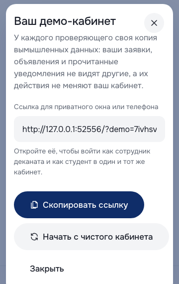
    <figcaption>Пример 1: ссылка на тот же кабинет для приватного окна или телефона.</figcaption>
  </figure>
  <figure>
    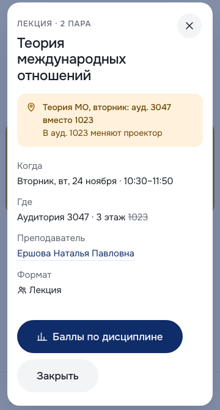
    <figcaption>Пример 2: из уведомления — сразу пара со старой и новой аудиторией.</figcaption>
  </figure>

Остальные пункты рецензии агент сделал так:

| Пункт | Что сделано | Коммиты и проверка |
|---|---|---|
| 2. Учёба без игрового API | Вход и учебные разделы работают при ответе 503 от `/api/play`, игровые разделы показывают заглушку | `cd64f24`; `browser-review-fixes.py` |
| 4. Жизненный цикл справки | Готовая электронная — в «Завершённых»; срок в рабочих днях; дубли с учётом формата, повтор открывает созданную заявку; код из 16 знаков, 40 проверок за 10 минут, минимум сведений | `b2b6e03`, `475dbd3`, `1fde12c`; `requests-lifecycle.test.js` |
| 5. Проверка релиза | Прогон из чистой копии (`git clone`, `npm ci`), готовность `/api/health`, замер нагрузки | `1472549`, `aa27f37`; раздел 10 |
| 7. Достоверный прогноз | «Пока нет данных для прогноза», прогноз допуска отдельно от фактического, ближайшее действие в зоне риска | `d4390aa`; `grades-forecast.test.js` |
| 9. Деканат | Поиск по номеру, прямая ссылка, подписанное поле комментария, черновик и фокус при автообновлении; действия по статусам — в маршруте жюри | `1fde12c`, `99e71cb`, `faf9a11`; `browser-review-fixes.py` |
| 11. Первый экран и доступность | На телефоне нет сообщения о входе (прошлый вход — в профиле), ручной демо-тур в «Ещё», вкладки зачётки со стрелками | `cd64f24`, `d4390aa`, `a95ec63` |
| 12. Обещания интерфейса | Пометки «демо» у push, почты, Telegram и смены пароля; ответ «Какая у меня группа?» по профилю без модели | `99e71cb`, `06d1e7e`; `assistant.test.js` |
| 13–15. Материалы | Эти примеры, указатель на второй странице, ранняя версия рядом с итоговой, обрезанные кадры, пакет для капитана в `SUBMISSION.md` | этот документ |

За нами остаются шаги, которые агент сделать не может: повторное прохождение заданий после правки по итогам
опроса 25 студентов (пункт 8, раздел 1), настоящие iPhone и Android, VoiceOver или TalkBack (пункты 10–11), обновление
стенда и оплата VPS до 28 ноября (пункт 5), ролик на площадке из задания и проверка ссылок без входа
(пункт 15). Ролик мы перезаписали тем же сценарием на итоговой версии: 2:11, с поиском по номеру
и «Скачать PDF». 22 ноября его записали ещё раз, на итоговой версии: в прежнем на странице справки была видна
ссылка проверки с кодом демо-кабинета (пример 4).

#### Ранняя и итоговая версии на одном сценарии

Код коммита `4f1e623` — последнего из коммитов 4 ноября — мы запустили 21 ноября в 20:13 МСК на свежей
базе и сняли тем же сценарием, что итоговую версию. Это повторный запуск, а не снимок того дня; даты
на экранах — 21 ноября. [Все кадры и как повторить](evidence/early-vs-final-2026-11-21/).

  <figure>
    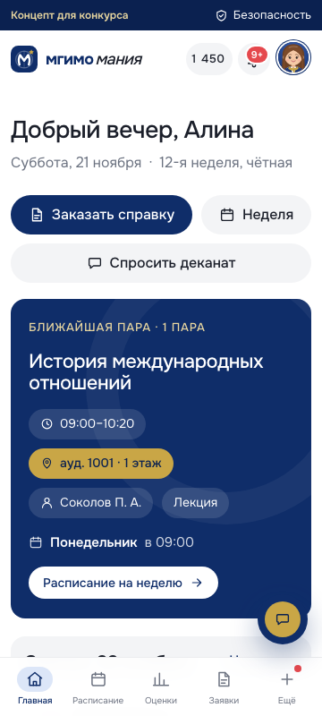
    <figcaption>4 ноября (<code>4f1e623</code>): первый экран целиком занимает карточка пары.</figcaption>
  </figure>
  <figure>
    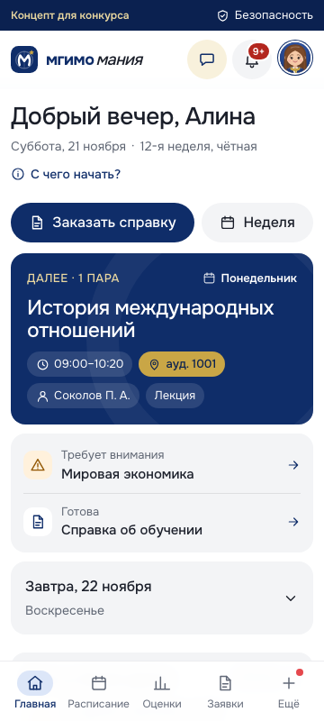
    <figcaption>Итоговая версия: пара компактно, затем «Требует внимания» и «Готова».</figcaption>
  </figure>

#### Нагрузка

Для обоснования стека мы замерили нагрузку на локальном сервере (Apple M3, один процесс Node.js, без сети):
пользователи без пауз открывают главную, расписание, оценки, уведомления и заявки, каждый десятый — очередь
деканата. При 10, 50 и 100 одновременных пользователях — около 2 750 запросов в секунду, 0 ошибок, p95 —
6,9, 26 и 53 мс. В режиме стенда с демо-кабинетами — 2 735 в секунду, за 20 секунд под нагрузкой вошли
10 новых проверяющих, первый вход — 60–81 мс. Стенд — другая машина, на нём нагрузку не замеряли:
[замер и команды](evidence/load-2026-11-21/).

#### 22 ноября: Safari на iPhone и вход на низких экранах

После отправки мы написали «доделай». Агент прошёл пункт 10 рецензии в Safari на iPhone SE — в симуляторе iOS
на Mac, не на настоящем телефоне: «Скачать PDF» открывает файл, кириллица читается, «Образец» виден; форма
справки работает с русской экранной клавиатурой. Там же нашлась проблема, которую тесты пропускали: тестовые
аккаунты стояли ниже первого экрана, потому что тест проверял только 360×800 и 390×844 (E-44). При исправлении
нашлась вторая причина — автофокус поля логина прокручивал страницу к форме. Теперь аккаунты идут перед формой,
автофокус не прокручивает страницу, а тест проверяет и 375×548, и 360×640: на прежней странице эти проверки
падали (`3a4dd99`). [Снимки симулятора](evidence/ios-simulator-2026-11-22/).

  <figure>
    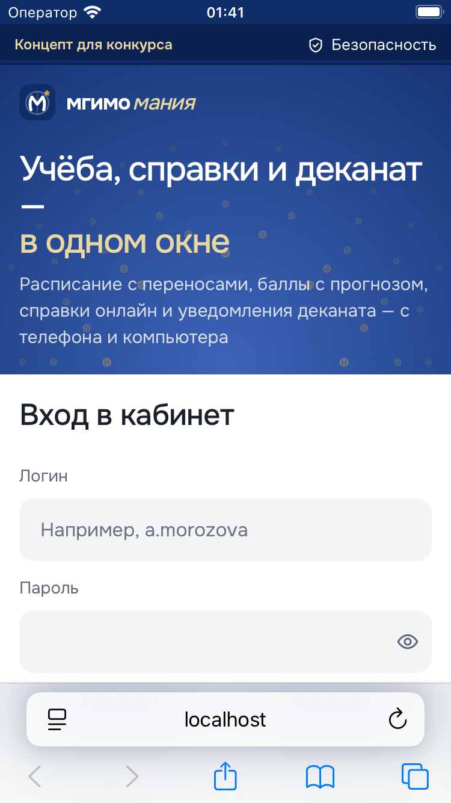
    <figcaption>Safari на iPhone SE, симулятор: до исправления аккаунтов на первом экране нет.</figcaption>
  </figure>
  <figure>
    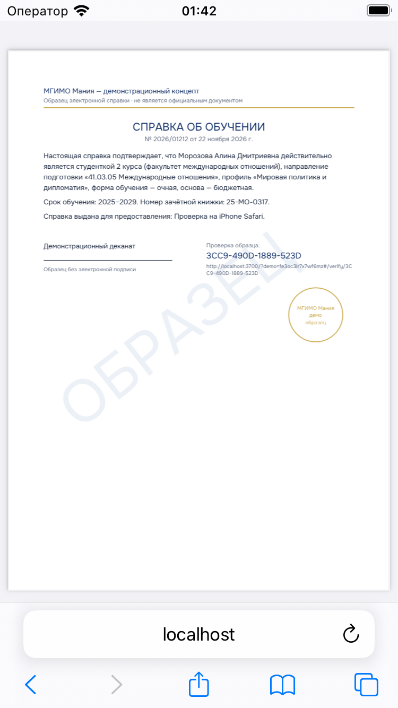
    <figcaption>Скачанная справка в Safari: кириллица и «Образец» видны.</figcaption>
  </figure>

### Итерация 22 ноября: вторая рецензия и одна правка целиком

Днём 22 ноября второй независимый проверяющий прислал восемь пунктов. Мы передали их Claude Code (Claude Opus 5.5)
вместе с таблицей повторного замера и словами **«выполняй их, если считаешь их нужными и что они реально смогут
поднять баллы за задания»**. Полное поручение — [review-2026-11-22/prompt.md](evidence/review-2026-11-22/prompt.md),
что сделано по каждому пункту — [README](evidence/review-2026-11-22/README.md). Повторный замер с пятью
участниками опроса провели мы (раздел 1). Одну правку разбираем целиком.

#### Пример 4. Ссылка проверки справки открывала кабинет проверяющего

- **Поручение (пункт 1, дословно).** «Отделить проверку справки от входа в демокабинет. Убрать ключ кабинета из PDF и со страницы справки. В чистом браузере ссылка и код должны подтверждать только документ, без подключения к кабинету.»
- **Находка.** Агент проверил по коду: ссылку с ключом 21 ноября написал он сам — в PDF и на странице справки адрес проверки имел вид `/?demo=<код кабинета>#/verify/<код справки>` (`e479e6c`, `99e71cb`). Адрес `/?demo=` ставит cookie кабинета, а демо-пароли опубликованы — значит, любой, кому показали PDF, входил в кабинет проверяющего и видел его заявки. Браузерный тест 21 ноября эту ссылку требовал: «ссылка из файла ведёт в этот же кабинет». Тем же чтением кода подтвердились проблемы из пункта 2: кабинет создавался до проверки пароля, три одновременных входа давали три кабинета, сброс работал без входа. Сверх рецензии агент нашёл, что лимит «20 в час» обходился параллельными запросами, а вытесненная из памяти база могла закрыться под идущим запросом (E-45, E-46)
- **Решение человека.** Какие пункты выполнять, мы оставили агенту — «если считаешь их нужными»; повторный замер провели сами. Отправка в GitHub и обновление стенда — только по нашему подтверждению, по правилу `AGENTS.md`
- **Коммит.** `2d22df1`: ссылка — `/#/verify/<код>`; кабинет справки сервер находит по указателю «код → кабинет», посетитель проверки cookie кабинета не получает; кабинет создаётся после верного пароля, одновременные входы из одного браузера ждут одно создание. Правило закреплено инвариантом 13 в `AGENTS.md`
- **Тест до и после.** Один и тот же `test/sandboxes.test.js`: на коде до правки (`13fb0bb`) проходят 4 из 13 — падают «проверка справки не открывает кабинет» и все проверки создания кабинета; после — 13 из 13 ([журналы](evidence/review-2026-11-22/)). В браузере `browser-review-1122.py`: человек в чистом браузере открывает ссылку из PDF, видит «Справка действительна» и остаётся без cookie кабинета; вход после этого открывает ему новый кабинет, а не кабинет владельца справки

  <figure>
    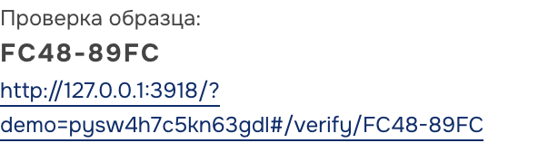
    <figcaption>До правки, <code>13fb0bb</code>: в ссылке — код демо-кабинета <code>?demo=…</code>.</figcaption>
  </figure>
  <figure>
    
    <figcaption>После правки, <code>1c65b31</code>: только код справки.</figcaption>
  </figure>

Остальные пункты второй рецензии:

| Пункт | Что сделано | Проверка |
|---|---|---|
| 2. Создание и сброс кабинетов | База — после верного пароля; три одновременных входа одного браузера — один кабинет; лимит не обходится параллельными запросами; сброс — из сеанса; два кабинета с одинаковыми логинами и перезапуск (`2d22df1`) | `sandboxes.test.js`, `browser-review-1122.py` |
| 3. Заявка без игры | Без игрового профиля заявка раньше сохранялась, а студент видел 404; теперь — номер и статус (`e229b32`, E-47) | `backend-regressions.test.js`, `browser-review-1122.py` |
| 4. Расписание и оценки | Карточка изменений на главной открывает пару (`aebbdb2`); «Сегодня занятия закончились в …» отдельно от «Сегодня пар нет» (`81fea7b`, E-48); «Сессия» без оценок — «Недостаточно данных для прогноза» (`e456f27`, E-49) | `today.test.js`, `grades-forecast.test.js`, браузер с подменёнными часами |
| 5. Повторный замер | Пятеро из 25 повторили задания; обе группы и разница у тех же людей — в разделе 1 | `survey-repeat-2026-11-22/` |
| 6. Телефоны и диктор | Без устройства проверены ошибка сети и потерянный ответ сервера: повтор не создаёт копию. Настоящие iPhone, Android и экранный диктор — наш шаг | `browser-review-1122.py` |
| 8. Одна версия | Один номер выпуска — на странице входа, в подвале, в `/api/health`, README, маршруте жюри и этом документе (`3fc1244`, `1c65b31`) | `release.test.js` |

<figure class="wide-shot">
  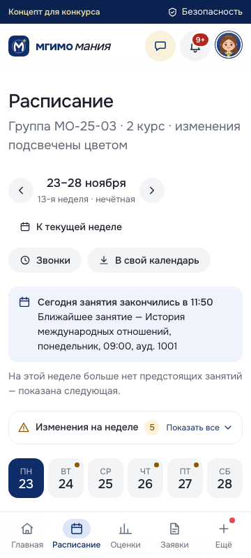
  <figcaption>Часы браузера подменены на вечер субботы после пар: раньше здесь было «Сегодня пар нет». Снимок прогона версии 1.1.1.</figcaption>
</figure>

### Проверка по критериям, 22 ноября, вечер

Мы попросили: **«проверь строго по критериям всю работу без учета контекста беседы»**. Агент взял критерии
из текста задания и проверял по коду, тестам, публичному стенду и снимкам экранов, а не по памяти. Главная
потеря — стенд на сборке 19 ноября; её закрывает только обновление стенда, это наш шаг. Остальное агент
исправил после нашего «Да, исправь»: обрезки текста на 360 px, которых не видели тесты ширины страницы (E-50),
перечень инструментов с IDE и сервисами, формулировки о версии стенда. Первый прогон после правок упал
на поиске в очереди деканата: нестабильный тест показал настоящую гонку в кабинете — ответ на прежний поиск
стирал набранный номер (E-51). Исправлено, неуспешная попытка сохранена рядом с успешной. Версия — 1.1.1.
Мы подтвердили то, что агент проверить не может: основной путь пройден на настоящих iPhone и Android, стенд
открывается из России без VPN, VPS оплачен до 28 ноября. Проход с экранным диктором решили не делать —
доступность проверена автоматически: клавиатура, фокус, контраст, роли и подписи.

## 10. Журналы и реальные снимки проверок

Каждая проверка запускается на новой временной базе, без пользовательских данных и без
внешнего ИИ: `python scripts/collect-evidence.py --output <папка>`. Сборщик сохраняет
журналы команд, JSON-отчёты и снимки экранов. Неуспешные попытки не удаляются: они лежат
рядом с успешными и показывают, что именно исправлялось.

### Текущая версия 1.1.1, 22 ноября

Итоговый прогон — из чистой копии репозитория: `git clone` на коммите `f6419db`, `npm ci` по lock-файлу,
затем все наборы на свежих временных базах: **115/115** автотестов и **604/604** браузерных проверок
в 18 наборах, без необработанных ошибок JavaScript. Наборы `browser-review-fixes` и `browser-review-1122`
шли с демо-кабинетами, как на стенде; внешние ключи ИИ отключены. [Сводка](evidence/release-1.1.1/run-summary.json)
содержит команды, время и SHA-256 проверенных исходников. Коммиты после `f6419db` меняют только
документы, PDF и ролик. Первая попытка прогона 1.1.1 (`d992b03`) упала на поиске в очереди деканата —
гонка в самом кабинете (E-51); она сохранена в [release-1.1.1-first-attempt](evidence/release-1.1.1-first-attempt/).

Таблица по 18 наборам со ссылками на журналы — в [приложении](PROCESS-APPENDIX.md#suites) и в [соответствии требованиям](CONTEST_AUDIT.md).

Первая попытка из чистой копии (20:14) остановилась на `browser-polish` из-за гонки в тесте (E-41) и сохранена
в [release-1121-first-attempt](evidence/release-1121-first-attempt/). Следующий прогон, [release-1121](evidence/release-1121/)
на коде `abaef02`, прошёл целиком; после правки отступа в расписании прогон повторён — [release-1121-final](evidence/release-1121-final/).
22 ноября после исправления входа на низких экранах (E-44) прогон повторён — [release-1122](evidence/release-1122/),
а после правки главной по итогам опроса — ещё раз: это итоговый.

<figure class="evidence-card">
  
  <figcaption>Фактический вывод запуска тестов. Карточка оформляет журнал, а не заменяет результат программы.</figcaption>
</figure>

<figure class="evidence-card">
  
  <figcaption>Результаты браузерных сценариев. Ширины и число проверок взяты из сохранённого запуска.</figcaption>
</figure>

### История проверок

| Когда | Что проверялось | Результат | Материалы |
|---|---|---|---|
| 8 ноября, первый аудит | API, сквозные сценарии, клавиатура и восстановление после ошибок | 30/30 автотестов, 111/111 браузерных проверок | [экраны](evidence/browser-results.json), [действия](evidence/browser-flows.json), [доступность](evidence/browser-accessibility.json) |
| 8 ноября, первая публикация | HTTPS-стенд; сохранение после перезапуска контейнера; возврат посетителей прежнего сайта | 117/117, заявка пережила перезапуск, миграция service worker 15/15 | [стенд](evidence/deployment/browser-results.json), [сохранение](evidence/deployment/production-persistence.json), [миграция](evidence/deployment/browser-migration.json) |
| 8 ноября, 20:23–20:28 | Компактные оценки и меню; публикация | 35/35 и 215/215 локально, 52/52 и 40/40 на HTTPS | [локально](evidence/quality-before/run-summary.json), [HTTPS](evidence/deployment/review-browser/browser-review.json) |
| 8 ноября, 20:57–21:00 | Главная, успеваемость, форма справки | 35/35 и 293/293 | [сводка](evidence/final/run-summary.json) |
| 8 ноября, 21:44–21:55 | «С чего начать», расписание; публикация | 35/35 и 367/367 локально*, 194/194 на HTTPS, живой ИИ 2/2 | [локально](evidence/finalization/run-summary.json), [HTTPS](evidence/deployment/finalization-browser/run-summary.json), [ИИ](evidence/deployment/finalization-ai.json) |
| 9 ноября | Доводка после независимого аудита | 37/37 и 381/381 | [сводка](evidence/polish/run-summary.json) |
| 9 ноября, окончательная проверка | Исправления реализации, вкладок, фокуса, контраста и мобильной главной | 42/42 и 492/492 | [сводка](evidence/quality-fixes/run-summary.json) |
| 19 ноября | Промпты библиотеки, выполненные субагентами Sonnet 5.5 | 73/73 и 523/523 | [сводка](evidence/release-1119/run-summary.json) |
| 21 ноября, 20:14 | Первая попытка из чистой копии, код `931f525` | остановлена на `browser-polish`: гонка в тесте (E-41) | [сводка](evidence/release-1121-first-attempt/run-summary.json) |
| 21 ноября, 20:19–20:24 | Чистая копия, код `abaef02`: правки рецензии | 100/100 и 562/562 | [сводка](evidence/release-1121/run-summary.json) |
| 21 ноября, 20:27–20:32 | Чистая копия, код `c37c69a` (до исправления входа, E-44) | 100/100 и 562/562 | [сводка](evidence/release-1121-final/run-summary.json) |
| 21 ноября | Нагрузка на локальном сервере, 10–100 пользователей без пауз | около 2 750 запросов в секунду, 0 ошибок | [замер](evidence/load-2026-11-21/) |
| 22 ноября | Safari на iPhone SE в симуляторе iOS | PDF, форма с клавиатурой, вход; найдено E-44 | [снимки](evidence/ios-simulator-2026-11-22/) |
| 22 ноября, 01:51–01:56 | Чистая копия, код `9e7baad`: вход на низких экранах | 100/100 и 568/568 | [сводка](evidence/release-1122/run-summary.json) |
| 22 ноября | Опрос 25 студентов | самооценка лёгкости заданий с телефона 4,4 из 5; трудными назвали риск по дисциплине и перенос пары, по 3 из 25 | [ответы и расчёт](evidence/survey-2026-11-22/) |
| 22 ноября, 14:24–14:29 | Чистая копия, код `4209326`: причина риска на главной | 101/101 и 570/570 | [сводка](evidence/release-1122-final/run-summary.json) |
| 22 ноября | Повторный замер на исправленной главной: пятеро из тех же 25 | самооценка лёгкости у них 3,2 → 4,4 | [ответы и расчёт](evidence/survey-repeat-2026-11-22/) |
| 22 ноября, 16:38–16:42 | Чистая копия, выпуск 1.1.0 (`1c65b31`): правки второй рецензии | 115/115 и 599/599 | [сводка](evidence/release-1.1.0/run-summary.json) |
| 22 ноября, 20:29–20:33 | Первая попытка 1.1.1, код `d992b03` | остановлена на `browser-review-fixes`: гонка в поиске деканата (E-51) | [журналы](evidence/release-1.1.1-first-attempt/) |
| 22 ноября, 20:37–20:42 | Чистая копия, версия 1.1.1 (`f6419db`): обрезки на 360 px после проверки по критериям | 115/115 и 604/604 | [сводка](evidence/release-1.1.1/run-summary.json) |

\* 333 проверки общего запуска и 34 проверки повтора одного сценария после исправления
ожидания в тесте. Неуспешные попытки сохранены в `evidence/finalization-first-attempt/`,
`finalization-schedule-attempt/`, `finalization-first-actions-attempt/`,
`finalization-first-actions-retry/` и `deployment/review-browser/browser-review-first-attempt.json`.
Во всех этих случаях ошибкой было ожидание в тесте, а не поведение кабинета.

В PDF вложены полные журналы и JSON-отчёты, экспорт истории Git
и записи поручений субагентам. Вложения открываются в PDF-ридере с поддержкой
прикреплённых файлов; те же файлы лежат рядом с документом в репозитории. Карточки журналов
создаются скриптом `scripts/render-process-evidence.py`.

Полное соответствие стандартам доступности не заявляется, нагрузка замерена только локально:
у каждой проверки есть конкретные границы, они описаны в [CONTEST_AUDIT.md](CONTEST_AUDIT.md).

## 11. Инструменты и вклад человека

| Инструмент или технология | Задача | Связанный результат и материалы |
|---|---|---|
| Claude Code в приложении Claude (модель Claude Opus 5.5) | 4 ноября — первая версия кабинета по тексту задания: структура, сервер, интерфейс, собственный знак, SVG-графика, кампус, игра и вымышленные демо-данные, самопроверка во встроенном браузере; 9 ноября — независимый аудит по критериям и доводка; 21 ноября — чистка материалов и видео, вечером — 15 пунктов независимого проверяющего (десять закрыты целиком, в пяти — его часть); 22 ноября — восемь пунктов второго проверяющего, в том числе исправление пяти своих ошибок 21 ноября | Журнал сессии 4 ноября (раздел 2); итерации 9, 19, 21 и 22 ноября (разделы 3 и 9); поручения — `docs/evidence/review-2026-11-21/` и `docs/evidence/review-2026-11-22/` |
| Codex и субагенты | Аудит, исправления, браузерные проверки, интеграция и документы | Инструкции `AGENTS.md`, поручения в `review-session.json` и `quality-session.json`, регрессии и сравнение мобильной версии до/после |
| Claude Code: субагенты Claude Sonnet 5.5 | 19 ноября — промпты библиотеки как настоящие задачи: О-9, П-09, повторные прогоны девяти промптов, исправления по их находкам, независимый аудит П-28 | Поручения и ответы в `docs/evidence/subagents-2026-11-19/`; раздел 3 |
| Комплект файлов для агентов | Единые правила для всех агентов проекта: инварианты с тестами, узкие роли субагентов, команды, журналы | `AGENTS.md`, `CLAUDE.md`, `QWEN.md`, `.claude/`, `docs/ai/` |
| ChatGPT (gpt-image) | Изображения «диалогов» для ранней версии описания процесса | Удалены как не соответствующие действительности; запись E-11 в `docs/ai/ERRORS.md` |
| OpenRouter | Ответы помощника по учебным данным вошедшего студента | `server/routes/assistant.js`, `domain/assistant.js`; сохранённые живые запросы двух аккаунтов и тесты резервного ответа |
| Anthropic SDK | Альтернативный серверный провайдер помощника | Зависимость и реализация в коде; сохранённые живые проверки относятся к OpenRouter |
| PowerShell, Git, ripgrep | Чтение проекта, поиск, история и запуск команд | Исходники, история Git и команды проверки |
| Node.js, SQLite, `node:test` | Приложение, данные и автоматические тесты | `package.json`, `server/`, `test/` |
| Python, Playwright, Chromium | Проверка браузерных сценариев, снимки, подготовка PDF, запись видео | Тестовые сценарии, скрипты сборки документа, `scripts/demo/record-demo.py` |
| AVFoundation (macOS) | Сборка видео-демонстрации из кадров записи | `scripts/demo/encode-demo.swift`, `docs/video/demo-mobile.mp4` |
| `pdf-lib`, `@pdf-lib/fontkit`, fontTools | PDF справки на сервере и шрифт для него | `server/domain/documentPdf.js`, `scripts/build-pdf-font.py`, ADR-013 |
| SVG, Canvas, CSS | Собственная графика, игровые сцены и оформление | `public/js/art/`, `public/js/campus/`, `public/js/game/`, `public/css/` |
| Onest / Google Fonts | Локальный шрифт интерфейса | Файлы шрифта и лицензия OFL в репозитории |
| Docker Compose и Caddy на VPS | Размещение стенда и HTTPS (сертификат Let's Encrypt) | `deploy/`, `Dockerfile`, протоколы публикации в `docs/evidence/deployment/` |
| Среда разработки (IDE) | Отдельной IDE в журналах проекта нет: код писали, запускали и проверяли агенты — Claude Code в приложении Claude (правка файлов, терминал, встроенный браузер) и Codex с субагентами; команды — PowerShell на Windows и терминал macOS | Журналы сессий (разделы 2–3), `docs/ai/PROMPTS_LOG.md` |
| GitHub | Репозиторий, история коммитов, открытый доступ жюри к коду, PDF и ролику | https://github.com/temurysega/vibe_code |
| Google Forms и Google Таблицы | Опрос 25 однокурсников и повторный замер; ответы выгружены в CSV без имён и почты | `docs/evidence/survey-2026-11-22/`, `docs/evidence/survey-repeat-2026-11-22/` |
| Xcode: симулятор iOS | Проверка PDF, формы с экранной клавиатурой и входа в Safari на iPhone SE (iOS 18.1) | `docs/evidence/ios-simulator-2026-11-22/` |

Claude Code работал в приложении Claude со встроенным браузером для самопроверки и
с субагентами Sonnet 5.5, Codex — с субагентами, между которыми заранее делилось владение
файлами. Таблица связывает инструменты с задачами и конкретными результатами.
`QWEN.md` в комплекте — точка входа для Qwen Code на будущее: в истории этой версии
он не подтверждён, поэтому в таблице его нет.

Мы определяли цель и ограничения, передавали требования, выбирали направление
развития, давали обратную связь и настройки для публикации. 21 ноября мы передали агенту
рецензию и решили объём правок; согласие на новую зависимость, обновление стенда, опрос
однокурсников и проверку на настоящих телефонах оставили за собой. 22 ноября передали вторую
рецензию, а повторный замер с пятью участниками опроса провели сами. Ассистенты читали и меняли
файлы, запускали команды и тесты, готовили материалы. Кабинет попробовали два студента;
их замечание о непонятном первом действии привело к доработке начальных подсказок.
Потом прошли опрос 25 студентов и повторный замер у пятерых (раздел 1); замеров времени у нас нет —
только самооценка.

Сторонние материалы перечислены в [THIRD_PARTY.md](../THIRD_PARTY.md). В процессе
проверки исправлена ошибочная запись лицензии SDK Anthropic: установленный пакет
использует Apache-2.0. Код проекта распространяется под MIT, шрифт Onest — под OFL.

## 12. Что демонстрирует прототип

«МГИМО Мания» показывает законченный путь: войти под вымышленным студентом, увидеть
учебную ситуацию, подать заявление, обработать его в деканате и вернуться к результату.
Мобильный кабинет выполняет те же основные задачи. Собственные графика и игровые
элементы формируют образ продукта, а помощник позволяет задать вопрос по учебным данным.

Для демонстрации подготовлены три разных студента и сотрудник деканата. Общий пароль
`mgimo2026` предназначен только для этих публичных вымышленных аккаунтов.

| Логин | Что показать |
|---|---|
| `a.morozova` | Учебный риск, изменения пар и справки студентки МО |
| `t.aliev` | Другой факультет, профиль первокурсника и первый заказ справки |
| `k.lebedeva` | Академический долг и запись на пересдачу |
| `dekanat.mo` | Очередь заявок своего факультета и решение по заявлению |

### Самостоятельный проход

1. Под Алиной открыть учебный риск и новую электронную справку, отправить форму
   и сохранить адрес её карточки. После обновления страницы данные остаются.
2. Открыть ссылку «Ваш демо-кабинет» в приватном окне, войти как деканат, найти эту заявку
   по номеру, взять в работу, оставить комментарий и отметить готовность. У Алины открыть
   уведомление, историю и документ и скачать PDF.
3. Выйти, войти как Тимур и открыть сохранённый адрес: чужая заявка недоступна.
   В новой форме должны быть данные Тимура. Ксения показывает другой путь — от долга
   в зачётке к форме пересдачи.

Встроенный «Демо-тур» знакомит с экранами. [Маршрут жюри](JURY_GUIDE.md) дополняет его
полным циклом с двумя ролями, названиями кнопок и ожидаемыми результатами.

**Материалы, которые можно проверить:** исходники, метаданные Git, комплект файлов для
ИИ-агентов, журнал промптов и ошибок, диалоги с субагентами 19 ноября, методичка промптов,
снимки интерфейса, автоматические и браузерные сценарии, сохранённые журналы и пример
демонстрационного документа.
Видео-демонстрация с мобильного экрана (2:11, версия 1.1.1) — [docs/video/demo-mobile.mp4](video/demo-mobile.mp4);
её записал сценарий `scripts/demo/record-demo.py`.
