# Как мы создали «МГИМО Манию»

## Цифровой деканат будущего

**История конкурсного прототипа: от учебных задач до работающего кабинета.**

9 ноября 2026 года · Москва

Учёба, документы и связь с деканатом в одном месте. Собственный визуальный стиль,
мобильные сценарии, игровой кампус и помощник по данным студента.

**«МГИМО Мания» — конкурсный концепт, а не официальный сервис МГИМО. Все персонажи,
оценки, группы, документы и учебные ситуации вымышлены.**

Прототип: [ai.neblanki.tech](https://ai.neblanki.tech/). 
Исходники: [temurysega/vibe_code](https://github.com/temurysega/vibe_code).

**Как читать документ.** Для знакомства с продуктом достаточно раздела 1 и
[короткого маршрута жюри](JURY_GUIDE.md). Разделы 2–3 показывают работу с ИИ,
раздел 9 — найденные ошибки и доработки, раздел 10 — результаты конкретных запусков.
Шаблоны промптов на будущее собраны отдельно — в [методичке](prompts/README.md).

<figure class="cover-shot">
  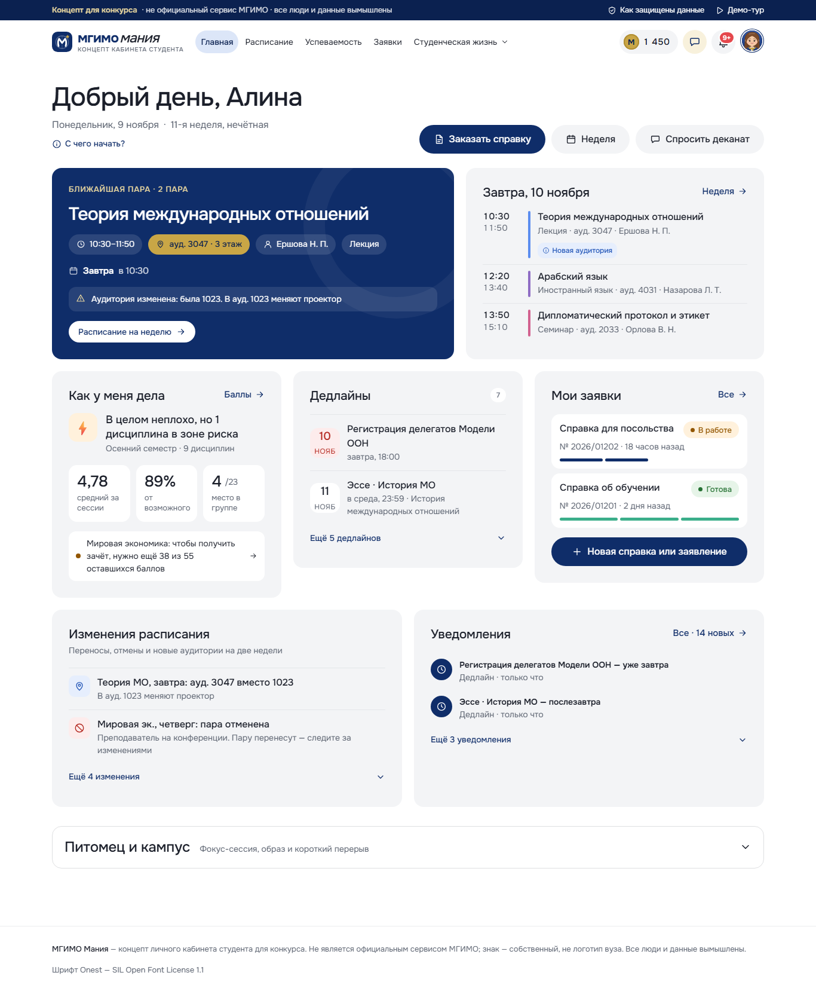
  <figcaption>Главная текущей итерации. Снимок отдельного локального прогона из evidence/quality-fixes.</figcaption>
</figure>

## 1. С какой задачи мы начали

Студенту обычно приходится собирать учебную жизнь по частям: искать расписание,
проверять оценки в другой системе, выяснять порядок получения справки и следить
за объявлениями в чатах. Мы хотели собрать эти действия вокруг одного человека
и одного понятного вопроса: **«Что мне нужно знать и сделать сейчас?»**

Поэтому ядром проекта стали пять связанных задач. В профиле хранятся данные для
заявления. Изменение пары появляется и в расписании, и в уведомлениях. Учебный риск
объясняется через баллы и следующий шаг. Заявка не заканчивается сообщением
«отправлено»: студент видит её движение и результат решения деканата.

### Гипотезы продукта и границы проверки

Технический тест подтверждает действие приложения. Понимает ли его студент и стало ли
ему удобнее, нужно проверять отдельно. Поэтому для каждой идеи фиксируем оба вопроса.

| Гипотеза | Решение в прототипе | Что подтверждено проверками | Что проверить со студентами |
|---|---|---|---|
| Явный первый шаг помогает перейти от знакомства к действию | Кнопка «С чего начать» открывает диалог: расписание, оценки и справки; эти действия доступны и при первом знакомстве | Отдельные браузерные повторы — по 34/34. Со слов автора, два студента прежней версии не сразу нашли первое действие | Стало ли понятно первое действие без подсказки? Повторная проверка после правок ещё не проведена |
| При коротком визите важнее ближайшая пара и изменения | Главная с ближайшим занятием; день и неделя с аудиторией и переносами | Переходы, разные дни, экспорт календаря и экран 360 px | Найдёт ли человек нужную аудиторию и заметит ли перенос без подсказки? |
| Баллы полезнее, когда понятен следующий шаг | Порог, недостающие баллы и подробности дисциплины; переход к пересдаче | Формулы расчёта, фильтр риска, открытие подробностей | Сможет ли студент своими словами объяснить риск и выбрать действие? |
| Прозрачный статус сокращает неопределённость после заявления | Форма → решение сотрудника → история → уведомление → образец документа | Полный путь двух ролей, сохранение полей, получение документа | Понятно ли, кто сейчас обрабатывает заявку и что делать после готовности? |
| Объявление полезнее, когда ведёт к предмету сообщения | Персональные уведомления со ссылкой на заявку или расписание | Переход к нужной заявке, адресаты, сохранение прочитанного | Различает ли человек общую новость и событие, требующее его действия? |
| Необязательный игровой слой придаёт кабинету характер | Питомец, фокус-сессии и кампус; учебные разделы доступны напрямую | Наличие отдельных маршрутов; учебный путь проходит без игры | Помогает ли этот слой возвращаться в кабинет или отвлекает от основной задачи? |

Источники технических проверок: `domain.test.js`, `security.test.js`,
`backend-regressions.test.js`, `browser-flows.py`, `browser-accessibility.py`
и `browser-home-priority.py`. Даты и результаты конкретных запусков — в разделе 10.
Изоляция аккаунтов является обязательным требованием: сервер проверяет владельца,
а при смене входа форма и помощник получают данные нового студента.

Проблема взята из конкурсного задания. По уточнению автора, кабинет попробовали
**два студента**. Обоим было понятно назначение сервиса и его возможности, но при переходе
от знакомства к действию они не сразу поняли, с чего начать и куда нажать дальше.
Оба в итоге разобрались. Имена участников не публикуются; исходные анкеты и измерения
времени выполнения задач не представлены. Это качественная обратная связь со слов автора.

По этому замечанию реализована заметная кнопка «С чего начать» на главной. Она открывает
диалог с прямыми переходами к расписанию, оценкам и справкам; его можно закрыть.
При первом знакомстве эти действия заменили единственное предложение настроить аватар.
Техническая проверка описана ниже. Повторное пользовательское тестирование после
изменений не проводилось.

Следующая проверка с участниками должна использовать четыре задания без подсказок:
найти изменённую пару, объяснить учебный риск, заказать справку и найти готовый документ.
Для каждого задания нужно записать успех, места затруднений, время и слова участника;
после основного пути отдельно спросить о пользе игрового слоя. Этот план пока не является
результатом исследования. Автоматические проверки и уменьшение высоты страницы
не доказывают сокращение времени выполнения задачи студентом.

Вторая часть идеи — ощущение собственного студенческого пространства. Аватар, питомец,
виртуальный кампус и короткая игра дают кабинету характер. При этом расписание и справки
доступны через обычную навигацию: для учебных действий не требуется играть или копить монеты.
Связь игрового слоя с вовлечённостью — гипотеза концепта, а не доказанный образовательный эффект.

Статус справки в демо может меняться автоматически, но проверенный сквозной сценарий
использует действие сотрудника: оно записывается в историю и вызывает уведомление студенту.
Так короткая демонстрация дополняется полноценным взаимодействием двух ролей.

## 2. Из чего складывается эта история

Кабинет написали **Claude Code** и **Codex** — это видно по истории Git, журналам запусков
и записям сессий. Документ опирается на то, что можно проверить в проекте: историю Git,
исходники, сохранённые результаты запусков и снимки браузера.

| Источник | Что он позволяет установить |
|---|---|
| Сведения автора | Автор ставил задачу и принимал решения о развитии проекта |
| Git | Состав и зафиксированную последовательность изменений, даты записей и атрибуцию соавторства |
| Исходники | Как устроены сценарии, защита, интерфейс и интеграция помощника |
| Журналы и реальные снимки | Что было выполнено в конкретном запуске и как выглядел проверенный экран |
| Дословные просьбы автора | Короткие постановки 8–9 ноября, сохранённые в записях сессий `docs/evidence/*-session.json` |
| Журнал промптов | [docs/ai/PROMPTS_LOG.md](ai/PROMPTS_LOG.md): постановки с указанием происхождения — оригинал, выдержка или реконструкция |
| Диалоги с субагентами 19 ноября | Промпты методички, выполненные по-настоящему: поручение → ответ → изменение в проекте ([папка](evidence/subagents-2026-11-19/)) |
| Методичка промптов | [docs/prompts/](prompts/README.md): промпты по этапам, поручения субагентам и промпты-коррекции. Написана после создания прототипа по его коду и журналам — это методичка, а не журнал |

**Чего в документе нет.** Ответы ассистентов на ранние постановки 4 ноября не сохранились,
поэтому «восстановленных» диалогов того времени здесь нет. Ранняя версия документа содержала
четыре изображения диалогов, созданные ChatGPT (в PNG есть метаданные C2PA: ChatGPT, gpt-image),
и подписывала их как скриншоты переписки; в записях сессий 8 ноября эта подпись сохранилась
как историческая цитата. На признаки генерации указала ИИ-проверка материалов: у всех четырёх
файлов одинаковый размер 1536×1024 и вес около 1,6 МБ, а рамка окна — macOS, хотя работа шла
в Windows. Отчёт той проверки остался в чате, поэтому её дата не подтверждена; сборка PDF
9 ноября изображения ещё содержала. 19 ноября мы проверили метаданные C2PA и удалили файлы —
см. запись E-11 в [журнале ошибок](ai/ERRORS.md).

### Что просил автор и что сделали агенты

| Дословная просьба автора | Кто выполнял | Что получилось | Источник |
|---|---|---|---|
| «вот фотки подставь их ну вот и подними все до 10» | Codex и три субагента: документы, интерфейс, публикация | Компактная успеваемость с фильтром риска, меню «Студенческая жизнь», публикация сборки `review-b27684eaebf8` | [review-session.json](evidence/review-session.json) |
| «подними все до 10 и запуш все» | Codex и субагенты: главная, успеваемость, документы | Главная без дублей с быстрыми действиями, компактная форма справки, маршрут жюри | [quality-session.json](evidence/quality-session.json) |
| «давай вот все поправим и зальем сайт и на github тоже все зальем» | Codex: основной агент и субагенты расписания, публикации и документов | «С чего начать», читаемое расписание, публикация `review-21595807feaf`, 194/194 проверки на HTTPS | [finalization-session.json](evidence/finalization-session.json) |
| «проверь по критериям все что написано… все что сделал», затем «давай все правки сделаем чтобы дотянуть до 10» | Claude Code (Claude Opus 5.5) | Независимый аудит и восемь исправлений с регрессиями (раздел 9) | Коммиты `0e3d1c3`…`645b5c5` |
| «вот промпты которые использовались… обращайся к подагенту… sonnet… делаешь скрины… пушить не забываешь» | Claude Code и субагенты Claude Sonnet 5.5, 18–19 ноября | Промпты методички выполнены по-настоящему, комплект файлов для агентов, диалоги — ниже в разделе 3 | [subagents-2026-11-19/](evidence/subagents-2026-11-19/) |

Короткие просьбы сработали потому, что агенты сами восстанавливали контекст из кода,
`AGENTS.md` и критериев. Как такие просьбы стоило формулировать полностью — в
[методичке](prompts/00-principles.md), раздел «Было → стало».

### Как шла работа: журналы сессий

Первая версия кабинета создана за одну сессию **Claude Code в приложении Claude**
(модель Claude Opus 5.5) **4 ноября, 20:49–22:13 МСК**. Стартовым промптом был полный
текст конкурсного задания. Дальше агент работал сам: создал 89 файлов, внёс 50 правок,
выполнил 39 команд и около 75 действий во встроенном браузере — открывал разделы кабинета,
проходил сценарии и проверял вёрстку на экране 360 px. Через веб-поиск агент уточнил
фирменные цвета МГИМО, список факультетов и 100-балльную систему оценивания.

8 ноября проект проверяли и дорабатывали в **Codex**: сохранился 31 журнал сессий —
основные сессии и сессии субагентов — с 46 постановками задач от автора и от основного
агента субагентам. Из этих сессий взяты поручения и результаты, описанные в разделах 3 и 9.
Журналы хранятся у автора локально и в репозиторий целиком не входят: в них есть служебные
данные сервера.

### Что показывает история Git

Коммиты **4 ноября не отражают хронологию работы**. В конце той же сессии агент написал
скрипт, который разложил готовый код на **629 последовательных коммитов** по файлам
и функциям, сверил итоговое дерево с резервной копией и отправил историю в GitHub.
Все 629 коммитов созданы за 2 минуты 21 секунду (22:09:47–22:12:08). Поэтому они
показывают устройство кода — от каркаса и модели данных к логике и интерфейсу, —
а не время, потраченное на каждую часть. В них есть трейлер `Co-Authored-By` с именем
Claude; это атрибуция в репозитории, а не независимое подтверждение текста промптов.

Начиная с **8 ноября** каждый коммит — отдельная реальная итерация: аудит и исправления,
интеграция OpenRouter, публикация, возврат посетителей прежнего сайта, доработка интерфейса.
Полный экспорт — в [git-history.json](evidence/history/git-history.json).

| Этап | Примеры коммитов | Что можно увидеть в проекте |
|---|---|---|
| Устройство кода, разложенное 4 ноября | `9c74eef`, `832c17b`, `5b9088a`, `aea48ab` | Каркас Node.js, схема SQLite, расписание, успеваемость, заявки, стили |
| Аудит и доработка, 8 ноября | `00882b7` | Исправления сценариев, интеграция OpenRouter, тесты и документы |
| Публикация, 8 ноября | `969bdf4`, `2e48826` | Конфигурация сервиса и результаты приёмки |
| Возврат посетителей прежнего сайта, 8 ноября | `6376d05`, `e3ac392` | Исправление старого офлайн-кеша и браузерный сценарий |
| Доработка по критериям, 8–9 ноября | `19e9672`, `0e3d1c3`, `a1aff22` | Первые действия, мобильный интерфейс, ограничения демо-стенда |

<figure class="evidence-card">
  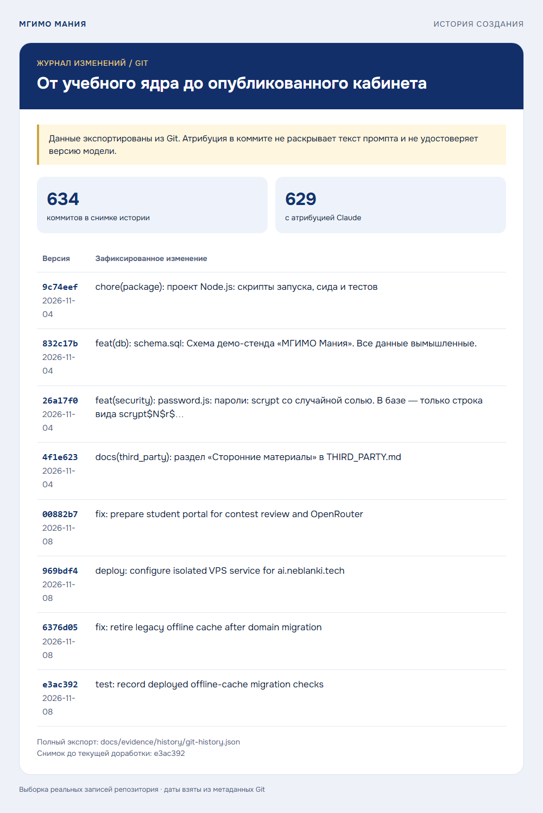
  <figcaption>Визуализация метаданных Git. Первичный источник — экспорт истории репозитория, а не восстановленный чат.</figcaption>
</figure>

## 3. Как распределялась работа с ИИ

Роль автора состояла в выборе задачи и продукта, передаче критериев конкурса,
обратной связи по результатам и решениях о демонстрации. В подтверждённом позднем
этапе автор предложил OpenRouter, предоставил настройки доступа к провайдеру,
отложил необязательный ролик и сообщил, когда после публикации открылся старый сайт.
Ключи и другие секреты в этот документ не включаются.

Codex использовался для согласованной работы над кодом, проверками и материалами.
Работа была разделена между основным ассистентом и тремя направлениями субагентов.

| Направление | Задача | Проверяемый результат |
|---|---|---|
| Основной ассистент | Сопоставить проект с заданием, распределить файлы и проверить интеграцию | `AGENTS.md`, скрипт `collect-evidence.py`, общий журнал `run-summary.json` |
| Сервер и безопасность | Проверить доступ, заявки, сеансы, сохранение и ошибки | `server/routes/`, `server/security/`; регрессии персональных дедлайнов, параллельного входа и дат в `backend-regressions.test.js` |
| Интерфейс | Пройти основные экраны, мобильные сценарии, клавиатуру и смену аккаунта | `public/`; очистка состояния после выхода, восстановление после ошибки, браузерные сценарии и снимки |
| Документы | Сверить описание с кодом, уточнить лицензии и собрать историю | `PROCESS.md`, `THIRD_PARTY.md`, `SUBMISSION.md`; реальные диалоги, команды и результаты по этапам |

В `AGENTS.md` сначала было шесть инвариантов; 19 ноября комплект для агентов расширил их до 12,
и у каждого теперь указан тест, который его охраняет. Там же структура каталогов и правила проверки.
Например, пользователя определяет серверная сессия; смена аккаунта очищает кеши;
основной кабинет работает без внешнего ИИ; новые заявки сохраняются после перезапуска.
Перед параллельными правками распределяется владение файлами.

В сохранённом описании позднего этапа приведены конкретные выдержки задач:

> «Проверь изоляцию минимум двух студентов, роли деканата, сессии/CSRF, основные сценарии
> заявок и расписания, персистентность, ошибки; запускай имеющиеся тесты».

> «Проверь сценарии login/profile/schedule/grades/requests/notifications, мобильные 360px,
> доступность, ошибки/пустые состояния, явную маркировку конкурсного концепта/вымышленных данных».

Полные тексты поручений субагентам 19 ноября — ниже в этом разделе и в папке
[briefs/](evidence/subagents-2026-11-19/briefs/).

### 19 ноября: промпты библиотеки, выполненные субагентами

Автор передал основному агенту — Claude Code (Claude Opus 5.5) — библиотеку промптов команды
([docs/prompts/](prompts/README.md)) и попросил: «обращайся к подагенту то есть к sonnet…
делаешь скрины… пушить не забываешь». Основной агент не стал пересказывать промпты, а отдал их
субагентам **Claude Sonnet 5.5** как настоящие задачи на этом проекте. Поэтому ниже —
не реконструкции, а реальные диалоги: поручение, ответ субагента и изменение в репозитории.

Как устроена работа:

- **Общие правила** для всех субагентов — один файл
  ([00-common.md](evidence/subagents-2026-11-19/briefs/00-common.md)): свои файлы, без коммитов,
  пушей и публикации, только временная база, без входа паролями на публичный стенд, факты
  отдельно от непроверенного, отчёт «Сделано / Как проверено / Не проверено / Предложения».
- **Поручение — файл.** Каждому субагенту основной агент передавал путь к поручению; эти файлы
  сохранены без изменений в [briefs/](evidence/subagents-2026-11-19/briefs/). Ответ — последнее
  сообщение субагента из журнала сессии, тоже без правок: `<имя>.json` рядом.
- **Владение файлами** назначено до запуска, поэтому субагенты работали параллельно
  и ни разу не правили один файл.
- **Коммит после каждого шага**: исправление, проверка, пуш.

| Субагент | Промпт библиотеки | Что сделал | Как проверено | Коммит |
|---|---|---|---|---|
| A · ошибки ИИ | О-9 «Найди все следы» | Нашёл все упоминания QR и исправил единственное обещание пользователю: квиз «Первые шаги» обещал справку «с QR-кодом» | Новый `test/qr-mentions.test.js` падал 2 из 5 до правки; снимки квиза до и после | `fe1191c` |
| D1 · повторный прогон | П-01, П-04, П-05, П-08 | Ответил на промпты исследования, концепции, спецификации и модели угроз и сверил каждый ответ с кодом | Только чтение; находка по П-08 → поручение F | `0706409` |
| D2 · повторный прогон | П-10, П-20, П-23, П-27, П-36 | Ответил на промпты дизайна, заявок, ИИ-помощника, проверки со студентами и сценария видео | Только чтение; находка по П-10 → поручение G | `0706409` |
| F · безопасность | продолжение П-08 | Тест внедрения разметки через объявление и комментарий, тест ключей во всей истории Git, тест cookie `__Host-` в боевом режиме | 21 браузерная проверка XSS; каждый тест падал на нарочно сломанной копии | `6616890` |
| G · дизайн | продолжение П-10 | Текст подсказок, зачёркнутой аудитории и «нет баллов» был 2,17–2,39:1 — стал 4,51–4,96:1; белый на красном 3,91 → 6,54:1 | `scripts/check-contrast.py`, `test/contrast.test.js` (24 проверки), снимки до и после | `3aff3bb` |
| E · документы | по README библиотеки | Перенёс библиотеку в `docs/prompts/` с пометкой происхождения, исправил 16 неверных утверждений, сверил 40 хешей коммитов | Скрипт проверки ссылок | `89748f4` |
| C · файлы для агентов | П-09 «Собери комплект для агентов» | `AGENTS.md`, `CLAUDE.md`, `QWEN.md`, шесть субагентов и три команды в `.claude/`, `docs/ai/` | Пробный прогон комплекта на задаче и сверка каждой ссылки | `89748f4` |
| B · независимый аудит | П-28 «Независимый аудит „свежим“ агентом» | Проверил итоговое состояние как эксперт: девять находок — от доступа к репозиторию и устаревшего PDF до первого экрана входа на телефоне | Тесты, API-пробы изоляции, свой браузерный маршрут на 360 и 1366 px, сверка архива с Git | `babcd1d` и поручение H |
| H · интерфейс | находка аудита П-28 | На телефоне кнопки тестовых аккаунтов попали в первый экран (кнопка поднялась с 976 до 730 px), уведомление о входе закрывается нажатием и держится 2,8 с | `test/browser-mobile-entry.py`: 16/16, на старом коде 12/16; снимки до и после | `c8955dc` |

**Цепочка, ради которой это делалось.** Промпт → ответ → сверка с кодом → находка → новое
поручение → исправление → тест. Ответ на П-08 показал, что экранирование объявлений описано,
но не проверено, — субагент F написал браузерный сценарий XSS. Ответ на П-10 посчитал контраст
токенов и нашёл серый текст 2,39:1 — субагент G исправил цвет и закрепил его тестом. Так промпты
библиотеки проверили не только себя, но и проект.

**Что пошло не так.** Первый запуск пяти субагентов 18 ноября упал сразу с ошибкой API
(аккаунт требовал подтверждения). На следующий день четыре субагента с максимальным усилием
упёрлись в пятичасовой лимит Sonnet; их перезапустили с усилием medium по просьбе автора.
Ошибку в поручениях допустил и основной агент: в них стояла дата «18 ноября», хотя настоящие
запуски прошли 19-го. Тексты поручений сохранены как есть, а даты в документах исправлены.

**Диалоги.** Карточки — не снимки экрана ассистента: их отрисовывает скрипт `scripts/render-dialogue-cards.py` из сохранённого текста поручения и ответа субагента. Длинные тексты в карточке сокращены с пометкой; полный текст обоих — в JSON рядом с изображением.

<figure class="prompt-card">
  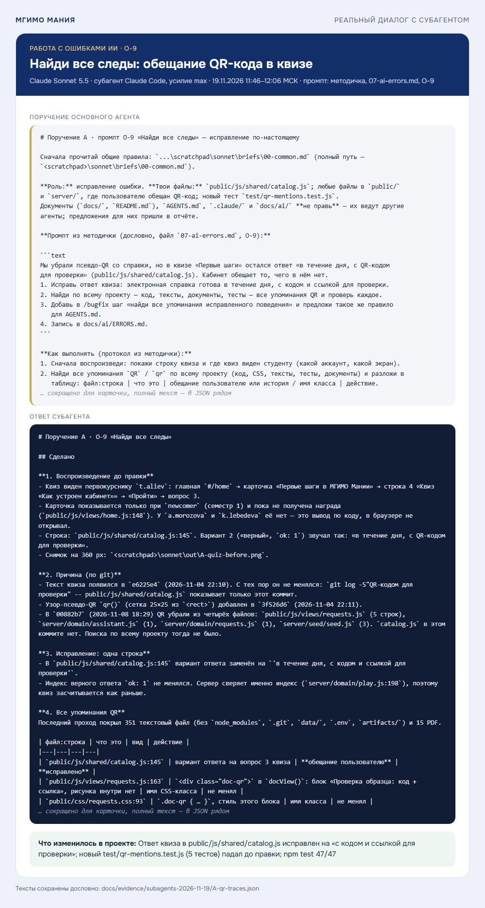
  <figcaption>Субагент A, промпт О-9: найти все следы исправленного поведения. Итог — `fe1191c`.</figcaption>
</figure>

  <figure>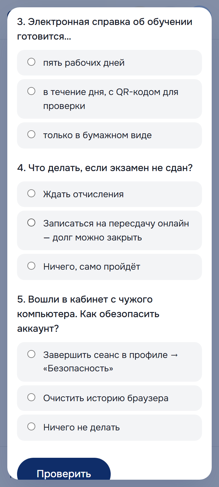<figcaption>До: квиз обещает «QR-код», которого в кабинете нет.</figcaption></figure>
  <figure>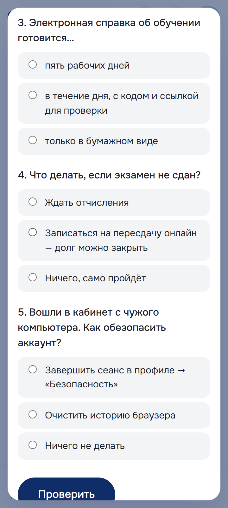<figcaption>После: «с кодом и ссылкой для проверки» — так, как работает справка.</figcaption></figure>

<figure class="prompt-card">
  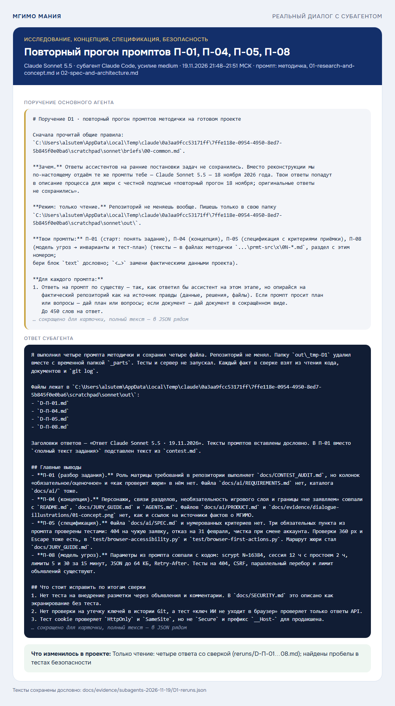
  <figcaption>Субагент D1: четыре промпта ранних этапов и сверка ответа с кодом. Ответы — в `reruns/`.</figcaption>
</figure>

<figure class="prompt-card">
  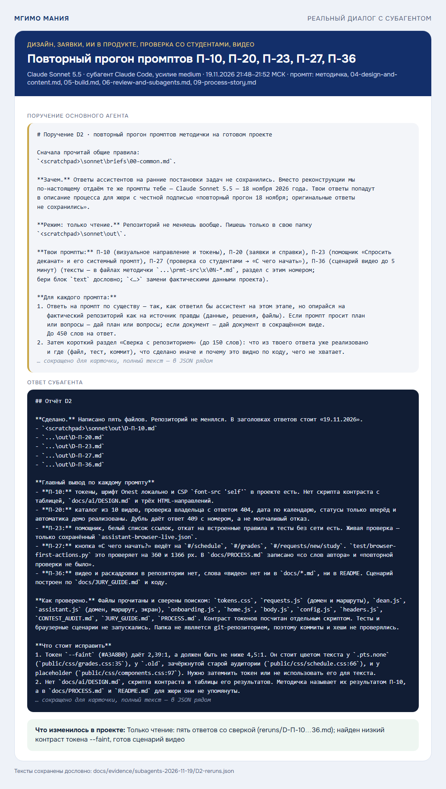
  <figcaption>Субагент D2: дизайн, заявки, ИИ-помощник, проверка со студентами и сценарий видео.</figcaption>
</figure>

<figure class="prompt-card">
  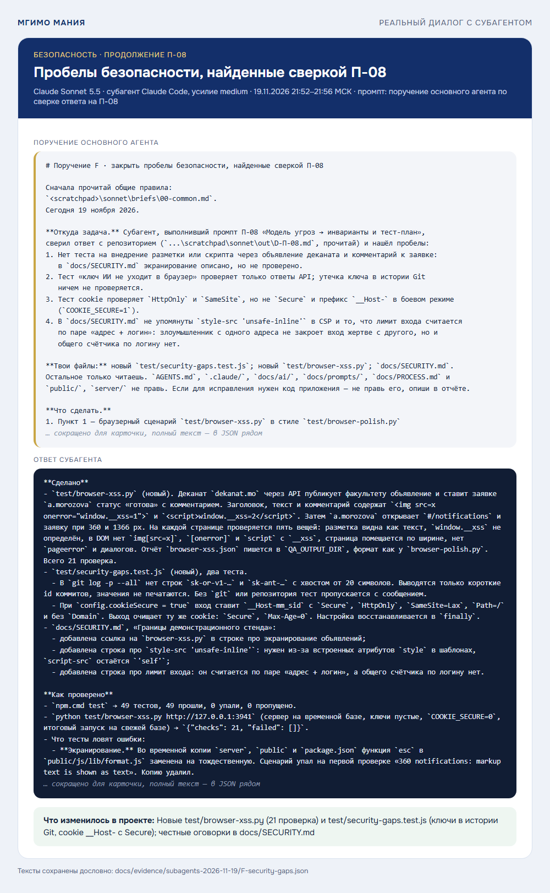
  <figcaption>Субагент F: пробелы безопасности из ответа на П-08 закрыты тестами. Итог — `6616890`.</figcaption>
</figure>

<figure class="prompt-card">
  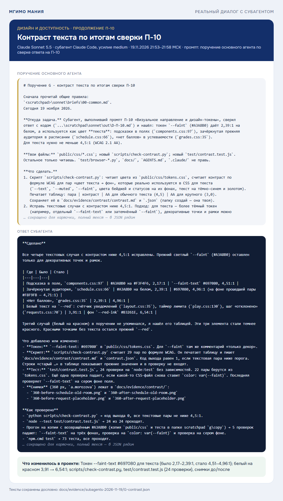
  <figcaption>Субагент G: контраст текста поднят до 4,5:1 и выше. Итог — `3aff3bb`.</figcaption>
</figure>

  <figure><figcaption>До: прежняя аудитория — серый #A3A8B0, 2,39:1.</figcaption></figure>
  <figure>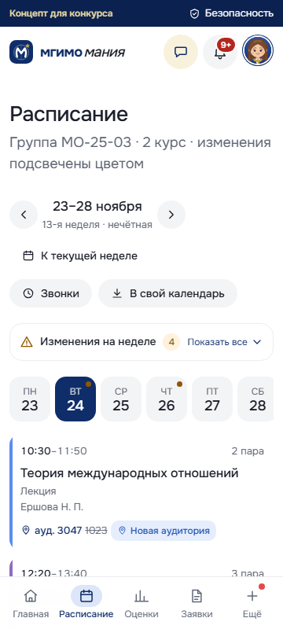<figcaption>После: #697080, 4,96:1; зачёркнутое читается.</figcaption></figure>

<figure class="prompt-card">
  
  <figcaption>Субагент E: библиотека в `docs/prompts/`, 16 утверждений исправлены по репозиторию.</figcaption>
</figure>

<figure class="prompt-card">
  
  <figcaption>Субагент C, промпт П-09: `AGENTS.md`, `CLAUDE.md`, `QWEN.md`, `.claude/`, `docs/ai/`.</figcaption>
</figure>
<figure class="prompt-card">
  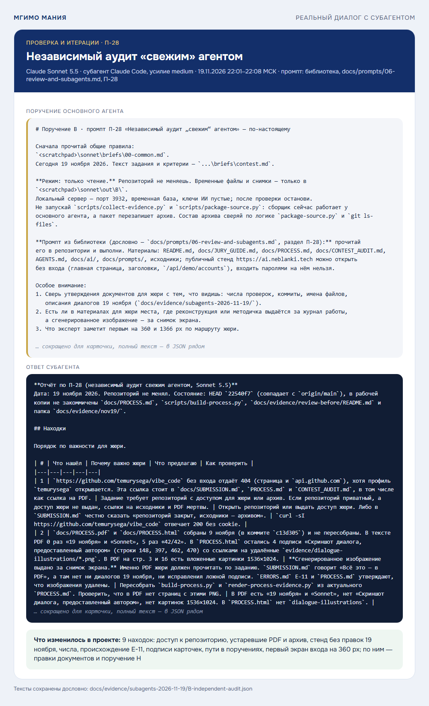
  <figcaption>Субагент B, промпт П-28: независимый аудит итогового состояния. Его находки закрыты правками документов и поручением H.</figcaption>
</figure>
<figure class="prompt-card">
  
  <figcaption>Субагент H: первый экран входа на телефоне по находке аудита. Итог — `c8955dc`.</figcaption>
</figure>

  <figure><figcaption>До: на 360 px видны обложка и поле логина, тестовые аккаунты ниже экрана.</figcaption></figure>
  <figure><figcaption>После: Алина и Тимур в первом экране, маркировка концепта на месте.</figcaption></figure>

## 4. От идеи к устройству приложения

Для конкурсного прототипа выбран небольшой стек: Node.js с серверными модулями HTTP,
SQLite и криптографии; в браузере — ES-модули без сборки. Данные и правила остаются
на сервере. Интерфейс получает JSON, показывает состояние и отправляет действия.

В маршрутах находятся проверки роли и входных данных. Предметная логика отдельно
собирает расписание, считает учебные показатели и проводит заявку через статусы.
SQLite хранит профили, сеансы, заявки, уведомления и игровой прогресс. Такое разделение
помогает проверять правила без браузера и менять интерфейс без переписывания прав доступа.

**Что получилось.** Пять обязательных задач связаны общими сущностями, а роли студента
и деканата разделены на сервере. Выбранная архитектура подходит для работающего демо.
Горизонтальное масштабирование потребует отдельной работы с хранилищем, общими лимитами
и фоновыми задачами; оно не заявляется как готовая возможность.

## 5. Учебное ядро: понимать ситуацию и действовать

В расписании важна не только таблица, но и исключения из неё. Поэтому регулярные занятия
и изменения хранятся раздельно: отменённая пара или новая аудитория отражаются при сборке
конкретной недели. Время рассчитывается по Москве, независимо от расположения сервера.

В успеваемости мы показываем не только итоговую цифру. Контрольные точки, прогноз,
учебный риск и пороги помогают понять положение по дисциплине. Сессия и зачётка
собраны рядом, чтобы студенту не требовалось искать их в другом сервисе.

<figure class="wide-shot">
  
  <figcaption>Настоящий экран расписания. Изменения выделены в контексте конкретных занятий.</figcaption>
</figure>

<figure class="wide-shot">
  
  <figcaption>Экран успеваемости связывает баллы, прогноз и учебные риски. Учебные данные вымышлены.</figcaption>
</figure>

**Инженерная итерация.** При проверке выяснилось, что персональный дедлайн с указанной
группой мог попасть в выборку другого студента. Условия отбора уточнили в API,
уведомлениях и контексте помощника. Для длинной истории исправили «прочитать все»:
действие теперь не ограничивается первой загруженной частью списка. Оба случая
проверяются регрессионными тестами.

## 6. Справка как законченный процесс

Путь заявки построен по модели отслеживания: студент понимает, что отправлено,
какой сейчас статус и что было сделано. Форма подставляет учебные сведения из профиля.
Сотрудник видит очередь своего факультета, принимает решение и оставляет комментарий.
Студент получает уведомление и видит запись в истории.

Для такого сценария важно разделить два решения: что видит студент после отправки
и кто вправе изменить статус. Поэтому в кабинете две роли, а сотрудник ограничен своим
факультетом; роли и переходы проверяются по коду и сквозному тесту.

Список статусов включает подачу, работу, готовность, выдачу, одобрение
и отмена; допустимый путь зависит от вида документа. Уведомление связано с конкретным
номером заявки, а сотрудник ограничен своим факультетом. Эти детали превращают
демонстрацию в проверяемый процесс с владельцем, действием и результатом.

У электронного образца есть код и ссылка проверки. Его можно сохранить в PDF через
печать браузера. Образец явно обозначен как демонстрационный документ без электронной
подписи — он не выдаётся за официальную справку университета.

<figure class="phone-shot">
  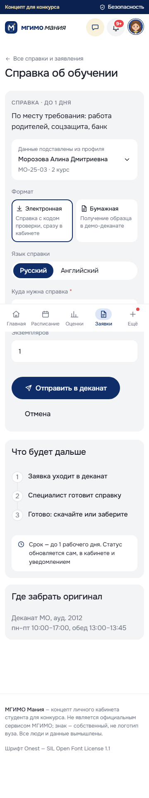
  <figcaption>Реальная форма на 360 px: сведения профиля подставляются автоматически.</figcaption>
</figure>

<figure class="wide-shot">
  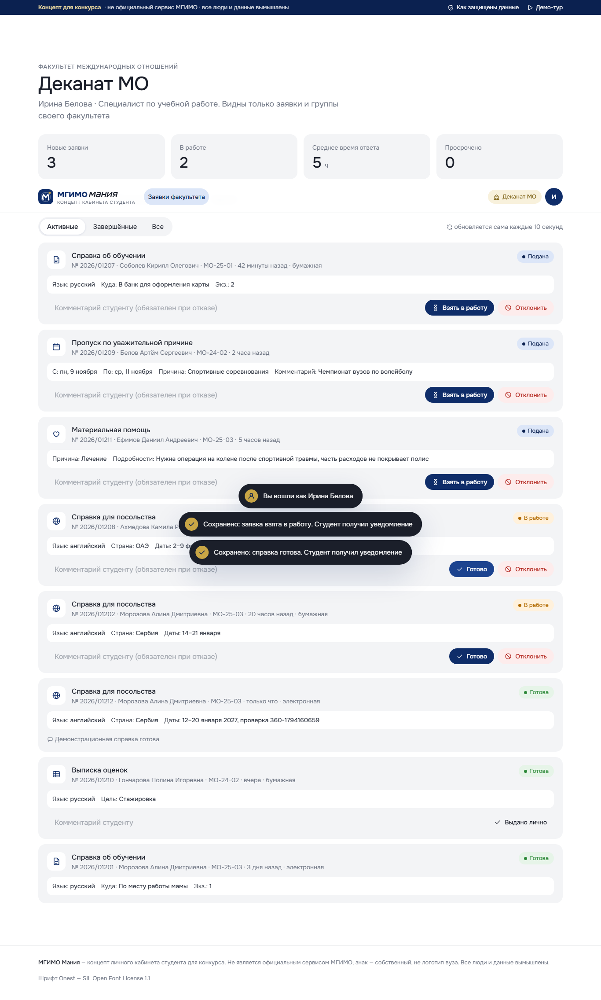
  <figcaption>Кабинет сотрудника работает с заявлениями своего факультета.</figcaption>
</figure>

<figure class="phone-shot">
  
  <figcaption>Студент видит результат обработки и может открыть демонстрационный документ.</figcaption>
</figure>

### Защита простыми словами

Пароль сравнивается с хешем scrypt и случайной солью. После входа браузер получает
случайный идентификатор сеанса в HttpOnly-cookie; сервер хранит его хеш. В HTTPS-режиме
cookie передаётся только по защищённому соединению. Изменяющие запросы проверяются
по CSRF-токену и источнику Origin.

Номер заявки в адресе не определяет право доступа. Сервер проверяет владельца
по сеансу; для сотрудника дополнительно ограничивает факультет. Подмена номера
не открывает чужой документ. После смены аккаунта очищаются данные интерфейса
и кеши модулей, включая автозаполнение формы.

В итоговой локальной версии справка о стипендии получила таблицу шести завершённых
месяцев, суммы по месяцам и общий итог вместо общего утверждения о назначении выплаты.
Нулевые начисления обозначены отдельно. Все суммы — демонстрационные, что явно указано
в документе; проверяются арифметика, оформление на двух ширинах и сохранение в PDF.

<figure class="wide-shot">
  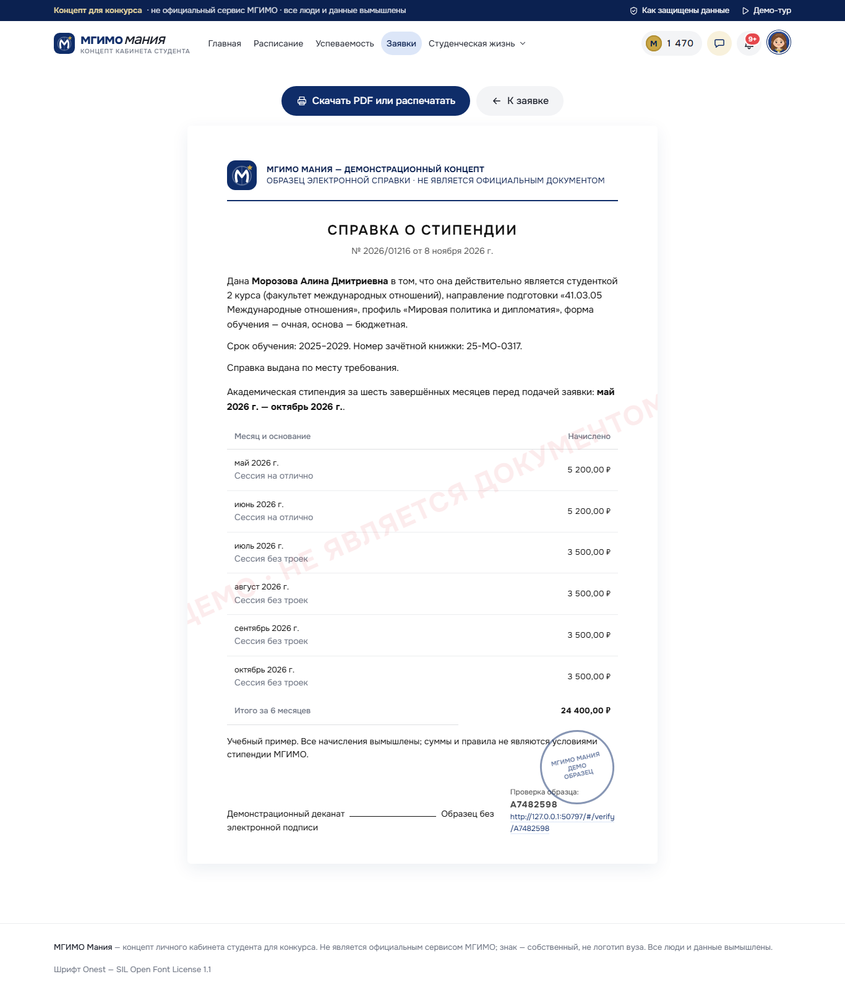
  <figcaption>Новая локальная версия справки о стипендии. Таблица и итог проверены в браузерном сценарии.</figcaption>
</figure>

**Инженерные итерации.** Исправлены кеш профиля предыдущего пользователя, нормализация
невозможных дат и обход последовательного счётчика неверных входов параллельными
запросами. Автоматический сброс демонстрационной базы выключен по умолчанию, чтобы
созданные изменения не исчезали. Декоративный рисунок, похожий на QR, заменён честной
ссылкой и кодом проверки.

## 7. Визуальный язык и мобильный кабинет

Проект использует светлые карточки, тёмно-синий и золотой акценты, единые поля и кнопки.
Шрифт Onest хранится локально вместе с лицензией. Собственный знак, аватар, питомцы
и кампус реализованы SVG; короткий раннер — Canvas. Отдельная генерация растровых
картинок для интерфейса приложения не подтверждается и не заявляется.

Визуальные решения подчинены порядку действий. Ближайшее занятие и срочные задачи
нужны при коротком визите с телефона; подробности дисциплин и история документов —
при более долгой работе. Поэтому ключевые сведения видны на главной, а дополнительное
содержимое раскрывается по запросу. Названия действий и текстовые статусы дополняют
иконки и цвет. Одинаковые карточки, поля и кнопки сокращают необходимость заново
разбираться в каждом разделе.

Замечание об интерфейсе превращалось в конкретную задачу: поменять приоритеты блоков
и объяснить балл через учебный порог. Измерения изменений интерфейса приведены в разделе 9,
а снимки готового кабинета получены браузерными сценариями.

Главная помогает быстро найти ближайшую пару, срок и нужное действие. На телефоне
сохраняются те же учебные сценарии. Игровой кампус добавляет альтернативный способ
перейти в раздел, а фокус-сессии связывают питомца с учебным контекстом.

В продукте кампус даёт дополнительный путь к разделам, а питомец и короткая игра
создают узнаваемый образ кабинета. Доступ к расписанию и заявкам не зависит от
игрового прогресса. Проверяемое ограничение здесь — возможность выполнить учебную
задачу обычной навигацией, даже если человек ни разу не открывал игру.

Второстепенные списки и игровой блок на телефоне сворачиваются, сохраняя доступ
по нажатию и с клавиатуры. Ближайшая пара, учебная ситуация и действие со справкой
остаются в основном учебном пути. Итерации и измерения описаны в разделе 9.

<figure class="phone-shot">
  
  <figcaption>Первый экран главной на 360 px. Текущая итерация, отдельная тестовая база.</figcaption>
</figure>

<figure class="phone-shot">
  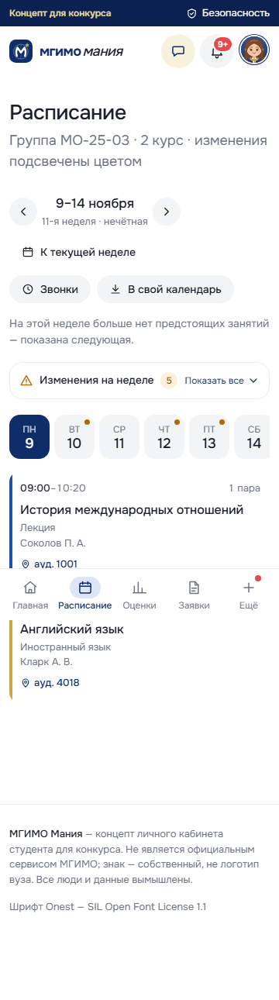
  <figcaption>Тот же учебный сценарий на узком экране.</figcaption>
</figure>

**Инженерная итерация.** В части разделов кнопка повторной загрузки не запускала запрос.
Добавлен общий обработчик восстановления. Отдельно проверяются подписи полей,
переход к основному содержимому, фокус в обычном и вложенном диалоге, Tab/Shift+Tab,
Escape, управление днями расписания и настройка уменьшения анимаций.

## 8. «Спросить деканат»: ИИ внутри продукта

Использование ИИ для разработки и ИИ-помощник в приложении — две разные части проекта.
Первое описывают история работы и постановки задач. Второе — конкретная пользовательская
функция: получить краткий ответ по своему расписанию, группе, срокам или заявкам.

Помощник получает ограниченный контекст вошедшего студента. Вызов провайдера идёт
только с сервера; ключ не передаётся браузеру. Модель не получает инструменты
изменения оценок и решений деканата. При отсутствии ключа, ошибке или тайм-ауте
работают встроенные правила, а источник ответа показан пользователю.

Контракт внешнего API проверяется подставными ответами, включая ошибки и отсутствие
полезного текста. Ранее, при публикации 8 ноября, отдельно выполнены живые запросы
OpenRouter для двух студентов. Ответы о группе совпали с их профилями; история
прошлого аккаунта не появилась в новом сеансе. Эти результаты сохранены в
[assistant-browser-live.json](evidence/deployment/assistant-browser-live.json).

<figure class="phone-shot">
  
  <figcaption>Архивный снимок живого запроса на опубликованном стенде, 8 ноября 2026 года. Это отдельная предыдущая проверка, а не новый локальный запрос.</figcaption>
</figure>

При первом подключении провайдер отклонил ключ с HTTP 401. Этот ответ не был принят
за успешную интеграцию. После замены ключа в серверном окружении запрос прошёл;
значения ключей не сохранялись в материалах. Успех конкретных запросов не является
гарантией точности будущих ответов модели.

## 9. Как мы проверяли результат и исправляли ошибки

Задачу ИИ формулировали через наблюдаемое поведение. Недостаточно написать,
что «сохранение работает»: нужно создать заявку, открыть ту же базу после перезапуска
и сравнить данные. Недостаточно показать красивую форму: нужно отправить её,
обработать в деканате и получить результат под исходным аккаунтом.

| Обнаруженная проблема | Что изменили | Как это проверяется |
|---|---|---|
| Автозаполнение сохраняло профиль после смены аккаунта | Очистка модульного кеша и состояния | Два разных входа в одной вкладке |
| Персональный дедлайн мог попасть другому студенту той же группы | Уточнение условий видимости | Сравнение API, уведомлений и контекста помощника |
| Параллельные неверные входы обходили счётчик | Резервирование попытки до проверки пароля | Одновременные запросы входа |
| «Прочитать все» оставляло часть истории непрочитанной | Обработка всей доступной истории | Длинная история уведомлений |
| Невозможная дата превращалась в другую дату | Строгая календарная проверка | Некорректные даты и недели |
| Повторная загрузка не работала в части экранов | Общий обработчик восстановления | Ошибка 503, затем нажатие «Повторить» |
| Старый сайт открывался после смены приложения на домене | Миграция прежнего service worker | Старый worker, две вкладки, сохранение других данных |

### Пример итерации после обратной связи

После публикации автор увидел на домене прежнее приложение, которое раньше работало
по этому адресу. Первые проверки проходили в чистых браузерных профилях и не покрывали
возвращение прежнего посетителя.
Сервер уже отдавал новый кабинет, но установленный service worker возвращал старую
страницу из офлайн-кеша.

Исправление оставили по прежнему адресу `/sw.js`: оно удаляет только кеши старого
приложения, снимает прежнюю регистрацию и переводит открытые вкладки на актуальную
страницу. Новым посетителям офлайн-worker не устанавливается. Добавлена отдельная
регрессия с двумя вкладками и проверкой сохранения других кешей, cookie и localStorage.

Это пример изменения самого плана проверки после обратной связи. Успешный набор
тестов покрывает перечисленные сценарии, но не означает, что неизвестных ошибок нет.

### Первая итерация оценки: от замечания к измеренному изменению

После оценки проекта по конкурсным критериям автор попросил добавить четыре изображения
и улучшить работу. Ассистент разделил задачи между документацией, интерфейсом и
проверкой публикации; владение файлами определили до правок. Выдержки фактических
поручений этой итерации сохранены в [review-session.json](evidence/review-session.json).

На сохранённом снимке страница успеваемости шириной 360 px имела высоту 4355 px.
Все девять дисциплин показывались подробными карточками. После доработки баллы,
форма контроля, статус и прогноз остались в компактном обзоре, а контрольные точки,
преподаватель и рекомендации открываются по нажатию на дисциплину. Добавлен фильтр
«Требуют внимания» с числом результатов и управлением клавишами Enter и Space.

Повторный браузерный проход измерил **2936 px вместо 4355 px — на 32,6% меньше**.
Это высота страницы на конкретных демонстрационных данных, не измерение скорости
чтения реальными студентами. При фильтре риска высота составила 1934 px. Все девять
дисциплин доступны через «Все», подробности открываются с клавиатуры, а при смене
студента фильтр сбрасывается. На компьютере сохранены подробные карточки.

Снимки для сравнения: [до](evidence/review-before/360-grades.png) и
[после первой итерации](evidence/quality-before/360-grades-review.png). Прежний протокол сохранён в
`evidence/review-before/`; измерения и 40 проверок этой итерации — в
[browser-review.json](evidence/quality-before/browser-review.json).

В верхнем меню оставили четыре основных учебных направления. Кампус, гардероб,
лавка и игра доступны из «Студенческой жизни»; проверены переход, Escape и возврат
фокуса. Короткие карточки главной больше не растягиваются по самому длинному списку,
а подписи нижнего меню на телефоне увеличены с 10 до 11 px.

### Следующая итерация: основные действия в первом экране

После повторной оценки автор попросил улучшить проект и передать изменения в Git.
Основной ассистент разделил работу
между главной страницей, успеваемостью и документами; сам доработал форму заявки
и общий прогон. Поручения, владение файлами и уточнения автора записаны в
[quality-session.json](evidence/quality-session.json).

На мобильной главной ближайшая пара больше не повторяется в развёрнутом списке дня.
Сразу после неё доступны два действия: открыть учебный риск или состояние заявки.
У первокурсника без заявок второе действие ведёт к первой справке. В проверенном окне
360 × 800 px оба действия занимают область 554–678 px и помещаются над нижним меню;
список остальных занятий раскрывается ниже. На компьютере весь день виден сразу.
Проверены переходы к конкретной дисциплине и заявке, пустой день, клавиатура и смена
аккаунта: [28/28 проверок](evidence/final/browser-home-priority.json).

  <figure><figcaption>До: занятия занимают первый экран.</figcaption></figure>
  <figure><figcaption>После: рядом с ближайшей парой доступны учебный риск и заявка.</figcaption></figure>

В успеваемости расширенная статистика на телефоне раскрывается по запросу. Все оценки,
посещаемость, рейтинг и стипендия сохранены; на компьютере обзор открыт сразу.
Высота страницы на том же демонстрационном профиле уменьшилась **с 2936 до 2096 px
(на 28,6%)**. Фильтр поднялся примерно с 1320 до 480 px, первая дисциплина — с 1447
до 607 px и теперь целиком помещается над нижним меню. Полная статистика открывается
клавишами Enter/Space; подробности дисциплины и фильтр сохраняют корректный фокус.
Подписи нижнего меню увеличены до 12 px. Источники:
[исходные измерения](evidence/quality-before/grades-measurements.json),
[31/31 проверка и новые измерения](evidence/final/browser-grades-compact.json).
Это измерения страницы, а не скорости работы реальных студентов.

<figure class="phone-shot">
  
  <figcaption>Успеваемость на 360 × 800 px после второй доработки. Расширенная статистика доступна по нажатию.</figcaption>
</figure>

В форме справки имя и группа остаются видимыми, дополнительные сведения профиля
раскрываются отдельно; электронный и бумажный форматы стоят рядом. Высота сохранённого
снимка прежней формы — 2195 px, текущая высота страницы в браузере — 1925 px.
Первое поле начинается на 722 px. Проверено, что сворачивание профиля сохраняет
введённые поля, формат выбирается с клавиатуры, а после смены аккаунта заменяются
и видимые, и скрытые сведения: [19/19 проверок](evidence/final/browser-request-compact.json).
Сравнение формы: [предыдущий снимок](evidence/quality-before/360-requests-new-study.png)
и [текущий снимок](evidence/final/360-request-compact.png).

### Итерация 8 ноября, вечер: первые действия и читаемость

После анализа по четырём критериям автор поручил: **«давай вот все поправим и зальем сайт
и на github тоже все зальем»**. Постановка и распределение работы сохранены в
[finalization-session.json](evidence/finalization-session.json). Это запись текущей
работы, а не восстановление раннего диалога.

| Исполнитель | Порученная область | Условие завершения |
|---|---|---|
| Основной ассистент | Главная, читаемость, общие проверки и GitHub | Проверить совместную работу изменений и зафиксировать отправленную ревизию |
| Агент расписания | Экран расписания, его стили и при необходимости отдельная проверка | Подтвердить затронутые действия на 360 px и обычном экране |
| Агент публикации | Подготовить и затем обновить существующий VPS | Сохранить базу; проверить опубликованную версию и записать результат |
| Агент документации | Обоснование продукта, происхождение материалов и краткий путь жюри | Разделить гипотезы и наблюдения; согласовать описание с подтверждёнными результатами |

В ходе этой работы автор уточнил отзывы двух студентов. Их затруднение с первым
действием стало основанием для блока «С чего начать».

На главной реализованы компактные списки и необязательный игровой блок; при активной
фокус-сессии он раскрывается. Высота страницы на 1366 px уменьшилась с 2825 до 1614 px.
Мобильные приоритетные действия остаются в первом экране. Недельное расписание на обычном
экране показывает три колонки и даёт доступ ко всем изменениям.

Кнопка «С чего начать» открывает три учебных действия и поддерживает закрытие диалога.
При первом знакомстве те же действия доступны сразу. Это ответ на конкретное замечание
двух участников, но повторной проверки с ними после доработки пока нет.

<figure class="phone-shot">
  
  <figcaption>Реальный снимок локальной проверки: первые действия доступны из отдельного диалога.</figcaption>
</figure>

Итог итерации: 35/35 автотестов и 367/367 браузерных проверок локально, затем
публикация на стенд и 194/194 браузерные проверки уже на HTTPS-версии (раздел 10).

### Итерация 9 ноября: независимый аудит и доводка

Автор попросил проверить всё сделанное по четырём критериям конкурса. Аудит вёл новый
ассистент — Claude Code, — не участвовавший в предыдущих итерациях. Он прочитал код
и документы, запустил тесты, прошёл кабинет своими браузерными сценариями на 360
и 1366 px, проверил изоляцию данных прямыми запросами к API и сверил архив исходников
с Git. Вывод: ядро и безопасность в порядке, а замечания касаются деталей интерфейса,
поведения общего демо-стенда и подачи материалов. После этого автор поручил:
**«давай все правки сделаем чтобы дотянуть до 10… и также запушить в git»**.

| Что нашёл аудит | Почему это важно | Что изменили | Как проверено |
|---|---|---|---|
| На экране входа при 320–414 px плашка «Справка готова» наезжала на подзаголовок | Первый экран, который жюри видит с телефона | Плашки ниже подзаголовка с запасом на анимацию | Промежуток измерен на ширинах 320–1366 px во всех фазах анимации |
| Ссылки «Баллы», «Все» и кнопка «Безопасность» — 20–23 px в высоту | Трудно попасть пальцем | Невидимая область нажатия 34–45 px без сдвига вёрстки | Нажатие на 8 px выше ссылки открывает раздел |
| Лента уведомлений на телефоне — около 4900 px | Настройки и важное теряются внизу | Порции по 12 с кнопкой «Показать ещё», фокус на первой новой карточке | Браузерный сценарий: число карточек, фокус, сброс при смене фильтра |
| Чужая заявка показывала общее «Не найдено» | Маршрут жюри обещал «Заявка не найдена» | Заголовок берётся из ответа сервера | Вход другим студентом по сохранённой ссылке |
| Электронная справка сама становилась готовой через 70 секунд | Жюри не успевало принять решение в кабинете деканата | Демо-автоматика — около 8 минут; ускорение только в браузерных тестах | Регрессионный тест времени и отключения автоматики сотрудником |
| Публичный аккаунт деканата мог бесконечно публиковать объявления всем студентам МО | Общий стенд для всех экспертов | 10 публикаций за 10 минут, затем 429 | Регрессионный тест лимита |
| CSP разрешала Google Fonts, хотя шрифт локальный | Лишнее разрешение в политике | Только свой домен для стилей и шрифтов | Тест заголовков |
| В документах — внутренние детали сервера и устаревшие формулировки | Жюри читает материалы, а не журнал администратора | Документы сокращены; история Git описана честно | Ссылки и тексты сверены с кодом |

Новые проверки закреплены в `test/dean-limits.test.js` и браузерном сценарии
`test/browser-audit-fixes.py`. Ошибки самого ассистента в этой итерации тоже записаны:

- Ускорение демо-автоматики для тестов сначала применялось ко всем этапам сборщика,
  и новый тест времени готовности упал внутри общего прогона. Ускорение оставили только
  браузерным сценариям, а тест сам закрепляет скорость стенда.
- Новый браузерный сценарий сначала мерил подзаголовок один раз — во время анимации
  появления экрана, когда текст ещё смещён на 5 px, — и сообщал о наложении, которого нет.
  Замер перенесли в каждый кадр; настоящий зазор — 6 px.
- Прогон, запущенный до правки автоматики, остановлен и не использован: проверенный код
  не совпал бы с итоговым.

Итог итерации: 37/37 автотестов и 381/381 браузерных проверок на свежих базах
в одном запуске, без повторов ([сводка](evidence/polish/run-summary.json)).

### Повторная проверка 9 ноября: реализация и доступность интерфейса

После проверки по критериям автор поручил исправить замечания к реализации и качеству
и отправить изменения в GitHub. Codex распределил работу между тремя субагентами:
календарные ответы помощника и серверные тесты; сохранение фокуса и контраст;
отдельный браузерный сценарий смены аккаунтов. Основной агент исправлял синхронизацию
сеанса, проверял изменения и собирал материалы. Владение файлами согласовали до правок.

| Воспроизведённый дефект | Исправление | Регрессионная проверка |
|---|---|---|
| В воскресенье помощник показывал пары понедельника; субботний вопрос о завтра давал пустой ответ | Три календарных дня в контексте, точный выбор даты, отдельные ответы для выходного и недоступных данных | Суббота, воскресенье, понедельник, праздник, пустой день в `assistant.test.js` |
| После смены аккаунта в другой вкладке оставались прежний интерфейс и CSRF | Сигнал входа/выхода между вкладками; очистка и перезагрузка; проверка при возвращении к вкладке | `browser-session-sync.py`: старые формы и чат исчезают, новые GET и POST работают |
| Пропущенный сигнал позволял загрузить новый профиль в старый интерфейс | CSRF связывает с сеансом и чтение API; сервер отклоняет старый контекст до выполнения маршрута, запрос автоматически не повторяется | Серверный тест и браузерные GET/POST без сообщения между вкладками |
| Обновление заявок и расписания удаляло сфокусированный элемент | Восстановление по устойчивому ключу без прокрутки; обновление не заменяет фон открытого диалога | Реальные callbacks обновления списка, карточки и расписания на 360/1366 px |
| Фильтр уведомлений терял фокус и не сообщал о выборе диктору | Сохранение кнопки под фокусом и `aria-pressed`; понятный фокус после исчезновения действия | Enter, Tab, «Прочитать все», выбранный фильтр и состояние фокуса |
| Мелкие серые, зелёные и оранжевые подписи были недостаточно контрастны | Затемнены текстовые токены с сохранением общей палитры | Контраст фактически отрисованных подписей на их фонах в `browser-focus-contrast.py` |
| Изменение счётчика уведомлений пересоздавало шапку и кнопку открытия меню | Счётчик обновляется точечно, кнопка остаётся тем же DOM-узлом | Фокус колокольчика и возврат после Escape при изменившемся счётчике |

Дополнительный review выявил крайний случай: анонимная вкладка могла пропустить вход
в соседней вкладке. Проверка сеанса при фокусе теперь работает и на форме входа;
браузерная регрессия проверяет восстановление без ручного обновления.
Обмен между вкладками не содержит профиля или токенов: временная запись storage
немедленно удаляется. При недоступности BroadcastChannel используется storage,
а пропущенные события дополнительно обнаруживаются сервером.

Первый общий прогон обнаружил ещё один дефект, который не проявлялся во время коротких
проверок: после окончания сегодняшних занятий главная показывала завтрашнюю пару с длинным
названием и пояснением об изменении аудитории. Карточка становилась выше, и второе важное
действие уходило под нижнее меню на 360 × 800 px. Проверка остановила сборку;
[неуспешный прогон](evidence/quality-fixes-first-attempt/run-summary.json) и
[снимок](evidence/quality-fixes-first-attempt/360-home-viewport.png) сохранены.
Этот случай потребовал исправления мобильной компоновки и отдельного сценария с длинным
названием и переносом; требование видимости обоих действий не ослаблялось.
Дата или остаток времени теперь стоят рядом с номером пары, повторная ссылка на неделю
внутри карточки скрыта только на телефоне, а верхняя кнопка ведёт в то же расписание.
Уменьшены пустые отступы; название, время, аудитория, преподаватель и причина изменения
остаются полностью видимыми. Отдельный прогон дал 40/40 проверок, включая текущую пару
с длинным названием и сменой аудитории; общий повтор приведён ниже.

После [успешного промежуточного прогона](evidence/quality-fixes-before-home-focus/run-summary.json)
42/42 и 482/482 дополнительная проверка нашла аналогичный сброс фокуса у кнопки
расписания на главной компьютера ([воспроизведение](evidence/quality-fixes-before-home-focus/home-focus-repro.json)). Таймер `next/day` теперь откладывает обновление карточки,
пока в ней находится клавиатурный фокус или фон заблокирован диалогом. После ухода фокуса
обновление возобновляется; игровые действия не менялись. Сценарий закреплён в
`browser-focus-contrast.py`: отдельный прогон — 65/65, окончательный общий запуск — ниже.

Существующие проверки проходили и до этих исправлений. Новые сценарии добавлены
именно для воспроизведённых ошибок. Успешный прогон не считается полным аудитом WCAG,
нагрузочной проверкой или подтверждением доступности из России. Результат этой итерации
приведён в разделе 10; публикация исходников и обновление публичного стенда учитываются отдельно.

### Публикация исправленной версии, 9 ноября

По отдельному поручению автора обновлён публичный сайт. Перед публикацией проверено
совпадение исходников с успешным локальным прогоном 42/42 и 492/492; в отдельную версию
упакованы только runtime-файлы, без базы, ключей и документов. Резервная копия SQLite
прошла `integrity_check`. Заменён контейнер деканата с прежним постоянным томом.

Опубликован код `3b722e9` (`review-ad34040a18b8`), контейнер `healthy`.
Все 52 публичных файла совпали с подготовленной версией; старые заявки, история и сеансы
сохранены. Отдельная проверочная заявка и её сеанс пережили замену, после проверки
заявка отменена. Четыре соседних контейнера остались с прежними ID и временем запуска.
[Протокол публикации](evidence/deployment/quality-fixes-deployment.json).

Другой субагент затем выполнил публичную браузерную приёмку: **25/25** на 360/1366 px,
без ошибок JavaScript. Проверены обе роли, учебные разделы, чужая заявка и очистка данных
после смены аккаунта между вкладками. Этот браузерный сценарий разрешал только вход и выход,
не создавая заявки, объявления или решения.
[Отчёт](evidence/deployment/quality-fixes-browser/public-acceptance.json) и
[снимок профиля на телефоне](evidence/deployment/quality-fixes-browser/360-profile.png).

### Итерация 19 ноября: находки из промптов библиотеки

Подробно — в разделе 3. Коротко: промпты библиотеки, выполненные субагентами Sonnet 5.5,
нашли три недоработки, которые прежние проверки пропускали.

| Что нашли | Каким промптом | Что изменили | Как проверено |
|---|---|---|---|
| Квиз «Первые шаги» обещал справку «с QR-кодом», а QR в кабинете убрали ещё 8 ноября | О-9 «Найди все следы» | Ответ квиза: «с кодом и ссылкой для проверки»; правило «найди все упоминания» в `AGENTS.md` и `/bugfix` | `test/qr-mentions.test.js`: до правки 2 из 5 падали |
| Экранирование объявлений и комментариев описано, но не проверено; нет проверки ключей в истории Git и боевой cookie | П-08 «Модель угроз» | Новые проверки, без изменения кода приложения | `test/browser-xss.py` (21), `test/security-gaps.test.js`; каждый падал на сломанной копии |
| Серый текст подсказок, прежней аудитории и «нет баллов» — 2,17–2,39:1 | П-10 «Токены и контраст» | Токен `--faint-text` и тёмно-красный фон для белого текста | `scripts/check-contrast.py`, `test/contrast.test.js` (24) |

После всех исправлений — общий прогон на свежих базах (73/73 автотеста, 523/523 браузерных
проверки в 17 наборах) и публикация этого же кода на стенд по просьбе автора «публичным сделал
сделай теперь стенд»: версия `review-d7a91e220757`, 16/16 проверок публикации, все прежние заявки
и сеансы сохранены ([протокол](evidence/deployment/nov19-deployment.json)). Репозиторий автор
открыл в тот же день.

## 10. Журналы и реальные снимки проверок

Каждая проверка запускается на новой временной базе, без пользовательских данных и без
внешнего ИИ: `python scripts/collect-evidence.py --output <папка>`. Сборщик сохраняет
журналы команд, JSON-отчёты и снимки экранов. Неуспешные попытки не удаляются: они лежат
рядом с успешными и показывают, что именно исправлялось.

### Текущая версия, 19 ноября

Окончательный общий запуск: **73/73** автотестов и **523/523** браузерных проверок в 17 наборах,
без необработанных ошибок JavaScript. Каждый браузерный набор использовал отдельную временную
SQLite; внешние ключи ИИ отключены. [Сводка](evidence/release-1119/run-summary.json)
содержит команды, время и SHA-256 проверенных исходников.

| Набор | Пройдено | Журнал |
|---|---:|---|
| API, безопасность и предметная логика | 73/73 | [unit-tests.txt](evidence/release-1119/unit-tests.txt) |
| Экраны на 360 и 1366 px | 52/52 | [browser-smoke.txt](evidence/release-1119/browser-smoke.txt) |
| Путь заявки двух ролей, смена аккаунта, изоляция | 36/36 | [browser-flows.txt](evidence/release-1119/browser-flows.txt) |
| Клавиатура, фокус, восстановление после ошибок | 23/23 | [browser-accessibility.txt](evidence/release-1119/browser-accessibility.txt) |
| Мобильные доработки и состояния расписания | 21/21 | [browser-polish.txt](evidence/release-1119/browser-polish.txt) |
| Справка о стипендии: заявка, таблица, PDF | 45/45 | [browser-stipend.txt](evidence/release-1119/browser-stipend.txt) |
| Компактные оценки, фильтр риска, меню | 40/40 | [browser-review.txt](evidence/release-1119/browser-review.txt) |
| Главная: приоритеты, длинные названия и текущая пара | 40/40 | [browser-home-priority.txt](evidence/release-1119/browser-home-priority.txt) |
| Успеваемость: первый экран и статистика | 31/31 | [browser-grades-compact.txt](evidence/release-1119/browser-grades-compact.txt) |
| Форма справки: профиль, формат, смена аккаунта | 19/19 | [browser-request-compact.txt](evidence/release-1119/browser-request-compact.txt) |
| Читаемость расписания | 29/29 | [browser-schedule-readability.txt](evidence/release-1119/browser-schedule-readability.txt) |
| «С чего начать»: первые действия | 34/34 | [browser-first-actions.txt](evidence/release-1119/browser-first-actions.txt) |
| Правки 9 ноября: вход, нажатия, уведомления, чужая ссылка | 14/14 | [browser-audit-fixes.txt](evidence/release-1119/browser-audit-fixes.txt) |
| Вкладки, пропущенные события и восстановление сеанса | 37/37 | [browser-session-sync.txt](evidence/release-1119/browser-session-sync.txt) |
| Фокус при обновлениях, меню и контраст текста | 65/65 | [browser-focus-contrast.txt](evidence/release-1119/browser-focus-contrast.txt) |
| Разметка в объявлениях и комментариях остаётся текстом (19 ноября) | 21/21 | [browser-xss.txt](evidence/release-1119/browser-xss.txt) |
| Первый экран входа на телефоне и уведомление о входе (19 ноября) | 16/16 | [browser-mobile-entry.txt](evidence/release-1119/browser-mobile-entry.txt) |

<figure class="evidence-card">
  
  <figcaption>Фактический вывод запуска тестов. Карточка оформляет журнал, а не заменяет результат программы.</figcaption>
</figure>

<figure class="evidence-card">
  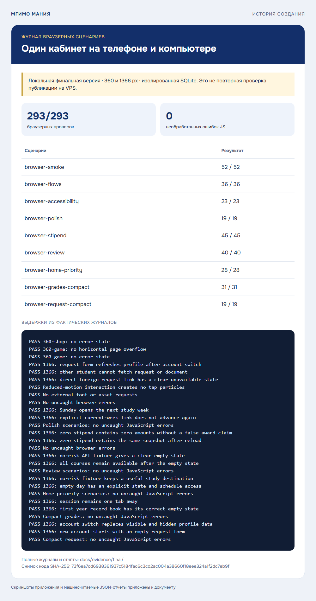
  <figcaption>Результаты браузерных сценариев. Ширины и число проверок взяты из сохранённого запуска.</figcaption>
</figure>

### История проверок

| Когда | Что проверялось | Результат | Материалы |
|---|---|---|---|
| 8 ноября, первый аудит | API, сквозные сценарии, клавиатура и восстановление после ошибок | 30/30 автотестов, 111/111 браузерных проверок | [экраны](evidence/browser-results.json), [действия](evidence/browser-flows.json), [доступность](evidence/browser-accessibility.json) |
| 8 ноября, первая публикация | HTTPS-стенд; сохранение после перезапуска контейнера; возврат посетителей прежнего сайта | 117/117, заявка пережила перезапуск, миграция service worker 15/15 | [стенд](evidence/deployment/browser-results.json), [сохранение](evidence/deployment/production-persistence.json), [миграция](evidence/deployment/browser-migration.json) |
| 8 ноября, 20:23–20:28 | Компактные оценки и меню; публикация | 35/35 и 215/215 локально, 52/52 и 40/40 на HTTPS | [локально](evidence/quality-before/run-summary.json), [HTTPS](evidence/deployment/review-browser/browser-review.json) |
| 8 ноября, 20:57–21:00 | Главная, успеваемость, форма справки | 35/35 и 293/293 | [сводка](evidence/final/run-summary.json) |
| 8 ноября, 21:44–21:55 | «С чего начать», расписание; публикация | 35/35 и 367/367 локально*, 194/194 на HTTPS, живой ИИ 2/2 | [локально](evidence/finalization/run-summary.json), [HTTPS](evidence/deployment/finalization-browser/run-summary.json), [ИИ](evidence/deployment/finalization-ai.json) |
| 9 ноября | Доводка после независимого аудита | 37/37 и 381/381 | [сводка](evidence/polish/run-summary.json) |
| 9 ноября, окончательная проверка | Исправления реализации, вкладок, фокуса, контраста и мобильной главной | 42/42 и 492/492 | [сводка](evidence/quality-fixes/run-summary.json) |
| 19 ноября | Промпты библиотеки, выполненные субагентами Sonnet 5.5 | 73/73 и 523/523 | [сводка](evidence/release-1119/run-summary.json) |

\* 333 проверки общего запуска и 34 проверки повтора одного сценария после исправления
ожидания в тесте. Неуспешные попытки сохранены в `evidence/finalization-first-attempt/`,
`finalization-schedule-attempt/`, `finalization-first-actions-attempt/`,
`finalization-first-actions-retry/` и `deployment/review-browser/browser-review-first-attempt.json`.
Во всех этих случаях ошибкой было ожидание в тесте, а не поведение кабинета.

В PDF вложены полные журналы и JSON-отчёты, экспорт истории Git
и записи поручений субагентам. Вложения открываются в PDF-ридере с поддержкой
прикреплённых файлов; те же файлы лежат рядом с документом в репозитории. Карточки журналов
создаются скриптом `scripts/render-process-evidence.py`.

Полное соответствие стандартам доступности и предел нагрузки не заявляются: у каждой
проверки есть конкретные границы, они описаны в [CONTEST_AUDIT.md](CONTEST_AUDIT.md).

## 11. Инструменты и вклад человека

| Инструмент или технология | Задача | Связанный результат и материалы |
|---|---|---|
| Claude Code в приложении Claude (модель Claude Opus 5.5) | 4 ноября — первая версия кабинета по тексту задания: структура, сервер, интерфейс, самопроверка во встроенном браузере; 9 ноября — независимый аудит по критериям и доводка | Журнал сессии 4 ноября (раздел 2); итерации 9 и 19 ноября (разделы 3 и 9) |
| Codex и субагенты | Аудит, исправления, браузерные проверки, интеграция и документы | Инструкции `AGENTS.md`, поручения в `review-session.json` и `quality-session.json`, регрессии и сравнение мобильной версии до/после |
| Claude Code: субагенты Claude Sonnet 5.5 | 19 ноября — промпты библиотеки как настоящие задачи: О-9, П-09, повторные прогоны девяти промптов, исправления по их находкам, независимый аудит П-28 | Поручения и ответы в `docs/evidence/subagents-2026-11-19/`; раздел 3 |
| Комплект файлов для агентов | Единые правила для всех агентов проекта: инварианты с тестами, узкие роли субагентов, команды, журналы | `AGENTS.md`, `CLAUDE.md`, `QWEN.md`, `.claude/`, `docs/ai/` |
| ChatGPT (gpt-image) | Изображения «диалогов» для ранней версии описания процесса | Удалены как не соответствующие действительности; запись E-11 в `docs/ai/ERRORS.md` |
| OpenRouter | Ответы помощника по учебным данным вошедшего студента | `server/routes/assistant.js`, `domain/assistant.js`; сохранённые живые запросы двух аккаунтов и тесты резервного ответа |
| Anthropic SDK | Альтернативный серверный провайдер помощника | Зависимость и реализация в коде; сохранённые живые проверки относятся к OpenRouter |
| PowerShell, Git, ripgrep | Чтение проекта, поиск, история и запуск команд | Исходники, история Git и команды проверки |
| Node.js, SQLite, `node:test` | Приложение, данные и автоматические тесты | `package.json`, `server/`, `test/` |
| Python, Playwright, Chromium | Проверка браузерных сценариев, снимки, подготовка PDF | Тестовые сценарии и скрипты сборки документа |
| SVG, Canvas, CSS | Собственная графика, игровые сцены и оформление | `public/js/art/`, `public/js/campus/`, `public/js/game/`, `public/css/` |
| Onest / Google Fonts | Локальный шрифт интерфейса | Файлы шрифта и лицензия OFL в репозитории |
| Docker Compose и Caddy | Ранее выполненное размещение и HTTPS | Конфигурация и сохранённый протокол публикации |

Claude Code работал в приложении Claude со встроенным браузером для самопроверки и
с субагентами Sonnet 5.5, Codex — с субагентами, между которыми заранее делилось владение
файлами. Таблица связывает инструменты с задачами и конкретными результатами.
`QWEN.md` в комплекте — точка входа для Qwen Code на будущее: в истории этой версии
он не подтверждён, поэтому в таблице его нет.

Автор определял цель и ограничения, предоставлял требования, выбирал направление
развития, давал обратную связь и настройки для публикации. На подтверждённом позднем
этапе ассистенты выполняли чтение и изменение файлов, запуск команд, тестирование
и подготовку материалов. По словам автора, кабинет попробовали два студента;
их замечание о непонятном первом действии привело к доработке начальных подсказок.
Измерения времени и исходные анкеты не представлены; повторной проверки после правок нет.

Сторонние материалы перечислены в [THIRD_PARTY.md](../THIRD_PARTY.md). В процессе
проверки исправлена ошибочная запись лицензии SDK Anthropic: установленный пакет
использует Apache-2.0. Код проекта распространяется под MIT, шрифт Onest — под OFL.

## 12. Что демонстрирует прототип

«МГИМО Мания» показывает законченный путь: войти под вымышленным студентом, увидеть
учебную ситуацию, подать заявление, обработать его в деканате и вернуться к результату.
Мобильный кабинет выполняет те же основные задачи. Собственные графика и игровые
элементы формируют образ продукта, а помощник позволяет задать вопрос по учебным данным.

Для демонстрации подготовлены три разных студента и сотрудник деканата. Общий пароль
`mgimo2026` предназначен только для этих публичных вымышленных аккаунтов.

| Логин | Что показать |
|---|---|
| `a.morozova` | Учебный риск, изменения пар и справки студентки МО |
| `t.aliev` | Другой факультет, профиль первокурсника и первый заказ справки |
| `k.lebedeva` | Академический долг и запись на пересдачу |
| `dekanat.mo` | Очередь заявок своего факультета и решение по заявлению |

### Самостоятельный проход

1. Под Алиной открыть учебный риск и новую электронную справку, отправить форму
   и сохранить адрес её карточки. После обновления страницы данные остаются.
2. В отдельной сессии деканата найти эту заявку, взять в работу, оставить комментарий
   и отметить готовность. У Алины открыть уведомление, историю и документ.
3. Выйти, войти как Тимур и открыть сохранённый адрес: чужая заявка недоступна.
   В новой форме должны быть данные Тимура. Ксения показывает другой путь — от долга
   в зачётке к форме пересдачи.

Встроенный «Демо-тур» знакомит с экранами. [Маршрут жюри](JURY_GUIDE.md) дополняет его
полным циклом с двумя ролями, названиями кнопок и ожидаемыми результатами.

**Материалы, которые можно проверить:** исходники, метаданные Git, комплект файлов для
ИИ-агентов, журнал промптов и ошибок, диалоги с субагентами 19 ноября, методичка промптов,
снимки интерфейса, автоматические и браузерные сценарии, сохранённые журналы и пример
демонстрационного документа.
Видео по условиям конкурса необязательно и пока не приложено.
