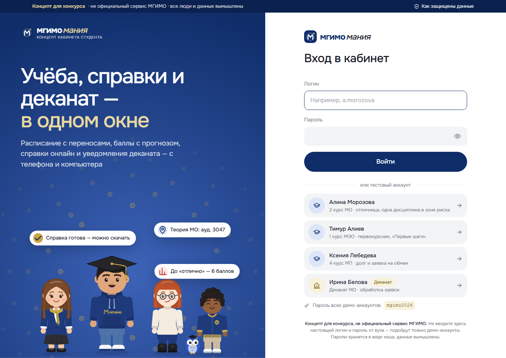
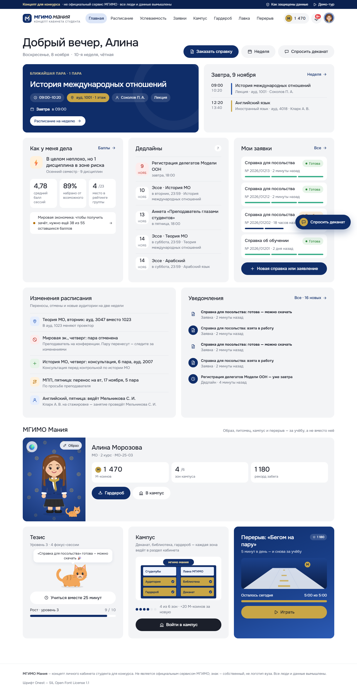
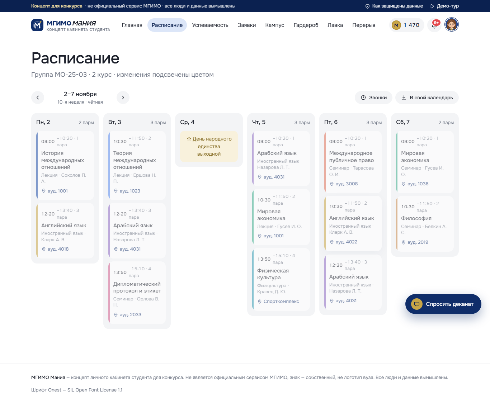
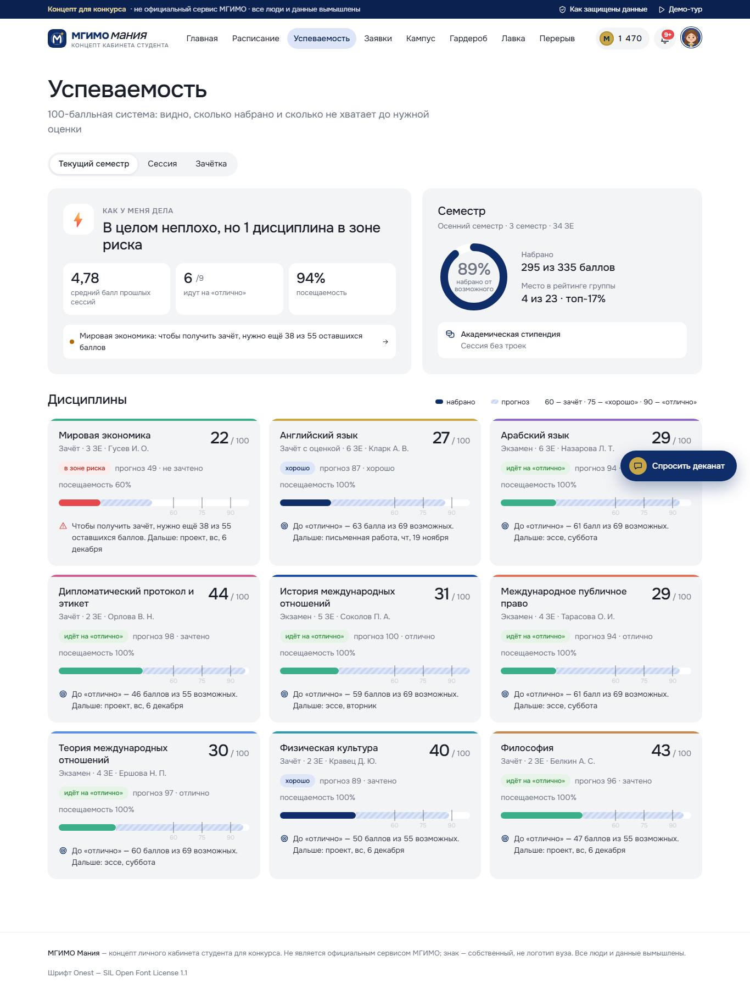
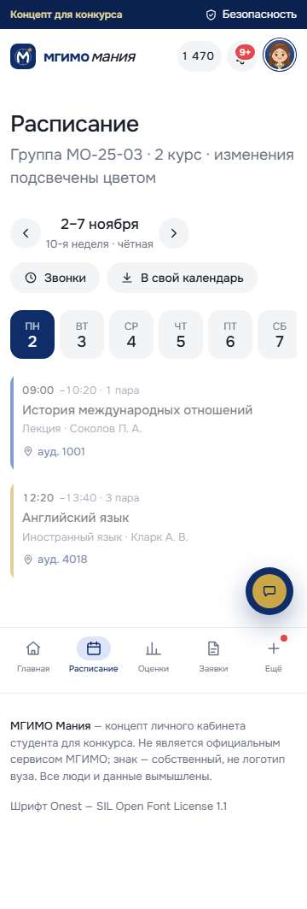
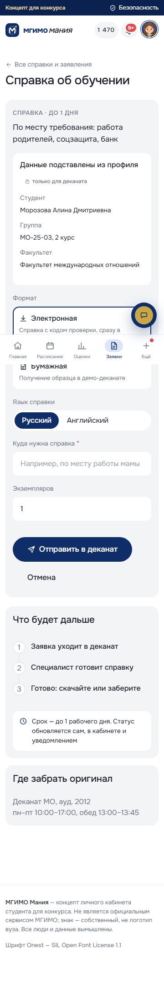
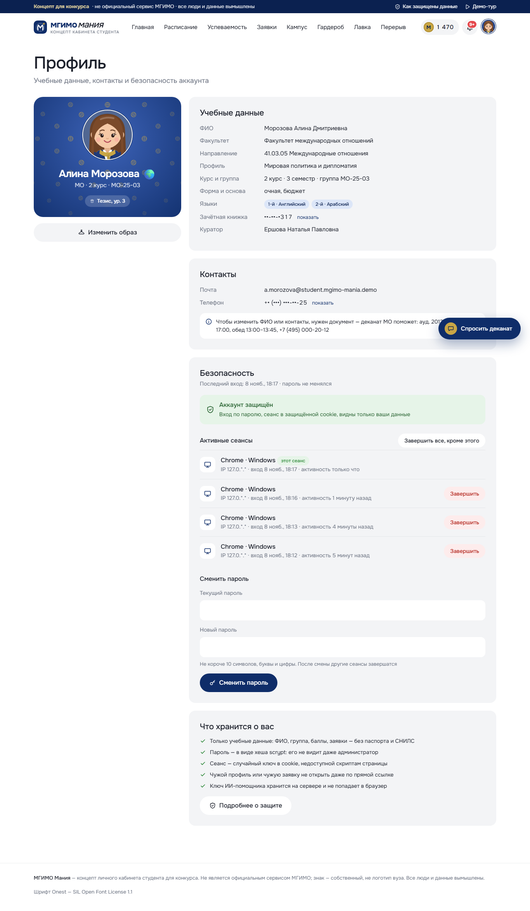
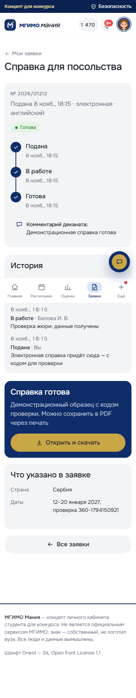
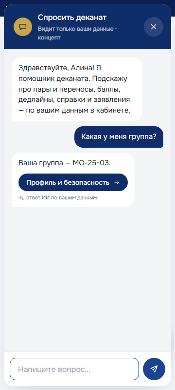
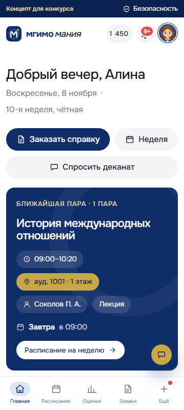

# Как создавался и проверялся «Цифровой деканат будущего»

**Проект:** «МГИМО Мания», конкурсный концепт личного кабинета студента. 
**Дата описанной проверки:** 8 ноября 2026 года, Москва. 
**Статус:** документ подтверждённых этапов аудита, доработки и публикации. Ранние переписки и макеты
не были предоставлены и не восстановлены задним числом.

Опубликованный кабинет: [ai.neblanki.tech](https://ai.neblanki.tech/).
Исходный код: [temurysega/vibe_code](https://github.com/temurysega/vibe_code).
При анонимной проверке GitHub вернул 404: открытый доступ жюри пока не подтверждён.
Архив исходников подготовлен локально, способ предоставления доступа ещё согласуется.
Ниже сохранена последовательность работы: сначала локальная проверка без живого ключа ИИ,
затем публикация на VPS и отдельная проверка рабочего подключения OpenRouter.

## Проблема и идея

В задании описана учебная жизнь, разбросанная между расписанием на сайте, отдельной системой
оценок, очередью за справками и объявлениями в чатах. Кабинет собирает эти действия в одном
месте. Студенту важно понять: куда идти на пару, что изменилось, какие учебные риски закрыть
и когда будет готов документ.

Разделы выбраны вокруг пяти задач обязательного ядра:

| Задача студента | Решение в кабинете | Связь с остальными разделами |
|---|---|---|
| Войти и убедиться, что данные свои | Профиль, факультет, направление, группа, активные сеансы | Эти данные подставляются в заявление и определяют доступ |
| Узнать, куда и когда идти | Расписание на день/неделю, преподаватель, аудитория, заметные изменения | Изменения приходят в уведомления, пары экспортируются в календарь |
| Понять, как идёт учёба | Баллы по дисциплинам, зачёты, прогноз, сессия и долги | Риск ведёт к понятному действию, например записи на пересдачу |
| Получить справку | Каталог заявлений, заполнение, отправка, история статусов | Деканат обрабатывает заявку, студент получает уведомление |
| Не пропустить важное | Объявления, сроки, новые статусы и изменения пар | Уведомление ведёт в соответствующий экран |

Дополнительная идея — сделать кабинет местом, куда приятно возвращаться: аватар, питомец,
виртуальный кампус и короткий игровой перерыв. Игровые элементы используют учебный контекст,
но основные действия остаются доступны через обычную навигацию. Помощник предлагает
короткий ответ по данным текущего студента и ссылку на нужный раздел.

Опрос однокурсников в доступных материалах не зафиксирован. Описанная проблема взята
из конкурсного задания; пользовательское исследование не заявляется как проведённое.

## Что известно о ранней версии

До этой проверки в рабочем каталоге уже был прототип на Node.js и SQLite: сервер, браузерные
ES-модули, демо-аккаунты, игровой слой, документация и автоматические тесты. История Git
содержит коммиты от 4 ноября 2026 года. Это подтверждает существование исходников к тому
моменту, но не доказывает, какие ИИ-инструменты и промпты применялись при их создании.

Ранние чаты, первые варианты макетов и неудачные итерации можно приложить только из
сохранённых оригиналов. В этом документе они не заменяются вымышленной реконструкцией.

## Этап 1. Локальный аудит и доработка

### Подтверждённые инструменты локального этапа

| Инструмент | Для чего использован | Что остаётся как свидетельство |
|---|---|---|
| Codex, основной ИИ-ассистент | Разбор задания, координация, проверка интеграции ИИ, объединение изменений | Текущий диалог, изменения исходников и отчёт аудита |
| Субагент backend/security | Независимая проверка доступа, заявок, сессий, сохранения и тестов | Исправления серверных файлов и регрессионные проверки |
| Субагент frontend/UX | Проверка экранов и мобильной версии, доступности и смены аккаунта | Изменения в `public/`, браузерные сценарии и скриншоты |
| Субагент документов | Сверка критериев, лицензий, архитектурных утверждений и материалов подачи | Этот документ, `CONTEST_AUDIT.md`, `THIRD_PARTY.md` |
| PowerShell, Git, ripgrep | Чтение исходников, поиск, запуск команд, сравнение изменений | Команды текущего диалога, Git diff |
| Node.js и `node:test` | Запуск приложения и автоматических проверок | Тестовые файлы и результат `npm test` |
| Python, Playwright и Chromium | Браузерный проход при ширине 360 и 1366 px | `test/browser-smoke.py`, `docs/evidence/browser-results.json`, снимки экранов |
| Python Markdown, Playwright | Подготовка печатного HTML и PDF из этого документа | `scripts/build-process.py`, итоговые файлы документа |
| Google Fonts / официальный репозиторий Google Fonts | Получение разрешённых локальных файлов Onest и лицензии | `public/fonts/` и ссылки на источники в `THIRD_PARTY.md` |

OpenRouter добавлен как серверный провайдер помощника по предложению пользователя.
Контракт API проверен с подставными ответами, включая ошибки и недоступность сети.
Действующий ключ на этом этапе не был предоставлен, поэтому живой ответ OpenRouter
не заявляется как проверенный. Наличие кода Anthropic в ранней версии также не доказывает
фактическое использование этого сервиса при разработке.

Это перечень подтверждённого этапа. Он не претендует на полный список инструментов более
ранней разработки. Отдельная генерация растровых картинок на этом этапе не выполнялась:
существующая графика реализована SVG и Canvas-кодом. Факт подключения API-провайдера
не означает, что этот провайдер использовался для написания исходного проекта.

## Ключевые постановки задач

Пользователь передал полный текст задания и поставил задачу:

> «нужно по всем критериям проверить чтобы был максимум»

Отдельное ограничение пользователя:

> «пока без ролика, позже его подготовим»

Основной ассистент разделил проверку по областям ответственности. Выдержки из задач
субагентам ниже относятся к текущему сеансу, а не к ранней разработке.

**Сервер и безопасность:**

> «Проверь изоляцию минимум двух студентов, роли деканата, сессии/CSRF, основные сценарии
> заявок и расписания, персистентность, ошибки; запускай имеющиеся тесты. Исправляй конкретные
> существенные баги, добавляй важные регрессионные тесты».

**Интерфейс:**

> «Проверь сценарии login/profile/schedule/grades/requests/notifications, мобильные 360px,
> доступность, ошибки/пустые состояния, явную маркировку конкурсного концепта/вымышленных данных».

**Материалы для жюри:**

> «Создай честный отчет по критериям (4 по 10 без обещания оценки), документ процесса
> с известными фактами текущего сеанса/промптами/разделением агентов».

Важные ограничения задач: не менять чужую область файлов без согласования, не выдумывать
прошлый процесс и опросы, сообщать, что действительно проверено. Результат ИИ принимался
после чтения кода, сверки лицензий и проверок сценариев, а не только по описанию ассистента.
Для продолжения работы создан `AGENTS.md` с картой проекта, инвариантами безопасности
и правилами проверки.

## Работа с ошибками и неточными выводами

| Наблюдение | Почему это важно | Исправление / свидетельство |
|---|---|---|
| В документах SDK Anthropic был назван MIT, а установленный пакет имеет Apache-2.0 | Материалы должны отражать реальные лицензии зависимостей | Исправлен `THIRD_PARTY.md`, добавлены транзитивные зависимости |
| Архитектура обещала PostgreSQL «с тем же SQL» и устойчивость к пиковому входу без замеров | План развития нельзя выдавать за готовую или проверенную возможность | Описаны реальные ограничения SQLite и работы одним процессом |
| Шрифт запрашивался с внешнего CDN | Внешняя загрузка не должна мешать демонстрации из России | Скачаны локальные WOFF2 и исходная лицензия OFL |
| Утверждение «все требования покрыты тестами» не перечисляло пределы проверки | Нужна проверяемая доказательная база | Документ безопасности описывает конкретные сценарии и ограничения |
| Кеш профиля в форме заявления переживал смену аккаунта | Новый студент мог увидеть данные предыдущего в форме | Очистка кеша и состояния при смене сеанса |
| Личный дедлайн с указанной группой попадал в выборку другого студента | Приоритет персонального адресата должен сохранять приватность | Уточнены условия отбора в API, уведомлениях и контексте помощника; добавлены регрессионные тесты |
| Параллельные неверные входы обходили последовательный счётчик | Ограничение перебора должно работать и при одновременных запросах | Резервирование попытки до проверки пароля, тест 12 параллельных входов |
| «Прочитать все» обрабатывало только ограниченную часть длинной истории | Счётчик непрочитанного оставался после действия пользователя | Обрабатывается вся доступная история; тест с 510 уведомлениями |
| Автосброс демо по умолчанию мог стирать созданные заявки | Для жюри требуется сохранение изменений | Автосброс отключён по умолчанию, проверено повторное открытие файла БД |
| Изображение на справке выглядело как QR, но не кодировало ссылку | Декоративный рисунок не должен обещать рабочее действие | Оставлены настоящий код и ссылка проверки, образец явно помечен как документ без ЭП |
| Кнопка повторного запроса не работала во многих разделах | После временной ошибки пользователь должен восстановить экран | Добавлен общий обработчик повторной загрузки |
| Некорректные даты могли нормализоваться вместо ошибки | В заявлении нельзя принимать 31 февраля | Строгая проверка дат и ISO-недель с регрессионными примерами |

Дополнительные исправления интерфейса, безопасности и интеграции ИИ фиксируются вместе
с окончательными результатами в `CONTEST_AUDIT.md`. Эта таблица описывает факты этапа,
а не утверждает, кто первоначально внёс ошибку: ранние диалоги недоступны.

## Как устроены вход, хранение и защита

Пароль сравнивается на сервере с хешем scrypt и случайной солью. Сам пароль в базе не лежит.
После входа браузер получает случайный идентификатор сеанса в cookie, недоступной скриптам
страницы; сервер хранит хеш этого идентификатора. На публичном HTTPS-стенде cookie передаётся
только по защищённому соединению.

При запросе заявки сервер смотрит и на номер заявки, и на её владельца. Поэтому замена
номера в адресной строке не даёт открыть заявку другого студента. У деканата дополнительно
проверяется факультет. Заявки, статусы, прочитанные уведомления и прогресс сохраняются в
SQLite. Чтобы они переживали публикации и рестарты, файл базы размещается на постоянном диске.

Ключ внешнего ИИ находится только в окружении сервера. В модель отправляется контекст
вошедшего студента, а не вся база. Помощник не получает полномочий менять оценки или
принимать решения деканата. При отсутствии ключа или недоступности внешнего сервиса
основной кабинет и встроенные подсказки продолжают работать.

Все аккаунты, имена, оценки и документы демонстрационные. Публичные пароли предназначены
для жюри. Любой посетитель с одним и тем же тестовым логином увидит данные этого тестового
аккаунта; это ожидаемый режим открытой демонстрации.

## Что сделано человеком

В доступном диалоге подтверждены постановка задачи, предоставление критериев конкурса,
предложение использовать OpenRouter и решение отложить ролик. Запуск инструментов,
изменения файлов и проверки в данном сеансе выполняются ИИ-ассистентами.

Не подтверждённые ручные действия — раннее проектирование, опросы, отбор неудачных макетов,
регистрация хостинга — здесь не приписываются автору. Их можно добавить после сверки
с сохранёнными материалами и фактическими действиями команды.

## Иллюстрации и проверки локального этапа

Ниже — реальные снимки локального тестового стенда. При ширинах **1366 px и 360 px**
выполнены 52 проверки отсутствия горизонтального переполнения и состояния ошибки
на экранах входа и двенадцати разделах. Ошибок JavaScript в этом проходе не зафиксировано.
Детали: [browser-results.json](evidence/browser-results.json), воспроизведение —
`python test/browser-smoke.py http://127.0.0.1:3100` при запущенном сервере и установленном Playwright.
Эта проверка не является полным аудитом доступности и не измеряет нагрузочную устойчивость.

### Вход и главная на компьютере

### Расписание и успеваемость

### Те же задачи на телефоне, 360 px

### Профиль и безопасность

### Заявка проходит полный цикл

В отдельном браузерном проходе выполнены **36 из 36 проверок**: обязательные поля формы,
отправка заявления, сохранение после обновления страницы, решение деканата, уведомление
и переход к готовой справке, печать в PDF, проверка кода, смена аккаунта в той же вкладке,
защита от просмотра чужой заявки и очистка истории/отложенного ответа помощника.
Ошибок JavaScript не зафиксировано. Подробности —
[browser-flows.json](evidence/browser-flows.json), пример выданного демонстрационного
документа — [demo-certificate.pdf](evidence/demo-certificate.pdf).

Дополнительно пройдены **23 из 23 проверок доступности и восстановления после ошибок**:
ответ 503 и кнопка «Повторить», клавиатурный фокус в обычном и вложенном диалоге,
Tab/Shift+Tab/Escape, переключение дней расписания через Enter, непустой экспорт ICS,
доступность сессии и зачётки, подписи полей, переход к основному содержимому,
некорректный маршрут и уменьшение анимаций по настройке пользователя.
В этом проходе не было внешних запросов шрифтов/ресурсов и необработанных ошибок JavaScript.
Артефакт — [browser-accessibility.json](evidence/browser-accessibility.json).
Суммарно получено **111 успешных браузерных проверок**; они покрывают перечисленные
сценарии и не являются заявлением о полном соответствии стандарту доступности.

Финальный запуск `npm.cmd test` на Windows: **30 тестов пройдено**, ошибок нет.
Из них 18 исходных, 7 серверных регрессионных и 5 тестов помощника с подставными ответами API.
Проверены, в частности, разделение аккаунтов, сохранение файла базы, параллельный перебор
пароля, приватные дедлайны и возврат к правилам при ошибках ИИ-провайдера.

`docker compose config --quiet` проверяет структуру конфигурации и завершился успешно.
Сборка и запуск Docker-образа не выполнялись: Docker Engine был недоступен. Публикации на
внешнем хостинге и проверки живого OpenRouter с ключом в этом этапе не было.

Все снимки подтверждают текущую реализацию, но не заменяют отсутствующие иллюстрации
ранних итераций. Дополнительные снимки входа, главной, профиля, оценок и формы заявки
для обеих ширин сохранены в `docs/evidence/`.

Для полного пакета по заданию нужны: публичная ссылка, исходный код с доступом жюри,
этот документ в PDF или по ссылке, актуальные скриншоты и сохранившиеся свидетельства
ранней работы. Видео отложено по решению пользователя и по заданию является необязательным.
Готовность каждого пункта указана в `CONTEST_AUDIT.md`.

## Этап 2. Публикация и проверка на VPS

После локального аудита кабинет опубликован по адресу [https://ai.neblanki.tech/](https://ai.neblanki.tech/).
Исходники размещены в [репозитории проекта](https://github.com/temurysega/vibe_code).
Анонимный запрос к GitHub вернул 404, поэтому репозиторий не заявляется как публичный.
Для передачи исходников также подготовлен локальный `artifacts/mgimo-mania-source.zip`;
его публикация до решения владельца не выполнена.
На момент первоначальной публикации серверная версия соответствовала коммиту `969bdf4`
после `00882b7`; последующие изменения материалов подачи не означают замену кода контейнера.

Для этого этапа дополнительно использованы Git/GitHub для доставки исходников, SSH для
настройки VPS, Docker Compose для сборки и запуска приложения, существующий Caddy для
HTTPS и OpenRouter для ответа модели `qwen/qwen3-30b-a3b-instruct-2507`.
Это сведения о размещении и работе приложения, а не заявление, что все эти сервисы
применялись при создании ранней версии.

Контейнер `mgimo-mania` успешно собран на VPS и прошёл проверку здоровья. Он работает
с постоянным томом `mgimo-mania-data`, где хранится SQLite. Автоматический сброс данных
отключён. Ключ провайдера находится в отдельном серверном `.env` с правами `0600`,
передаётся через окружение и не включается в Git, образ, скриншоты и исходный архив.
Порядок последующего обновления описан в `DEPLOYMENT.md`.

Сохранение данных подтверждено фактическим перезапуском контейнера: тестовая заявка
создана с HTTP 201, после `docker restart mgimo-mania` та же сессия прочитала её с HTTP 200.
Поля заявления и история статусов сохранились. После проверки тестовая заявка отменена.
Артефакт: [production-persistence.json](evidence/deployment/production-persistence.json).

При переключении домена менялся только адрес приложения в блоке `ai.neblanki.tech`.
Ответ `predel-ai.ru` остался идентичным по SHA-256, перенаправление `www.predel-ai.ru`
сохранилось. Идентификаторы соседних контейнеров совпали с исходными; их текущие даты
старта относятся к 29 октября, то есть предшествуют публикации. Отдельного исходного
снимка StartedAt не было, поэтому не заявляется сравнение двух сохранённых значений.
Доказательство и пределы проверки:
[preserved-services.json](evidence/deployment/preserved-services.json).

Заменённый сервис «Живой конспект» удалён после проверки контрольных сумм локальной
резервной копии файлов, образов и конфигурации. Удалены его 10 контейнеров, 10 тегов образов
и каталог `/opt/zhivoy-konspekt`; удалены и временные серверные копии. Остались контейнеры
кабинета и двух соседних сервисов. Артефакт:
[removal-report.json](evidence/deployment/removal-report.json).
Резервная копия `artifacts/vps-backup-390701` содержит серверные настройки и секреты,
поэтому остаётся локальной и не входит в репозиторий или исходный архив для жюри.

### Работа с ошибкой внешнего ИИ

Первый предоставленный ключ получил от OpenRouter ответ 401. Этот результат не был принят
за работающую интеграцию: пользователь предоставил новый ключ, он был заменён только
в серверном окружении. После замены живой запрос помощника завершился HTTP 200 с
`source=ai` и `provider=openrouter`. На вопрос о группе модель ответила **«МО-25-03»**,
что совпало с профилем вошедшего студента. Значения ключей не приводятся.
Подтверждение: [openrouter-live.json](evidence/deployment/openrouter-live.json).

Затем живой помощник проверен через мобильный интерфейс 360 px в двух аккаунтах.
Для Алины ответ содержал «МО-25-03», для Тимура — «МЭО-26-07»; обе группы совпали
с их профилями. Подстановка ответов не использовалась, видна метка ответа ИИ,
история предыдущего аккаунта отсутствовала. Пройдены **2 из 2 дополнительных проверок**,
ошибок JavaScript нет: [assistant-browser-live.json](evidence/deployment/assistant-browser-live.json).

Этот пример подтверждает доступность провайдера и передачу корректного персонального
контекста в проверенном запросе. Он не является гарантией точности всех будущих ответов
модели. Резервный режим по правилам сохранён для ошибок и недоступности внешнего сервиса.

### Приёмка опубликованного кабинета

На публичном HTTPS-адресе заново выполнены **117 из 117 браузерных проверок**:

| Проверка | Результат | Артефакт |
|---|---|---|
| Экраны на 360 и 1366 px | 52/52, без необработанных ошибок JavaScript | [browser-results.json](evidence/deployment/browser-results.json) |
| Полный цикл заявки, смена аккаунта и cookie HTTPS-сеанса | 42/42, без необработанных ошибок JavaScript | [browser-flows.json](evidence/deployment/browser-flows.json) |
| Клавиатура, доступность полей, повтор после ошибки и локальные ресурсы | 23/23, без необработанных ошибок JavaScript | [browser-accessibility.json](evidence/deployment/browser-accessibility.json) |

Дополнительные проверки сеанса подтвердили cookie `__Host-mm_sid` с `Secure`, `HttpOnly`,
`SameSite=Lax` и `Path=/` для двух студентов и деканата. В браузерном проходе получены
готовая справка и её PDF, проверены код документа, недоступность чужой заявки и очистка
состояния при смене аккаунта.

Снимки и демонстрационный PDF опубликованной версии сохранены отдельно в
`docs/evidence/deployment/`, чтобы отличать их от результатов первого, локального этапа.

### Оставшиеся условия конкурса

Стенд доступен из среды проверки. Доступность без VPN из независимых российских сетей
пока не подтверждена и требует проверки с компьютера и телефона в России.
По данным владельца VPS оплачен до **28 ноября 2026 года, 18:42 по Москве**. Для работы
до конца дня объявления итогов требуется продление владельцем; продление не подтверждено.
Ранние переписки и макеты по-прежнему отсутствуют, видео отложено пользователем.
Также нужно предоставить жюри доступ к исходникам и итоговому документу: анонимный доступ
к репозиторию сейчас не подтверждён, подготовленный исходный архив пока остаётся локальным.

## Этап 3. Исправление кеша у возвращающегося пользователя

После публикации пользователь показал скриншот: по адресу кабинета у него по-прежнему
открывался «Живой конспект». Первые браузерные проверки выполнялись с чистыми профилями
и не покрывали возвращение посетителя, у которого установлен service worker старого сайта.
Поэтому успешные проверки предыдущих этапов не исключали эту ошибку.

Проверка сохранённого старого `/sw.js` подтвердила причину: worker отдавал навигацию
сначала из кеша `zk-*`. Ответ 404 на `/sw.js` после замены сервиса не удалял уже
установленный worker, и браузер продолжал показывать старую страницу.

Добавлен временный worker по прежнему адресу: при обновлении он активируется, удаляет
только кеши с префиксом `zk-`, снимает свою регистрацию и переводит открытые вкладки
на актуальную страницу. Обработчика перехвата запросов у него нет. Скрипт новой страницы
запрашивает обновление только уже существующей регистрации `/sw.js`; новым посетителям
worker не устанавливается. Сам `/sw.js` отдаётся как JavaScript с `Cache-Control: no-store`.

После правки пройден **31 из 31 автоматический тест**: к прежним 30 добавлена проверка
неавторизованных GET/HEAD `/sw.js`, типа содержимого и запрета кеширования. Отдельная
браузерная регрессия с реально установленным старым worker и двумя открытыми вкладками
прошла **15/15 проверок** без ошибок JavaScript: обе вкладки переходят на новый сайт,
старый кеш и регистрация удаляются, другие кеши, cookie и localStorage сохраняются.
Проверены также жёсткое обновление и чистое посещение без установки worker.
Результат: [browser-migration.json](evidence/deployment/browser-migration.json).
Это пример доработки после обратной связи пользователя и расширения проверки
на пропущенный сценарий; воспроизведение — `python test/browser-migration.py`.
