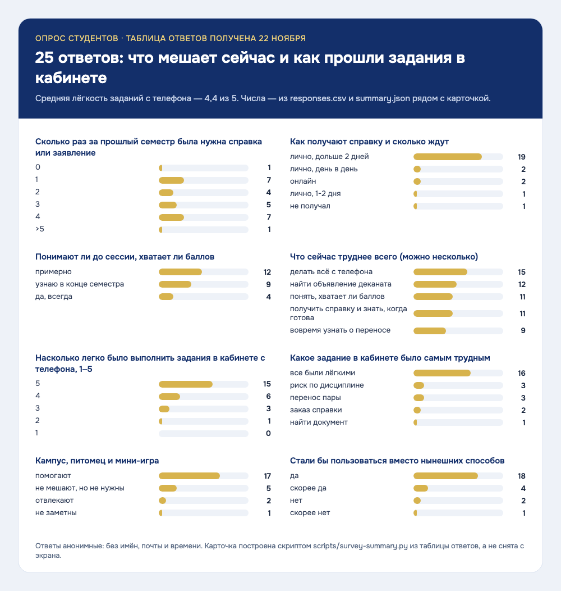

# Опрос студентов: что мешает сейчас и как прошли задания в кабинете

**Откуда данные.** Таблица ответов Google Forms, которую автор передал 22 ноября. В ней 25 ответов, все — выбор
из готовых вариантов. Имён, почты и отметок времени нет, поэтому даты опроса и способ отбора участников здесь
не указаны. [responses.csv](responses.csv) — копия ответов: убран только пустой первый столбец, добавлен номер
строки. Числа — [summary.json](summary.json), карточка — [survey-results.png](survey-results.png); пересчитать:

```
python scripts/survey-summary.py docs/evidence/survey-2026-11-22
```

Кто ответил: 2 курс — 11, 3 курс — 6, 1 курс — 4, 4 курс — 2, магистратура — 2.



## Что мешает сейчас

- Справка или заявление в деканат за прошлый семестр понадобились 24 из 25; трём и более раз — 13.
- 19 из 25 получают справку лично и ждут дольше двух дней; онлайн — двое.
- Хватает ли баллов до зачёта или «автомата», до сессии точно понимают 4 из 25; «примерно» — 12, узнают в конце семестра — 9.
- Труднее всего (можно было выбрать несколько): делать всё с телефона — 15, найти объявление деканата — 12,
  понять, хватает ли баллов — 11, получить справку и знать, когда готова — 11, вовремя узнать о переносе — 9.
- О переносах узнают из приложения вуза — 18, на месте — 14, из почты — 9, из чата группы или от старосты — 5, с сайта — 4.

## Как прошли задания в кабинете

По формулировкам вопросов участники выполняли задания в кабинете с телефона.

- Насколько легко, от 1 до 5: среднее 4,4, медиана 5; пятёрок 15, четвёрок 6, троек 3, одна двойка.
- Самое трудное задание: «все были лёгкими» — 16, риск по дисциплине — 3, перенос пары — 3, заказ справки — 2,
  найти документ — 1.
- Средняя лёгкость у тех, кто назвал задание самым трудным: риск по дисциплине — 3,7, перенос пары — 4,3,
  заказ справки — 3,0 (два ответа), найти документ — 3,0 (один ответ).
- Кампус, питомец и мини-игра: помогают возвращаться — 17, не мешают, но не нужны — 5, отвлекают — 2, не заметны — 1.
- Стали бы пользоваться вместо нынешних способов: да — 18, скорее да — 4, скорее нет — 1, нет — 2.

## Что изменили

Чаще других самыми трудными называли «риск по дисциплине» и «перенос пары», по три ответа, но у риска ниже
средняя лёгкость, поэтому его взяли первым. На главной в ярлыке «Требует внимания» было только название
дисциплины, причину приходилось искать в оценках. Теперь ярлык называет причину теми же числами, что
в успеваемости, — например, у Алины «Риск · нужно ещё 38 из 55 баллов» (`4209326`). Тесты: `grades-forecast.test.js` «главная называет причину
риска…», две проверки в `browser-home-priority.py`.

## Чего опрос не показывает

- Время до первого верного действия и успех по каждому заданию не записывались: есть только самооценка лёгкости
  и одно самое трудное задание.
- Почему задание было трудным, участники не писали: свободных ответов нет. Изменение для «риска» — наша гипотеза
  по устройству экрана.
- Повторного прохождения после изменения ещё не было.
- 25 ответов без описания выборки — не репрезентативная выборка студентов.
