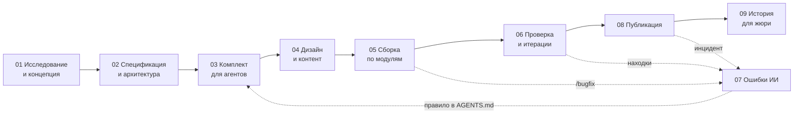

# «МГИМО Мания»: промпты и файлы для ИИ-агентов

> **Происхождение.** Методичка написана после создания прототипа по его коду, журналам и истории Git. Это не журнал промптов. Настоящие диалоги — [`docs/ai/PROMPTS_LOG.md`](../ai/PROMPTS_LOG.md) и [`docs/evidence/subagents-2026-11-19/`](../evidence/subagents-2026-11-19/).

Набор, по которому с нуля собирается прототип из репозитория
[temurysega/vibe_code](https://github.com/temurysega/vibe_code) — концепт личного кабинета студента
для конкурса «Цифровой деканат будущего». Процесс проходит от разговора с однокурсниками до
публикации и PDF для жюри.

**Что внутри:**
- 37 промптов по этапам;
- 3 поручения субагентам;
- 10 промптов-коррекций для ошибок ИИ;
- системный промпт помощника внутри продукта;
- комплект файлов для агентов, который лежит в корне репозитория: [`AGENTS.md`](../../AGENTS.md),
  [`CLAUDE.md`](../../CLAUDE.md), [`QWEN.md`](../../QWEN.md), шесть субагентов и три команды в
  [`.claude/`](../../.claude/), документы [`docs/ai/`](../ai/).

> **Происхождение (подробнее).** Набор написан после создания проекта на основе его кода,
> `docs/PROCESS.md`, `AGENTS.md`, записей поручений (`docs/evidence/*-session.json`) и истории Git.
> Настоящие просьбы автора были короче — три из них разобраны в [00-principles.md](00-principles.md).
> Для жюри использованы оба честных пути: набор приложен как методичка с пометкой «реконструкция»,
> а часть промптов прогнана заново —
> субагентами Claude Sonnet 5.5 19 ноября 2026; их поручения и ответы лежат в
> [`docs/evidence/subagents-2026-11-19/`](../evidence/subagents-2026-11-19/). Этого же требует
> `AGENTS.md` проекта: не объявлять исторические промпты без источника.
>
> Файлы `docs/ai/REQUIREMENTS.md`, `RESEARCH.md`, `SPEC.md` и `COPY.md`, на которые ссылаются промпты,
> — результаты самих промптов (П-01, П-03, П-05, П-15). В готовом комплекте `docs/ai/` их нет.

## Как пользоваться

1. Прочитайте [00-principles.md](00-principles.md): формула промпта, десять правил, шаблоны.
2. Комплект для агентов уже лежит в корне этого репозитория (см. список выше). Если переносите его в
   другой проект, скопируйте оттуда `AGENTS.md`, `CLAUDE.md`, `QWEN.md`, `.claude/` и `docs/ai/`.
   Папка `.claude/` скрытая — в Finder её показывает `Cmd + Shift + .`.
3. Идите по этапам 01 → 09. Каждый файл начинается с цели этапа и шлюза — условия, без которого
   дальше не идём.
4. В промптах замените `<…>` своими данными. Ссылки «В репозитории» показывают, какие файлы
   и коммиты получились из промпта в прошлый раз.
5. После каждого шлюза — коммит и запись в журналы (П-32). Ошибки ИИ — по протоколу из
   [07-ai-errors.md](07-ai-errors.md).

## Процесс целиком

| Этап | Шлюз: что должно быть правдой, чтобы идти дальше | Промпты |
|---|---|---|
| [01 Исследование и концепция](01-research-and-concept.md) | Пересказ задания сверен; `PRODUCT.md` с границами утверждён человеком | П-01…П-04 |
| [02 Спецификация и архитектура](02-spec-and-architecture.md) | У каждого требования есть номер и способ проверки; ADR записаны; инварианты безопасности сформулированы до кода | П-05…П-08 |
| [03 Комплект для агентов](03-agent-kit.md) | Комплект лежит в репозитории; пробный прогон агента на маленькой задаче прошёл | П-09 |
| [04 Дизайн и контент](04-design-and-content.md) | Направление выбрано; контраст проверен скриптом; знак утверждён; данные и тексты готовы | П-10…П-15 |
| [05 Сборка по модулям](05-build.md) | После каждого модуля: тесты зелёные, 360 и 1366 px проверены, аудит сервера, коммит | П-16…П-24 |
| [06 Проверка и итерации](06-review-and-subagents.md) | Матрица требований подтверждена; ошибки закреплены регрессиями | П-25…П-29, Б-1…Б-3 |
| [07 Работа с ошибками ИИ](07-ai-errors.md) | Идёт через все этапы: каждая ошибка → тест → журнал → правило | О-1…О-10 |
| [08 Публикация](08-release.md) | Приёмка HTTPS-стенда; данные пережили перезапуск; люди проверили доступ из России и оплату | П-30, П-31 |
| [09 История для жюри](09-process-story.md) | PDF собран скриптом; маршрут жюри пройден; финальный чек-лист закрыт | П-32…П-37 |

## Кто что делает

Это распределение ролей, которое предлагает методичка. Оно не хронология. По истории Git и записям
сессий первую версию сделал Claude Code (Claude Opus 5.5) 4 ноября, дорабатывали в Codex 8 ноября,
аудиты 9 и 19 ноября вёл Claude Code. Qwen Code в истории проекта не подтверждён: `QWEN.md` —
точка входа на случай, если команда подключит третий инструмент.

| Инструмент | Роль в методичке | Промпты |
|---|---|---|
| Claude Code (Claude Opus 5.5) | Основной разработчик: план-режим, код, встроенный браузер, субагенты из `.claude/agents/` | П-01, П-04…П-10, П-12, П-13, П-16…П-24, П-26, П-28, П-31…П-35, П-37 |
| Codex | Оркестратор аудита: субагенты по направлениям, владение файлами, итерации | П-25, Б-1…Б-3, П-29, П-30 |
| Qwen Code (по желанию) | Третий агент через `QWEN.md`; в этом проекте не использовался | — |
| Claude, GigaChat, YandexGPT в чате | Интервью, синтез, тест со студентами, вымышленные данные, тексты, сценарий видео | П-02, П-03, П-14, П-15, П-27, П-36 |
| Kandinsky, Шедеврум или другой генератор | Референсы стиля; в продукт картинки не попадают | П-11 |
| OpenRouter или Anthropic API | ИИ внутри продукта — помощник «Спросить деканат» | П-23 |
| Playwright и Python | Проверка результата ИИ в браузере, снимки, PDF | П-26, П-29, П-34 |
| Люди | Решения о продукте, интервью и тест со студентами, выбор направлений, «да» на необратимые шаги, проверка доступа из России | все шлюзы |

## Все промпты

**[00 · Принципы](00-principles.md)** — формула промпта, десять правил, «было → стало» для трёх
настоящих просьб, шаблоны задачи, поручения, баг-репорта и отчёта.

**[01 · Исследование и концепция](01-research-and-concept.md)**
П-01 Старт: понять задание, прежде чем строить · П-02 Гайд интервью и мини-опрос ·
П-03 Синтез: от ответов к болям и гипотезам · П-04 Концепция: главный вопрос, роли, границы

**[02 · Спецификация и архитектура](02-spec-and-architecture.md)**
П-05 Спецификация с критериями приёмки · П-06 Выбор стека (ADR) ·
П-07 Модель данных и демо-данные от текущей даты · П-08 Модель угроз → инварианты и тест-план

**[03 · Комплект для агентов](03-agent-kit.md)**
П-09 Собери комплект для агентов · таблица файлов комплекта и правила их обновления

**[04 · Дизайн и контент](04-design-and-content.md)**
П-10 Визуальное направление и токены · П-11 Референсы в генераторе изображений ·
П-12 Собственный знак · П-13 Аватар, питомцы, кампус и забег кодом · П-14 Вымышленные данные ·
П-15 Тексты интерфейса и тон

**[05 · Сборка по модулям](05-build.md)**
П-16 Каркас · П-17 Вход, сессии и профиль · П-18 Время вуза и расписание ·
П-19 Успеваемость, сессия и зачётка · П-20 Заявки и справки · П-21 Кабинет деканата ·
П-22 Уведомления · П-23 Помощник «Спросить деканат» + системный промпт · П-24 Игровой слой

**[06 · Проверка и субагенты](06-review-and-subagents.md)**
П-25 Аудит силами субагентов + поручения Б-1 (сервер), Б-2 (интерфейс), Б-3 (документы) ·
П-26 Сборщик доказательств и браузерные сценарии · П-27 Проверка со студентами → «С чего начать» ·
П-28 Независимый аудит «свежим» агентом · П-29 Итерация с измерениями

**[07 · Работа с ошибками ИИ](07-ai-errors.md)**
Протокол из семи шагов · классы ошибок с реальными случаями · О-1 Баг-репорт · О-2 «Стоп, по кругу» ·
О-3 «Покажи доказательство» · О-4 «Это неправда» (4 варианта) · О-5 «Не тот слой» · О-6 «Тест врёт» ·
О-7 «Вышел за границы» · О-8 «Новая сессия» · О-9 «Найди все следы» · О-10 «Инцидент после публикации» ·
как ошибки стали правилами

**[08 · Публикация](08-release.md)**
П-30 Первая публикация на VPS · П-31 Повторная выкладка проверенного кода

**[09 · История для жюри](09-process-story.md)**
П-32 Журналы в конце сессии · П-33 PROCESS.md · П-34 Карточки, PDF и архив ·
П-35 Маршрут жюри и матрица соответствия · П-36 Сценарий видео · П-37 Финальная проверка

**Комплект для агентов в корне репозитория** — [`AGENTS.md`](../../AGENTS.md), [`CLAUDE.md`](../../CLAUDE.md),
[`QWEN.md`](../../QWEN.md), `.claude/settings.json`, `.claude/agents/` (security-auditor,
ui-mobile-reviewer, test-engineer, content-writer, docs-chronicler, release-engineer),
`.claude/commands/` (feature, bugfix, verify), `docs/ai/` (PRODUCT, DESIGN, DECISIONS, PROGRESS,
ERRORS — 37 записей, PROMPTS_LOG). Описание — в [03-agent-kit.md](03-agent-kit.md).

## Как набор закрывает критерии

| Что оценивают | Где смотреть |
|---|---|
| Продуманность процесса | Этапы и шлюзы выше; правила в [00](00-principles.md); жизненный цикл комплекта в [03](03-agent-kit.md); `PROGRESS.md` |
| Качество промптов и постановки задач ассистентам и субагентам | Формула и «было → стало» в [00](00-principles.md); у каждого промпта — кому, на что опирается, приёмы, «если ИИ ошибся»; поручения Б-1…Б-3; `.claude/agents/*` |
| Документы и файлы для ИИ-агентов | [03](03-agent-kit.md) и файлы в корне репозитория (`AGENTS.md`, `.claude/`, `docs/ai/`): один источник правды для трёх инструментов, узкие субагенты, команды, `docs/ai/` |
| Работа с ошибками ИИ | [07](07-ai-errors.md): протокол, классы, 10 промптов-коррекций, «ошибка → правило»; `ERRORS.md` с 37 записями |
| ИИ-инструменты для дизайна и контента | [04](04-design-and-content.md): генератор для референсов, графика кодом, данные и тексты через языковые модели и `content-writer` |
| Полнота и наглядность описания процесса | [09](09-process-story.md): журналы с первого дня, PROCESS.md с источниками, PDF скриптом, маршрут жюри, видео |
| Проработанность идеи | [01](01-research-and-concept.md), П-05, `PRODUCT.md` |
| Имплементация | [05](05-build.md), [06](06-review-and-subagents.md), [08](08-release.md) |
| Качество: дизайн и удобство | [04](04-design-and-content.md), П-27…П-29, `DESIGN.md` |

## Что в наборе устроено иначе, чем было на самом деле

| Было в проекте | В наборе | Зачем |
|---|---|---|
| Стартовый промпт — полный текст задания, дальше агент работал сам | П-01: разбор задания и вопросы до кода | Ошибку понимания дешевле поймать до 89 файлов |
| Отзыв двух студентов после первой версии | П-02, П-03 до проектирования; П-27 после | Раздел «какую проблему решаем» опирается на свои данные |
| `AGENTS.md` появился 8 ноября, на этапе аудита | П-09 до первой строки кода | Первая версия сразу соблюдает инварианты |
| Шесть карточек заданий реконструированы по коду | П-32: журнал промптов с первого дня | Не нужно восстанавливать и оговаривать происхождение |
| Четыре изображения «диалогов» подписали как скриншоты, а они оказались созданы ChatGPT (метаданные C2PA) | П-32 и [00](00-principles.md), пункт 2: проверка происхождения файла до вставки | Подпись «скриншот» не должна опираться на слова, если файл можно проверить |
| 629 коммитов 4 ноября разложены скриптом за 2 минуты 21 секунду (22:09:47–22:12:08) | Коммит после каждого шлюза | История Git — честная хронология работы |
| Растровая графика не генерировалась, словаря текстов не было | П-11 и П-15 | Явный и проверяемый шаг работы с ИИ для дизайна и контента |
| «подними все до 10 и запуш все» | Задачи с критериями, владением файлами и остановками ([00](00-principles.md)) | Человек решает, что исправлять и когда публиковать |

## Замечено при подготовке набора

Квиз «Первые шаги» обещал, что электронная справка приходит «с QR-кодом для проверки»
(`public/js/shared/catalog.js`, вопрос о справке), хотя QR-кода в продукте нет: его заменили кодом и
ссылкой проверки (E-07). Это было недоделанное исправление — промпт О-9 в
[07-ai-errors.md](07-ai-errors.md) закрывает его вместе с правилом «найди все упоминания».

**Исправлено 19 ноября 2026 (поручение A):** коммит `fe1191c` убрал обещание из квиза и добавил
регрессию [`test/qr-mentions.test.js`](../../test/qr-mentions.test.js) (до исправления падали 2 теста из 5).
Поручение, ответ субагента и снимки «до/после» — в
[`docs/evidence/subagents-2026-11-19/`](../evidence/subagents-2026-11-19/).
